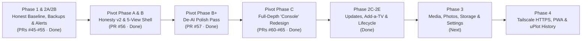

# Control Hub Improvement Plan

Nov 25, 2026 · *(Phase 2C `#27`–`#29`, Phase 2D `#30`–`#31b`, and Phase 2E `#32`–`#33` complete; ready for Phase 3)*

## Summary

The Control Hub works, and PRs `#45`–`#65` have now shipped Phase 1 (honest baseline, 3-breakpoint responsive CSS, WCAG 2.2 AA dialogs/tests), Phase 2A (photo backup pre-flight, history, retention, monthly restore test, media settings backup, remote switcher), Phase 2B (multi-channel alerts), TV nicknames, **Pivot Phase A** (Honesty v2, broken controls, universality, root hourly `homelab-storage-sizes.timer`), **Pivot Phase B** (5-view hash-routed Operations Console, Dark/Light/Auto theme engine, inline SVG sprite, HiDPI sparklines, keyed DOM patching), the **De-AI Polish Pass (`PR #57`)**, and **Pivot Phase C — Complete Full-Depth `Console` Redesign (`PR #60`–`#65`)**, including the collapsible icon-rail sidebar (`PR #63`) and automated visual regression history (`PR #62`).

**Why we pivoted and what comes next:**
1. **Solved in Pivot Phases A & B (`PR #56`, `2ff463b`):** Fixed every remaining fake/wrong readout (WAN speedtest substitution, partial-permission photo size under-reporting via `homelab-storage-sizes.timer`, SSD appdata inside HDD bar, Sleep Guard disabled/uninstalled states, phantom Recyclarr cron, qBittorrent 5.x `stop`/`start`, Netplan 120 s confirm flow, Config Center read-only banner, and N100/AMD/Haswell hardware probing) and restructured the dashboard from a 9,000 px single scroll wall into a 5-view hash-routed Operations Console (`Overview`, `Apps`, `Backups`, `TVs`, `System`).
2. **Solved in De-AI Polish Pass (`PR #57`, `032e103`):** Audited `apps/control-hub/static/` with **[`pbakaus/impeccable`](https://github.com/pbakaus/impeccable)** (`114.4k ⭐`) and **[`Nutlope/hallmark`](https://github.com/Nutlope/hallmark)** (`58.9k ⭐`), clearing all 10 static anti-patterns (`border-left: 4px` side-tabs, tracked uppercase labels, glass blur, nested service cards).
3. **Next Step — Pivot Phase C (Complete Full-Depth De-AI Redesign with Hallmark `Console` + Impeccable):** Elevate Control Hub from a `polish`-depth card layout to a **`redesign: full` (`--scope app`) single-surface instrument console** using Hallmark's **`Console`** theme (`console: graphite` dark default + `console: paper` light mode), eliminating the remaining 162 off-4px spacing rules (`REFLEX 24b`) and 5 repeated box-recipe warnings (`WARN F7`) before landing Phase 2C–2E (`core/updates.py`, Guided Add-a-TV, Container Lifecycle) and Phases 3–4.

Evidence comes from the live dashboard at `http://<server-lan-ip>:7575` on 2026-11-21 (original baseline `c0cf3ec`, updated and verified live at `032e103`), full source review of `apps/control-hub`, `apps/tv-autoupdater`, `apps/mediaserver`, `apps/immich-face-xmp-exporter`, `apps/noodle-gallery`, and `system/`, and read-only inspection of the live host state.

## Roadmap



Each phase starts only after the gate before it passes. Phase 4 items ship one by one when ready.

## Architectural constraints (from `AGENTS.md`)

Four monorepo rules shape how Phases 1–4 must be implemented:

- **Module isolation (`AGENTS.md` §1.6, `testing/test_module_contract.py`):** `apps/control-hub`, `apps/mediaserver`, `apps/immich-face-xmp-exporter`, and `apps/tv-autoupdater` publish as independent repositories (`split-simulation` CI tests each in isolation). No file in `apps/control-hub` may reference another module folder or `../` outside itself (only `core/config_core/env_manager.py` is exempt). Cross-module integrations must communicate through env config, state files (such as `status.json`), or blueprint-only host helpers.
- **Unprivileged daemon & root-owned config (`control-hub.service`, `homelab-sudoers.example`):** Control Hub runs as `homelab` (in the `docker` group) while `/opt/homelab-blueprint` and `/etc/homelab/*` are `root`-owned (`/api/config/update` intentionally returns `403` on blueprint installs). Writing `/etc/homelab/*`, changing `rclone` remotes, updating the blueprint checkout, or running `setup.sh` from the UI must use audited `sudo` helpers (and be hidden/gated in standalone mode).
- **Resource ceiling (`AGENTS.md` §2.2):** Control Hub targets `< 25 MB` RAM and `< 0.2%` CPU idle, capped at `MemoryMax=100M` and `CPUQuota=20%`. Expensive jobs (folder `du` scans, monthly Postgres restore tests) must run asynchronously or in root cron/systemd timers outside Control Hub's cgroup.
- **Sleep Guard & verification gates (`AGENTS.md` §1.5, §3–4):** Any new endpoints or auth modes must update `apps/control-hub/docs/openapi.yaml` and `apps/control-hub/README.md` and pass `test_module_contract.py`, `test_docs_integrity.py`, `test_version_consistency.py`, `test_standalone.py`, `test_lifecycle_handoff.py`, `test_e2e_regression.py`, `test_setup.py`, `ruff`, and `shellcheck`.

## What the audit found

The page never scrolls sideways on a phone, but almost everything else about small screens and assistive technology needs work. The worst problems are false data and a refresh mode that does nothing on touch screens.

**Layout and mobile** (measured in the live dashboard and verified in `apps/control-hub/static/css/style.css`)

| Problem | Where | Effect |
| --- | --- | --- |
| Header stacks 5 full-width buttons, 4 status tags, the clock and the mode switch | 390 px phone | The whole first screen is header; no content is visible without scrolling |
| Header buttons run past the right edge; Account and Kiosk are cut off | 820 px tablet | Two actions cannot be reached; the page is 997 px wide |
| Internet and LAN speed panels stretch to about 500 px tall with empty space | 820 px tablet | Long blank gaps between numbers |
| "Service Matrix" title overlaps its Ingest/System tabs and the Dozzle button | 390 px phone | Text collides; tabs are hard to hit |
| Every app gets a 160 px tall card | 390 px phone | 11 apps take about 1,800 px; the page is 9,121 px tall |
| TV card shows "0/3 online" next to a live list of 3 TVs | All widths | `static/index.html` ships 3 dummy TV rows and `tvUpdater.js` returns early when `devices` is empty instead of clearing them |
| 44 to 47 buttons are under 32 px tall (for example the MB/s toggle at 48 x 21 px) | All widths | Hard to tap; 44 px is the usual minimum |
| 129 of 228 CSS `font-size` rules are under `0.8rem` or `12 px` (133 to 155 elements render at 10–11 px) | All widths | Hard to read, worst in monospace labels |
| Only 10 media queries, at 7 different breakpoints (`440px`–`1024px`), with 233 `!important` rules | `static/css/style.css` (124.7 KB, 6,128 lines) | Layout fixes fight each other |

**Behaviour on touch screens**

- The default "Hover Only" mode refreshes a card only while a mouse is over it (`static/js/app.js`). Phones have no hover, so live numbers never update unless the user finds the "Real-Time All" switch.
- 80 CSS rules depend on `:hover` for showing controls or details.

**Accessibility** (verified in `static/index.html`, `static/js/auth.js`, and `static/css/style.css`)

| Gap | Count | Fix |
| --- | --- | --- |
| Buttons named only by `title` (plus `.modal-close` / icon controls with no descriptive `aria-label`) | 29 `title`-only buttons | Visible text or `aria-label` on icon/close/title-only buttons |
| Form fields without a `<label for>` or `aria-label` | 6 of 23 (`chk-force-update`, `indexer-search`, `indexer-filter-protocol`, `indexer-filter-privacy`, `indexer-force-save`, `perm-enabled-checkbox`) | Add labels |
| Modal dialogs without `role="dialog"`, `aria-modal`, focus trap or Esc to close | 10 of 10 in `static/index.html` (`static/js/auth.js` overlays already set `role="dialog"` and `aria-modal="true"`) | One shared dialog component |
| Focus outlines removed, no `:focus-visible` style | 2 `outline: none`/`0` rules, 0 `:focus-visible` styles | Visible focus ring |
| Status changes and toasts not announced (`aria-live`) | 0 regions | Polite live region |
| No `<main>` or `<nav>` landmarks | 0 | Add landmarks and a skip link |
| Animations with no `prefers-reduced-motion` | 11 `@keyframes`, 0 queries | Respect the setting |
| Emoji used as icons, read aloud by screen readers | 34 | `aria-hidden` or SVG icons |

**Data that is not real**

- **Backup card:** Google Drive total, used and free (5,120 / 272.4 / 4,847.6 GB), dump size (341.4 MB), library size (265 GB), and Immich asset/face counts (`35,762` assets, `120` people, etc.) are hard-coded fallbacks in **both** `widgets/backup_sync.py` and `static/js/widgets/backupSync.js` (plus static HTML placeholders in `static/index.html`, including `gdrive:Memories` and `/opt/immich/backups/backup.log`). `backup_sync.py` also initializes `backup_status = "synced"` and falls back to `"synced"` when no log matches, and runs `du -sh /mnt/hdd/Memories` directly instead of reading `HDD_MEMORIES`.
- **Backup log marker mismatch:** Both `widgets/backup_sync.py` and `widgets/cron_tasks.py` look for `"Starting Immich / Noodle Backup:"`, while `apps/immich-face-xmp-exporter/scripts/immich_backup_gdrive.sh.example` prints `"Starting Immich Backup:"`, so v2 backup start times never match.
- **Storage bar:** The Movies/Photos/DB split is a fixed 75% / 20% / 5% of used space (`static/js/widgets/systemVitals.js`), and the legend text `~620 GB` / `~140 GB` / `~3.5 GB` is typed into `static/index.html`.
- **Internet speed card:** `widgets/network_speed.py`, `static/js/widgets/networkSpeed.js`, and `static/index.html` fall back to hard-coded `"Excitel"`, `"ADN Broadband (Delhi)"`, `94.1 Mbps`, `11.2 MB/s`, and `2.7 ms` / `3.1 ms` when `speedtest_cache.json` does not exist.
- **Service Matrix & footer:** `static/js/widgets/serviceMatrix.js` hard-codes `'● 4ms'` ping latency on every running container, `static/index.html` hard-codes filter counts `All (11)` / `Media (3)` / `Ingest (4)` / `System (4)`, and `SERVICES_CATALOG` in `config.py` includes `dozzle` (`:8888`) even though `apps/mediaserver/docker-compose.yml` has no Dozzle service. The footer still reads `"ServerFF Control Hub • Replaces archived Homarr v0.16.1"` with fixed links to Dozzle, Byparr, and Cockpit.
- **Hard-coded `IST` / `Asia/Kolkata` and `ServerFF` leftovers:** `header.js`, `index.html`, and 6 backend widgets (`sleep_guard.py`, `backup_sync.py`, `cron_tasks.py`, `system_vitals.py`, `tv_updater.py`, `network_speed.py`) hard-code `IST` / `Asia/Kolkata` instead of the host's configured timezone; `"ServerFF"` remnants also remain in comments, `sleep_guard.py`, `telemetry_sampler.py`, and `localStorage` (`serverff_stream_mode`).

**Broken integrations found in codebase validation**

- **Docker restart fails under `homelab`:** `widgets/service_matrix.py` runs `sudo docker restart <id>`, which is not in `homelab-sudoers.example` (and unnecessary because `homelab` is already in the `docker` group).
- **Stale qBittorrent / Samba checks in `core/telemetry_sampler.py`:** `qb_login()` checks for HTTP `200` with `"Ok."` (qBittorrent 5.3 returns HTTP `204`), and `get_smb_sessions()` filters `smbstatus` for `"RootFS"` or `"MediaDrive"` instead of v2's `[Media]` and `[Photos]` shares (`system/networking/homelab-shares.conf.example`).
- **Stale Netplan UI timeout:** `static/index.html` and `static/js/widgets/configCenter.js` still advertise `"45s rollback"` and pass `timeout: 45` instead of the v2 `120s` flow.

## Photo backup check

The Google Drive path is valid today, but nothing verifies it: not the installer, not the nightly script, not the dashboard. If the Drive login expired or the folder moved, the backup would fail at 22:00 and the dashboard would still say "verified".

**What a read-only check on the server found**

| Check | Result |
| --- | --- |
| Configured remote `<configured-rclone-remote>:` answers `rclone about` | Yes: 5 TiB total, 284.7 GiB used, 4.71 TiB free |
| Folders the script writes to | `Memories`, `Immich_Backup/database` and `Immich_Trash` all exist |
| Latest database dump on Drive | `immich_db_20261120_220001.sql.gz`, 356 MB, uploaded 2026-11-20 22:00 |
| Last run of the old script | "Completed Successfully", Fri 2026-11-20 22:01 local time |
| Drive login | OAuth token for full Drive access; the access token refreshes itself from the stored refresh token |
| First run of the v2 script | Not yet: due 2026-11-21 22:00, logging to `/var/lib/homelab/photo-backups/cron.log` (and `backup.log` via `tee`) |

**Gaps**

- The installer only checks that `rclone` is installed. It never runs `rclone lsd <remote>`, so a typo in `gdrive_remote` installs cleanly and fails at night.
- The backup script (`immich_backup_gdrive.sh`) starts the dump and upload with no pre-flight check of the remote, and records no machine-readable result.
- On blueprint installs, `env_manager.py` already points `control-hub.env` at `/var/lib/homelab/photo-backups`, **but** `apps/control-hub/config.py` and `.env.example` still default to `/var/backups/immich`, `static/index.html` displays `/opt/immich/backups/backup.log`, and `backup_sync.py` / `cron_tasks.py` look for `"Starting Immich / Noodle Backup:"` instead of `"Starting Immich Backup:"`.
- `env_manager.py` passes `GDRIVE_REMOTE` into `homelab.env` but not into `control-hub.env` (and omits `HDD_MEMORIES` from `control-hub.env`), so Control Hub falls back to `gdrive:` and `/mnt/hdd/Memories` and calls `sudo rclone`, which sudoers does not allow. Both fail silently and the hard-coded numbers show instead.
- Nobody is told when a backup fails; there is no alert of any kind.
- No restore has ever been tested from a Drive dump.

The fix is in phase 2 (backup health), with the false numbers removed in phase 1.

## TV updater onboarding

A USB-debugging guide exists, but only in the module's developer README (`apps/tv-autoupdater/README.md`, "Prepare Android TV"). A normal user never sees it: the setup wizard and the dashboard say nothing about Developer Options, and adding a TV means editing JSON on the server.

**What exists today**

- The README's five steps: open About, tap Build 7 times, turn on USB debugging and network debugging, run `adb connect <ip>:5555` from the server, accept "Always allow" on the TV.
- The updater finds a TV by model name (`match_models`) and scans `<subnet>.30` to `.120` when the saved IP is stale. Today it found the Android TV box at `<tv-lan-ip>`.
- Profiles live in `/etc/homelab/tv-autoupdater.json` (`0640 root:homelab`, read-only to `homelab`). The setup wizard only accepts a list of IPs (`tv_ips` in a profile), with no names, models or a connection test.
- The dashboard can deploy now, show the log and toggle force-install. It cannot add, rename, test or remove a TV.

**Problems found on the live server and in code**

- The three saved profiles are still the example ones ("Living Room TV (Nvidia Shield / Mi Box)" at `.150`, "Bedroom Smart TV" at `.151`, "Guest Room TV" at `.152`), not the actual household TVs.
- `setup/installer/host.py` creates `homelab` with `--no-create-home`, and `system/systemd/control-hub.service` sets no `HOME`/`ANDROID_SDK_HOME` and enables `PrivateTmp=true`. It worked initially only because an ADB server started earlier by the host admin account was still running with that user's approved key. After a reboot, `homelab` would start its own ADB server, and every TV would show an "Allow USB debugging?" prompt or refuse to connect.
- Every log line is written twice (`tv_updater.py` uses both `FileHandler` and `StreamHandler(sys.stdout)`, while `host/cron/tv-autoupdater` and `setup_cron.sh` redirect `stdout` into the same log file); `tv_updater.py` also still logs hard-coded `"Mi Box 4, Mi TV 4A, Acer TV"` in its quiescent message.
- The card's "0/3 Online" and its live list of 3 TVs disagree because `index.html` ships 3 static dummy rows and `tvUpdater.js` returns early without clearing `#tv-fleet-preview` when `devices` is empty (and uses `data.total_devices || 3`).

**What is needed:** an "Add a TV" guide inside the dashboard (phase 2D), a stable ADB key owned by the service user (done in PR `#45`), and a TV list people can edit.

---

## Progress since the original plan (`c0cf3ec` -> `032e103`)

Thirteen PRs have merged to `develop` (and are deployed on the live server at `/opt/homelab-blueprint` @ `032e103`), plus one untracked WIP file locally:

| PR / Commit | Plan Area | What shipped | Remaining gaps (see Audit v2 & Pivot Phase C) |
| --- | --- | --- | --- |
| `#45` (`fdba80a`) | Phase 1A–1E | Removed hardcoded fallback literals (`35762`, `Excitel`, `Mi Box 4`, `4ms`, `IST`, `ServerFF`); 3-breakpoint CSS with zero `!important`; WCAG 2.2 AA shared `modal.js`, landmarks, `:focus-visible`, `prefers-reduced-motion`; `HOME`/`ANDROID_SDK_HOME` in `control-hub.service`; direct `docker restart`; visibility polling + pull-to-refresh; Playwright + `axe-core` + `test_honest_data.py` | Residual telemetry & UI issues resolved in PR `#56` |
| `#46` (`08458de`) | Phase 1A / 3E | Frontend stops labeling unknown duplex as "Half Duplex" | Backend `get_nic_link_info()` fixed in PR `#56` |
| `#47` (`32001a4`) | Phase 2A | Photo backup pre-flight checks, atomic `status.json`, 7-run history, retention summary, stale (`>26h`) red state | Provider-neutral wording & module hiding fixed in PR `#56` |
| `#48` (`194cf30`) | Phase 2B | Alerts engine (`core/alerts.py`, `widgets/alerts.py`) for ntfy, Telegram, Discord, SMTP; 10 rules, quiet hours, daily summary, test button | Firing badge priority, mobile header bell, DB containers & thermal sensors fixed in PR `#56` |
| `#49` (`bdf4945`) | Phase 2A / 2B | "Run backup now" detaches into its own transient systemd unit (outside Hub's 100M cgroup); alerts queued before a channel is enabled now deliver once enabled | Script presence check added in PR `#56` |
| `#50` (`bea61ec`) | Docs | `docs/CONTROL_HUB_ALERTS.md` setup guide for every channel | — |
| `#51` (`1939695`) & `#52` (`5d92bb3`) | Phase 2D (partial) | TV nicknames (`nicknames.json`), ADB model/Android probing (`device_info.json`), inline details drawer + rename form | Async ADB cache & dynamic app names added in PR `#56`; Add/Edit/Remove TV wizard in Phase 2D |
| `#53` (`5cee039`) | Phase 2A (#24) | Nightly off-site backup of media app settings (`media_config_backup.py`, `media-backups/status.json`, card section + alerts) | Wired into Scheduled Tasks in PR `#56` |
| `#54` (`08527f1`) | Phase 2A (#23) | Monthly photo restore test (`photo-restore-test.service`/`.timer`, `photo_restore_test.sh`, card row + alert rule) | Wired into Scheduled Tasks in PR `#56` |
| `#55` (`5377122`) | Phase 2A (#21) | Change backup remote dialog (`homelab-backup-remote` sudo helper, test-before-save, switches photo + media backups) | Provider-agnostic copy completed in PR `#56` |
| `#56` (`2ff463b`) | **Pivot Phase A & B** | **Honesty v2, Broken Controls, Universality & 5-View Operations Console:** Separated live NIC traffic from Speedtest benchmark; fixed qBittorrent 5.x `stop`/`start` & auth check; added root hourly `homelab-storage-sizes.timer` + `st_dev` SSD/HDD split; honest Sleep Guard states + `server-suspend.sh` deferrals; real `cron.d`/systemd reader; Docker healthchecks + dynamic ports; Netplan 120 s confirm banner; 5 hash-routed views (`Overview`, `Apps`, `Backups`, `TVs`, `System`); Dark/Light/Auto theme switcher; inline SVG icon sprite; HiDPI sparklines; keyed DOM patching; sanitized Live Server Testing Protocol in `AGENTS.md` §4.1 | Ready for De-AI visual craft audit (`PR #57`) and full-depth `Console` structural redesign (`Pivot Phase C`) |
| `#57` (`032e103`) | **Pivot Phase B+ (De-AI Polish Pass)** | **Impeccable & Hallmark Polish Pass (`redesign: polish`):** Audited `apps/control-hub/static/` with `pbakaus/impeccable` (`0 anti-patterns found`) and `Nutlope/hallmark` (`sloplint.mjs`); removed all `border-left: 4px` side-tab callouts, glassmorphism, neon shadows, and uppercase tracked labels; converted Service Matrix cards into a hairline-divided ledger; tightened Backup & Cron rows; refreshed sanitized documentation screenshots | Still on legacy card-stack layout (`162 REFLEX 24b` off-4px spacing rules, `5 WARN F7` repeated container recipes) — addressed in **Pivot Phase C (`redesign: full`)** below |
| *(untracked WIP)* | Phase 2C | `apps/control-hub/core/updates.py` — compares running Compose image tags against GitHub releases (not yet wired to `server.py`, UI, or alerts) | Needs widget blueprint, UI integration in `Apps` view, alert rule, and tests |

---

## Audit v2 (post-PR `#55`, resolved in PR `#56`): what was still fake, wrong, misleading, broken, or non-universal

This audit covered every backend file (`apps/control-hub/server.py`, `config.py`, `core/**`, `widgets/**`, `host/**`), every frontend file (`static/index.html`, `static/js/**`, `static/css/**`), adjacent module hooks (`apps/tv-autoupdater/tv_updater.py`, `apps/immich-face-xmp-exporter/host/cron/immich-ml`, `system/systemd/homelab-sudoers.example`), and read-only live server state. *(All items A1–A13, B1–B9, C1–C5, and D1–D6 below were resolved and verified in PR `#56` / `2ff463b`.)*

### A. Still fake, wrong, or actively misleading data

| # | Area | Where (file -> symbol) | What is wrong / misleading | Live server evidence & universal impact |
| --- | --- | --- | --- | --- |
| A1 | **WAN "Internet Speed" card fakes live throughput & flatlines sparkline** | `static/js/widgets/networkSpeed.js` -> `fetchSpeedometers()`, `renderSpeedReadouts()`, `setUnit()`; `core/telemetry_sampler.py` -> `telemetry_worker()` | When qBittorrent is idle (`dl_mbs === 0`), the frontend replaces live WAN speed with the cached Ookla speedtest (`sp.download_mbs`), pushes that constant number into `wanHistory` every 2.5 s, sets `Peak` to it, and draws a flat line. Starting a real `1.0 MB/s` download makes the giant WAN speed *drop* from `9.8 MB/s` to `1.0 MB/s`. Backend also labels qBittorrent-only transfer as `"Internet Speed"` (ignoring rclone, Immich, Jellyfin, Docker pulls) and divides by a hardcoded `100.0` Mbps cap. Sparkline axis ticks (`0 / 3M / 6M / 9M / 12.5M` and `0 / 25M / 50M / 75M / 100M`) are hardcoded for 100 Mbps and contradict the auto-scaled canvas ceiling. `setUnit()` multiplies MiB/s by `8.0` (~4.86% off from backend `*_mbps`) and does not convert Current Downloads or Disk I/O units. | Live `/var/lib/homelab/control-hub/speedtest_cache.json` (`9.8 MB/s`) causes the idle dashboard to show a fake continuous `9.8 MB/s` stream. On 300 Mbps / 1 Gbps / 2.5 Gbps connections, axis ticks are flat-out wrong. |
| A2 | **Photo storage under-reported by ~83% silently + SSD appdata plotted inside HDD bar** | `core/storage_sizes.py` -> `_dir_size_bytes()`, `_measure_all()`; `widgets/system_vitals.py` -> `get_system_vitals()`; `static/js/widgets/systemVitals.js` -> `fetchVitals()` | `du -sb` runs as unprivileged `homelab`; when subdirectories are unreadable (`Permission denied`, exit code 1), `storage_sizes.py` keeps the partial byte total, `systemVitals.js` hides `bd.reason` whenever `bd.measured === true`, and `backupSync.js` puts it only in a hover `title`. Also: `du -sb` measures apparent size (inflating sparse torrent files), never measures `UPLOAD_LOCATION` when outside `HDD_MEMORIES`, and `system_vitals.py` puts `APPDATA_DIR` + `BACKUP_DIR` (which live on OS root `/` SSD!) into the **Data Pool (HDD)** stacked bar (no `"Other"` slice; can exceed 100% on small disks). | Live `/var/lib/homelab/control-hub/storage_sizes_cache.json` reported `photos_gb: 45.25` (`reason: "photos: some subdirectories unreadable"`) when the photo library was ~265 GB — ~220 GB missing with no visible warning, and `photo_upload_dir` (`/mnt/hdd/immich`) was unmeasured. |
| A3 | **Sleep Guard claims "Sleep Armed" when permanently disabled or not installed** | `widgets/sleep_guard.py` -> `load_permanent_config()`, `get_sleep_status()`; `static/js/widgets/sleepGuard.js` -> `fetchSleepStatus()` | Neither backend nor frontend checks `permanent_config["enabled"] === false`! Disabling automatic nightly sleep still displays **"Sleep Armed"**, `"Automatic suspend armed at 00:00 ... for 6 hours"`, and ticks down a live countdown. On servers without `sleep_guard` installed (24/7 hosts, VMs, Pi, VPS), `load_permanent_config()` invents `enabled: true, 00:00 -> 06:00`. Sleep windows crossing midnight (e.g. `23:00` → `06:00`) calculate `left + width > 100%` and overflow off the 24 h timeline. | Every user who opts out of S3 sleep or disables it in the modal is shown a fake countdown to a suspend that will never occur. |
| A4 | **Scheduled Tasks ("Cron") card fabricates jobs & hardcodes schedules** | `widgets/cron_tasks.py` -> `get_cron_tasks_status()`, `trigger_cron_job()`; `static/js/widgets/cronTasks.js` -> `fetchCronTasks()` | **Midnight Sleep Suspend** hardcodes `00:00`, `06:00`, `6h sleep`, and `Armed (00:00)` — ignores permanent config edits, overrides, `enabled: false`, and whether Sleep Guard is installed. **Recyclarr TRaSH Sync** is always listed (`Daily at 06:30`) even though v2 installs neither a host `recyclarr` binary nor `/etc/cron.d/recyclarr`; clicking `Sync TRaSH` swallows `FileNotFoundError` and toasts `"Task Started"`. **Immich ML** hardcodes `06:00 -> 10:00` instead of reading `/etc/cron.d/immich-ml` and shows even without `photos`. **TV Updater** hardcodes `"Every 15 min (06:00 - 23:59)"` in both `widgets/tv_updater.py` and `apps/tv-autoupdater/tv_updater.py`. Meanwhile **Media Settings Backup** (`/etc/cron.d/media-backup`) and **Monthly Restore Test** (`photo-restore-test.timer`) are missing entirely! `job.summary` is never rendered, and `"Sleep Disabled"` gets the `.running` badge class. | Verified on `/etc/cron.d` and `/var/log/recyclarr.log` (`False`): Recyclarr is completely absent on v2 hosts yet shown as an actionable daily job. |
| A5 | **Current Downloads shows green "qBittorrent Idle" when offline, bad-password, or uninstalled** | `core/telemetry_sampler.py` -> `qb_login()`, `telemetry_worker()`; `static/js/widgets/currentDownloads.js` -> `renderTorrents()` | `qb_login()` accepts HTTP `200` regardless of body, so qBittorrent's `200 "Fails."` (wrong password) is treated as logged in. `telemetry_state["internet"]["connection_status"]` defaults to `"connected"`. When qBittorrent is unreachable, unconfigured, or unauthenticated, `items` is `[]`, which `currentDownloads.js` renders with a checkmark: `"No active torrent downloads in queue • qBittorrent Idle"`. `format_eta()` also checks `"paused"` instead of qBittorrent 5.x's `"stopped"` states (`stoppedDL`/`stoppedUP`). | Standalone or media-free installs, or users with a changed qBittorrent password, get a false green "Idle" state instead of "Disconnected / Auth failed / Not installed". |
| A6 | **"Jellyfin Streaming Active" false positives** | `core/telemetry_sampler.py` -> `get_jellyfin_streams()` | Runs `ss -tn sport = :8096` and labels *every* established TCP socket to port 8096 as `"Direct Stream / Video Playback • Streaming Active"`. Leaving a Jellyfin browser tab open (idle WebSocket/keepalive) falsely reports active video streaming. | Misleads operators (and would falsely block S3 sleep once Jellyfin deferral is wired) unless real playback is queried via Jellyfin `/Sessions` (`NowPlayingItem`) or honestly labeled as open HTTP connections when no API key is configured. |
| A7 | **NIC link speed, duplex, and active NIC fallback lies** | `core/telemetry_sampler.py` -> `detect_active_nic()`, `get_nic_link_info()`, `telemetry_worker()`; `core/config_core/netplan_manager.py` -> `probe_network_interfaces()` | `get_nic_link_info()` defaults to `speed_mbps = 100` and `duplex = "full"` whenever `/sys/class/net/<iface>/speed` or `duplex` is unreadable or `-1` (Wi-Fi, virtual NICs, containers, link down) — silently fabricating `100 Mbps Full-Duplex`. `netplan_manager.py` defaults unreadable speed to `1000`. `detect_active_nic()` never reads `/proc/net/route` (contrary to `.env.example`), picking the first interface alphabetically (often an unplugged NIC), and `telemetry_worker()` uses substring matching (`if active_iface in line:`) rather than exact interface prefix matching. | Breaks LAN telemetry on Wi-Fi mini-PCs, multi-NIC boards, VMs, and containers. |
| A8 | **Disk I/O & partition probing broken on LVM, single-disk, RAID, eMMC, and `/proc/mounts`** | `core/telemetry_sampler.py` -> `detect_storage_devices()`, `telemetry_worker()`; `core/config_core/storage_manager.py` -> `get_disk_partitions()` | `detect_storage_devices()` falls back to hardcoded `"sdb"` / `"sda"`; fails on Ubuntu's default LVM (`/dev/mapper/...` -> `dm-*` skipped in `/proc/diskstats`), causing permanent `0.00 MB/s`; and on single-disk servers hits `if dev == DATA ... elif dev == ROOT`, leaving OS Root at `0.00 MB/s` while listing the same disk twice as "HDD" and "SSD". Worse, **`storage_manager.py -> get_disk_partitions()` has a bug**: it adds every mount from `/proc/mounts` into `seen_mounts`, then skips every candidate already in `seen_mounts` — silently discarding `/` and every real mountpoint discovered from `/proc/mounts`, plus ignoring `/dev/mmcblk*` and `/dev/md*`. | Affects every default Ubuntu Server LVM install, every single-NVMe mini-PC, every Raspberry Pi / eMMC host, and any user with custom mount paths (`/mnt/nas`, `/srv/media`). |
| A9 | **CPU temperature reads the wrong thermal sensor** | `core/telemetry_sampler.py` -> `telemetry_worker()`; `core/alerts.py` -> `read_cpu_temp()` | Hardcodes only `/sys/class/thermal/thermal_zone0/temp` and `thermal_zone1/temp` without inspecting `thermal_zone*/type` or `/sys/class/hwmon/hwmon*/name` (`coretemp`, `k10temp`, `zenpower`, `x86_pkg_temp`, `cpu_thermal`). | On many Intel/AMD desktops and mini-PCs, `thermal_zone0` is `acpitz` (stuck at `27.8 °C`) or a Wi-Fi/NVMe sensor — showing false temperatures and silently defeating the 80 °C overheat alert. |
| A10 | **Disk warning/critical threshold contradiction & `< 100 GB` false alarm** | `widgets/system_vitals.py` -> `get_system_vitals()`; `core/alerts.py` -> `DEFAULT_CONFIG` | `system_vitals.py` hardcodes warning at `80%` and critical at `90%` OR `< 100 GB` free, ignoring the user-configurable thresholds in `alerts.py` (default `85%` warning, `95%` critical). | Verified live on the server: `/mnt/hdd/data` was `88.5%` full (`96.1 GB` free). `alerts_state.json` marked it **Warning**, while the dashboard flashed a **RED Critical Capacity banner** (`96.1 < 100 GB`). Also falsely marks a 128 GB / 256 GB drive critical when half-empty. |
| A11 | **Service Matrix hides unhealthy state, critical containers, and custom ports** | `widgets/service_matrix.py` -> `get_services_status()`; `config.py` -> `SERVICES_CATALOG`; `widgets/alerts.py` -> `collect()` | Marks any `state == "running"` container as green **Online** even when Docker reports `(unhealthy)`. Hardcodes default ports (`8096`, `2283`, `8080`, etc.) instead of reading Docker's actual published host ports (footer also hardcodes `Port 7575`). Ignores `immich_postgres`, `immich_redis`, `immich_machine_learning`, and any user containers — and `alerts.py` will not alert if `immich_postgres` or `immich_redis` crashes. `"dozzle_installed"` is true even if `dozzle` is stopped. | Breaks "Open" links for anyone using non-default ports (which Setup Wizard allows) and leaves database crashes invisible. |
| A12 | **TV card: stuck error state, `"Custom UI"` label, offline foreground lie, blocking ADB** | `widgets/tv_updater.py` -> `get_tv_updater_status()`; `apps/tv-autoupdater/tv_updater.py` -> `get_cluster_telemetry()`; `static/index.html`; `static/js/widgets/tvUpdater.js` | `index.html` labels CloudStream (`#tv-val-cs`) as **`Custom UI`**. `widgets/tv_updater.py` scans the last 40 log lines for `[ERROR]` without resetting on quiet/up-to-date runs, locking the card in red **"Attention Needed"** indefinitely. `tvUpdater.js` hardcodes `ADB Port 5555` instead of `dev.port`, shows `CURRENTLY FOCUSED: Idle / Launcher` and `Idle Session` for **offline** TVs, and hardcodes only SmartTube + CloudStream in the summary strip. `get_cluster_telemetry()` runs 6+ blocking `adb` subprocesses per online TV synchronously inside the Flask GET handler every 15 s (with non-atomic `save_state()` on every GET!). | Stalls HTTP responses when a TV has weak Wi-Fi and misleads users about offline TVs and app names. |
| A13 | **Fake `/api/readyz`, decorative "Live Polling" pill, and stale OpenAPI/README** | `server.py` -> `readyz()`; `static/index.html`; `apps/control-hub/docs/openapi.yaml`; `apps/control-hub/README.md` | `/api/readyz` unconditionally returns `{"status": "ready", "checks": {"telemetry": "ok", "storage": "ok"}}` without checking anything. Header `"Live Polling"` green dot keeps pulsing even if the server stops responding. `openapi.yaml` and `README.md` document wrong URLs (`/api/storage/ops`, `/api/downloads/status`, `/api/tv/status`, `/api/power/*`) and wrong flat JSON schemas. | Breaks API integrators, healthchecks, and operator trust when the daemon drops offline. |

### B. Broken features & silently failing controls

| # | Control / Component | Where | What fails today |
| --- | --- | --- | --- |
| B1 | **Pause All / Resume All Torrents** | `widgets/current_downloads.py` -> `toggle_torrents()`; `static/js/widgets/currentDownloads.js` | Posts to `/api/v2/torrents/pause` and `/api/v2/torrents/resume`, which were **removed in qBittorrent 5.0** (replaced by `/stop` and `/start`; blueprint ships `5.3.0`). Always returns 404. Also uses `qb_session` concurrently across threads without a lock, and client-side `state.torrentsPaused` never reflects real queue state on reload. |
| B2 | **Netplan Static IP Apply** | `static/js/widgets/configCenter.js` -> `applyNetplanSafe()`; `static/js/config.js` -> `ENDPOINTS` | Never wires `/api/config/netplan-confirm`, never shows a confirmation countdown or new-IP link, and never calls confirm. Every static IP applied from Control Hub shows a green toast and then **silently reverts 120 s later**. |
| B3 | **Config Center Save + "Setup Guide" + "Auto-Detect PUID/PGID"** | `widgets/config_center.py` -> `update_config()`; `static/js/widgets/configCenter.js`; `core/config_core/port_manager.py`; `core/config_core/system_prober.py` -> `probe_host_user()` | Form looks fully editable on blueprint installs, then always returns `403 Forbidden` (root-owned `/etc/homelab`). **"Setup Guide"** opens dead `http://<host>:8000/` (Setup Wizard exits after install) *and* reloads the current tab (`href="/"` without `preventDefault()`). **"Auto-Detect Host PUID/PGID"** returns the `homelab` service account's system UID (e.g. `999`) instead of the container/human UID (`1000`). `port_manager.py` also marked running services as `"status": "conflict"`. |
| B4 | **AI Copilot "Copy Diagnostic Prompt"** | `static/js/widgets/configCenter.js` -> `copyAiPromptToClipboard()` | Calls `navigator.clipboard.writeText()` with no fallback — browsers disable `navigator.clipboard` on plain `http://<lan-ip>:7575` origins, so Copy fails on every standard LAN install. |
| B5 | **Speedtest failure feedback & CLI portability** | `widgets/network_speed.py` -> `run_speedtest_thread()` | Silently swallows all exceptions and non-zero exits (e.g. missing Ookla binary or Ubuntu's `speedtest-cli` package). Users click "Run Speedtest", wait, and receive no error reason. |
| B6 | **Sleep Guard host deferral guards missing** | `apps/control-hub/host/server-suspend.sh`; `widgets/sleep_guard.py` | `server-suspend.sh` checks only backup processes (`immich_backup_gdrive.sh`, `rclone sync`, `pg_dumpall`) — it is **missing** active qBittorrent download deferral, active SMB session deferral, active Jellyfin playback deferral, and `media_config_backup.py` / `photo-restore-test` deferral required by `AGENTS.md` §1.5. Also `widgets/sleep_guard.py` omits `timeout=` on all `subprocess.run` calls. |
| B7 | **Immich ML cron misses wake-up on S3 hosts** | `apps/immich-face-xmp-exporter/host/cron/immich-ml` (verified in `/var/log/server-suspend.log` & `/var/log/immich-ml.log`) | `rtcwake` resumes at `06:00:02`, missing cron's `0 6 * * *` (`06:00:00`) tick. ML failed to start on wake while `10:00` kept stopping an already-stopped container. Fixed by moving start to `06:05` (`5 6 * * *`). |
| B8 | **Backup modal Refresh Log & unguarded manual triggers** | `static/js/widgets/backupSync.js` -> `setupBackupSync()`; `widgets/backup_sync.py` -> `trigger_backup_sync()`, `run_media_backup()` | `backupModalRefresh.addEventListener("click", refreshBackupLog)` passes the truthy `MouseEvent` as `quiet = true`. `POST /api/backup/sync` returns `success: true` even when `/usr/local/sbin/immich_backup_gdrive.sh` is missing; `POST /api/backup/media/run` spawns `Popen` without verifying `sudo` succeeded. |
| B9 | **Alerts badge masks open alerts + mobile invisibility + disk dedup race** | `static/js/widgets/alerts.js` -> `renderBadge()`, `checkNow()`; `core/alerts.py` -> `collect_disks()` | When `!any_channel` and critical alerts are firing, header shows grey `"off"` instead of the firing count. On phones (`<=599 px`), Alerts lives inside the collapsed hamburger menu. `collect_disks` deduplicates by `(u.total, u.used)` rather than `os.stat(mount).st_dev`, risking duplicate alerts on busy disks. `checkNow()` has no error handling. |

### C. Non-universal & personal/hardware-specific assumptions

1. **Optional modules do not cleanly hide:** `tv_autoupdater` hides cleanly when unset, but **Cloud Backup & Gallery** (`#backup-section` + `"Photos"` nav item), **Sleep Guard** (`#sleep-guard-card`), **Current Downloads** (qBittorrent), **Recyclarr**, and **Immich ML** stay visible with broken/confusing placeholders when those modules are not installed.
2. **Hardcoded `"Google Drive"` & `"Noodle Gallery"` copy:** Backup stepper (`GDrive Sync`), modal headers (`Google Drive Used/Free`), retention copy (`Drive keeps N dumps`), and API messages still say Google Drive / Noodle Gallery even when using Backblaze B2, S3, OneDrive, SFTP, or upstream Immich. `_query_immich_db()` also hardcodes `immich_postgres`, `postgres`, `immich`, and Noodle/Immich column names instead of reading env config and handling schema differences cleanly.
3. **Personal CPU/GPU/Haswell assumptions in `system_prober.py` & `configCenter.js`:**
   - `probe_cpu_info()` flags Intel **N100** and **N5105** (modern 11th/12th-gen QuickSync CPUs capable of 4K HEVC/AV1 transcoding!) as `"older low-power / Direct Play enforced"`.
   - `probe_hardware_acceleration()` and `configCenter.js` label any `/dev/dri/renderD128` as `"Intel QSV / VAAPI Active"` even on AMD Radeon or ARM GPUs.
   - `generate_ai_context_dump()` hardcodes `/mnt/hdd/data`, `HASWELL_DIRECT_PLAY_GUIDE.md`, `S3 sleep 00:00 - 06:00 (1.2W)`, and `netplan try --timeout 45` (and `index.html` retains `id="ai-haswell-pill"`).
   - `probe_ram_info()` falls back to fake `8.0 / 4.0 GiB` when `/proc/meminfo` is unavailable (e.g. macOS).
4. **Hardcoded `192.168.1` subnet & Xiaomi profiles in `tv_updater.py`:** Default `DHCP_SUBNET_PREFIX = "192.168.1"` fails on `192.168.0.x` / `10.0.0.x` LANs unless manually edited; `/etc/homelab/tv-autoupdater.json` still held example profiles.
5. **Plain `http://` app links & external Google Fonts:** `serviceMatrix.js`, `config.js`, and `configCenter.js` assume `http://HOSTNAME:port` (breaking behind HTTPS / Tailscale Serve / reverse proxies); `<head>` loads Google Fonts from the public internet (stalls on offline LANs); dead legacy stylesheets `static/css/base/variables.css` and `reset.css` remained unused in the repo.

### D. Usability & look-and-feel audit (why the pivot is needed)

1. **Inverted information hierarchy:** Installed Services — the #1 thing homelab owners open a dashboard for (to launch Jellyfin, Immich, Seerr, Radarr, Sonarr, Prowlarr, qBittorrent) — is buried **7th at the very bottom** of the page behind Sleep Guard, Speedometers, idle Downloads/Disk boxes, Backup, TVs, Vitals, and Cron!
2. **Fake multi-view navigation on a single long scroll wall:** The left rail (desktop/tablet) and bottom bar (phone) look like distinct views (`Home`, `Media`, `Photos`, `TVs`, `System`), yet they are plain `#anchor` links with no scroll-spy (`IntersectionObserver`), no `Apps` entry, `"Media"` jumping to Torrents instead of media apps, and `"Home"` jumping to Sleep Guard.
3. **"Wall of bordered boxes" & accordion fatigue:** Every button (including minor `Log`, `Refresh`, `Details`, `Close` actions) uses the same heavy bordered `44 px` dark-slate rectangle; desktop cards wrap every title in a full-width collapse accordion button that duplicates the numbers shown 20 px below; the Backup card stacks 8 nested sub-blocks inside one card; and Vitals prints CPU `%` twice side-by-side (`#cpu-temp-badge` next to `#cpu-load-val`).
4. **Mixed visual language:** 34+ platform-dependent cartoon emojis (`⏱ ☰ ⚙️ 🔎 🤖 🔔 👤 ⛶ 🏠 🎬 📸 📺 🖥️ 🌙 ⚡ ☁️`) clash with crisp stroke SVGs across buttons, nav, and headers; `auth.js` renders hardcoded inline-CSS overlays disconnected from `style.css`; and missing `font-variant-numeric: tabular-nums` makes live clocks, countdowns, and speeds jitter horizontally every second.
5. **Blurry sparklines & destructive polling redraws:** `<canvas width="320" height="58">` ignores `window.devicePixelRatio` and container width, rendering pixelated on Retina/desktop displays. `currentDownloads.js` and `storageOps.js` replace `innerHTML` every **2.5 s**, and `serviceMatrix.js` / `cronTasks.js` / `tvUpdater.js` replace `innerHTML` every **15 s** — breaking text selection, tooltips, and keyboard focus.
6. **Redundant controls & missing safety nets:** Four separate Refresh buttons (`Refresh`, `Refresh Now`, `Sample LAN`, `Refresh Tasks`) plus pull-to-refresh; three separate buttons opening the exact same TV modal; zero click affordance on clickable metric strips (`backup-library-strip`, `tv-cluster-strip`); and zero confirmation before restarting a live streaming container like Jellyfin.

---

## Pivot plan: Honesty v2, Universal Polish & Usability / Look-and-Feel Redesign

Pause new feature expansion until **Pivot Phase A** (truth + correctness + universality) and **Pivot Phase B** (usability + look & feel) pass their verification gates. Both phases strictly uphold `AGENTS.md` invariants: module isolation (`test_module_contract.py`), `< 25 MB` RAM / `< 0.2%` CPU idle, zero Node/npm build step (pure vanilla ES6 + CSS), and WCAG 2.2 AA.

### Pivot Phase A: Honesty v2, broken controls & universality

Split into four focused, independently testable PRs:

#### A1. Network, Speedtest & qBittorrent 5.x truth
1. **Separate live traffic from broadband benchmark:** Remove the `if (dlMbs === 0) dlMbs = sp.download_mbs` substitution in `networkSpeed.js`. Show **Live Server Interface (LAN/NIC)** (`RX`, `TX`, `Total`, real link speed/duplex) as the primary live throughput card, **Broadband Benchmark (Speedtest)** as a distinct benchmark block (download, upload, ping, ISP, server, tested time, link to result), and **Torrent Ingest Speed** inside Downloads — never labeling qBittorrent speed alone as total server WAN speed.
2. **Dynamic sparkline scaling & accurate units:** Scale sparkline ticks dynamically from the actual plotted ceiling (never hardcoded `12.5M` / `100M`), use backend decimal `*_mbps` and binary `*_mbs` directly (no `× 8.0` approximation), and propagate the `MB/s` ↔ `Mbps` unit toggle across Network, Downloads, and Disk I/O.
3. **Honest NIC detection & link status:** Update `core/telemetry_sampler.py -> detect_active_nic()` to read `/proc/net/route` default route first (skipping virtual interfaces including `virbr*`, `wg*`, `podman*`, `cni*`), use exact prefix matching on `/proc/net/dev`, and return `link_speed_mbps: None`, `duplex: None`, `spec_text: "Link speed unavailable"` when sysfs returns `-1` or is absent (fixing `netplan_manager.py` too).
4. **qBittorrent 5.x compatibility & honest connection state:** Fix `qb_login()` to verify `resp.status_code == 204 or (resp.status_code == 200 and resp.text.strip().lower() == "ok.")`, synchronize `qb_session` with a lock, support both qBittorrent 5.x (`/api/v2/torrents/stop`, `/start`, `stoppedDL`/`stoppedUP`) and 4.x fallback (`/pause`, `/resume`), and expose explicit `status: "connected" | "auth_failed" | "unreachable" | "not_configured"` so Current Downloads never shows a green "Idle" checkmark when broken or uninstalled.
5. **Surface Speedtest errors & CLI fallback:** Record last speedtest error/timestamp in `widgets/network_speed.py` so missing binary or network failure shows a clear message in the UI; detect official Ookla `speedtest` vs Python `speedtest-cli` cleanly.

#### A2. Storage, Disk I/O, thermal sensors & mount truth
1. **Fix `storage_manager.py -> get_disk_partitions()`:** Separate `seen_mounts` (evaluated paths) from `discovered_mounts` so `/proc/mounts` entries are never skipped; include `/dev/mmcblk*`, `/dev/md*`, and deduplicate by `os.stat(path).st_dev`.
2. **Universal block device I/O (`telemetry_sampler.py`):** Resolve mountpoints through `/proc/mounts` + `/sys/block` / `lsblk` (handling LVM `/dev/mapper/*` → `dm-*`, NVMe, eMMC, MDADM, and single-disk setups). Return a dynamic `disks: [...]` list of unique physical/logical devices (never duplicate a single disk as both HDD and SSD, never fall back to fake `"sda"` / `"sdb"`).
3. **Accurate storage breakdown & partial-permission honesty:**
   - In `core/storage_sizes.py`, use allocated block size (`du -s -B1`, deduplicating hardlinks without sparse-file inflation), measure `UPLOAD_LOCATION` when distinct from `HDD_MEMORIES`, and return explicit per-bucket `partial: true` flags when `du` exits `1`.
   - **Root hourly size-cache timer (blueprint installs):** Add a lightweight root systemd service + hourly timer (`homelab-storage-sizes.service` / `.timer`, `Nice=19`, `IOSchedulingClass=idle`) that runs `core/storage_sizes.py --once` as root outside Control Hub's `100M` cgroup and atomically writes `storage_sizes_cache.json` (`0644`), so photo/media sizes are 100% accurate without granting `homelab` read permissions on private photo folders. Standalone/unprivileged installs fall back to the background thread and display a clear visible warning (`"≥ 45.3 GB (some folders unreadable)"`) whenever `partial` is true.
   - In `widgets/system_vitals.py`, group measured folders by the **actual filesystem (`st_dev`)** they live on so `/` (OS SSD) shows `Appdata & Backups` + `OS & Other` and `/mnt/hdd` (Data Pool) shows `Media` + `Photos` + `Other` — never plotting SSD folders inside the HDD bar! Deduplicate single-disk setups cleanly.
   - Unify disk warning/critical thresholds with `core/alerts.py` config (`disk_warning.percent`, `disk_critical.percent`), dropping the hardcoded `< 100 GB` critical override that breaks smaller drives.
4. **Universal CPU thermal probing:** Replace hardcoded `thermal_zone0`/`1` in both `telemetry_sampler.py` and `core/alerts.py` with a shared helper that checks `/sys/class/hwmon/hwmon*/name` (`coretemp`, `k10temp`, `zenpower`, `cpu_thermal`, `soc_thermal`) and `/sys/class/thermal/thermal_zone*/type` (`x86_pkg_temp`, `cpu-thermal`, `TCPU`), returning `None` rather than reading an unrelated `acpitz`/Wi-Fi sensor.

#### A3. Sleep Guard, Cron, Services, Jellyfin & TV truth
1. **Sleep Guard honest states & `AGENTS.md` §1.5 compliance:**
   - Detect whether `sleep_guard` is actually installed (`/usr/local/sbin/server-suspend.sh` or `/etc/cron.d/server-suspend` or `/etc/server-suspend.conf`); return `installed: bool` and `state_mode: "not_installed" | "disabled" | "skip" | "override" | "default"`. When `permanent.enabled` is `false` or not installed, stop the countdown and render `"Automatic sleep disabled"` / hide the card cleanly.
   - Support midnight-crossing sleep windows (split into two segments `[start..24:00]` + `[00:00..end]` on the 24 h track). Add explicit `timeout=` to every `subprocess.run` call in `widgets/sleep_guard.py`.
   - Update `apps/control-hub/host/server-suspend.sh` to enforce all `AGENTS.md` §1.5 deferral guards (active qBittorrent downloads, active SMB file sessions via `smbstatus`, active Jellyfin playback when configured, `media_config_backup.py`, `photo-restore-test.service`, and checking `enabled: false` in `/etc/server-suspend.conf`).
2. **Real Scheduled Tasks (`widgets/cron_tasks.py`):**
   - Derive every job's existence, schedule, and status from actual host files (`/etc/cron.d/*`, systemd timers, `sleep_guard.load_permanent_config()`, `installed.json` / module detection).
   - Remove the phantom host `recyclarr` entry unless a Recyclarr binary/cron/container actually exists; hide `immich_backup` and `immich_ml` when not installed; **add** `media_backup` (`/etc/cron.d/media-backup`) and `photo_restore_test` (`photo-restore-test.timer`); parse `/etc/cron.d/tv-autoupdater` for the real TV schedule; render `job.summary` cleanly; fix `"Sleep Disabled"` badge styling.
   - Fix `apps/immich-face-xmp-exporter/host/cron/immich-ml` start time from `0 6 * * *` to `5 6 * * *` (`06:05`) so `rtcwake` resuming at `06:00:02` never misses the morning ML run.
3. **Real Service Matrix & Container Health (`widgets/service_matrix.py`, `core/alerts.py`):**
   - Parse Docker's actual healthcheck status (`healthy`, `unhealthy`, `starting`, `none`), actual published host ports from `docker ps`/`docker inspect`, image tag, uptime, and restart count (`is_up` requires running AND not unhealthy).
   - Include core dependency containers (`immich_postgres`, `immich_redis`, `immich_machine_learning`) in both Service Matrix (under `System` / `Photos` group) and `alerts.py` container monitoring (skipping intentionally stopped `immich_machine_learning` when `ml_schedule` is active!), plus an optional `"Other Docker containers"` section for custom user stacks.
   - Read actual `CONTROL_HUB_PORT` dynamically for the footer instead of hardcoding `Port 7575`.
4. **Honest Jellyfin playback detection:** If `JELLYFIN_API_KEY` (or optional token) is configured, query `GET /Sessions` for real `NowPlayingItem` playback (user, title, Direct Play vs Transcode); otherwise label TCP `:8096` sockets honestly as `"Web / Client Connection"` instead of claiming `"Direct Stream / Video Playback • Streaming Active"`.
5. **TV Updater accuracy & non-blocking telemetry:**
   - Fix `index.html` `"Custom UI"` → dynamic app names (`SmartTube`, `CloudStream`, etc., from `upstream_apps`).
   - Fix `widgets/tv_updater.py` stuck `[ERROR]` state by scoping errors to the latest run timestamp rather than any historical error in the last 40 lines; fix `tv_updater.py` offline `fg_app_name = None` (display `"Offline"` instead of `"Idle / Launcher"`); display real `dev.port`; derive default DHCP scan subnet from host IP instead of hardcoding `192.168.1`.
   - Move `get_cluster_telemetry()` ADB polling to a short background cache refresh thread (e.g. every 30–60 s + on-demand `Scan TVs` button) with atomic `save_state()` so Flask GET handlers never stall for 10–60 s on Wi-Fi ADB timeouts.

#### A4. Config Center, Netplan, Alerts, Health Probes & Universal Copy
1. **Complete Netplan 120 s confirm flow:** Wire `/api/config/netplan-confirm` and `/api/config/netplan-status` in `config.js` and `configCenter.js`. After `netplan-apply`, display a clear confirmation banner with a live 120 s countdown, a direct link to the new IP, and a **"Confirm New IP"** button (also surfaced in the top Attention Strip if `netplan_pending.pending === true` on page load!).
2. **Honest Config Center & working utilities:**
   - Expose `read_only` flag from `/api/config/current` (true when `ETC_DIR` is not writable by the service user); when read-only, clearly label the form as **View Only (root-managed blueprint install)** with exact copyable CLI command instead of presenting a Save button that always fails with `403`.
   - Replace the broken `"Setup Guide"` `:8000` link with a real link to the repo/docs or remove it when Setup Wizard isn't running; fix `port_manager.py` Setup Wizard port (`8099`), check configured ports (not just defaults), and label bound ports truthfully (`In Use` vs `Free`, showing which known service owns each port).
   - Fix `system_prober.py`: stop flagging Intel `N100` / `N5105` as low-power Haswell; detect GPU vendor from `/sys/class/drm/card*/device/vendor` (`0x8086` Intel, `0x1002` AMD, `0x10de` NVIDIA) instead of labeling all DRI nodes `"Intel QSV"`; fix `probe_host_user()` to prefer `PUID`/`PGID` from env or UID `1000` rather than the `homelab` system UID; remove hardcoded `/mnt/hdd/data`, `HASWELL_DIRECT_PLAY_GUIDE.md`, `00:00 - 06:00 (1.2W)`, and `netplan try --timeout 45` from `generate_ai_context_dump()`; remove `id="ai-haswell-pill"`.
   - Add an `execCommand('copy')` textarea fallback in `copyAiPromptToClipboard()` so Copy works on plain HTTP LAN URLs.
3. **Provider-agnostic Backup copy & module-awareness:**
   - Replace hardcoded `"Google Drive"` / `"GDrive"` / `"Noodle Gallery"` labels with dynamic/neutral copy (`Cloud Backup`, `Off-site Storage`, `Photo Library`, remote name/type) across `index.html`, `backupSync.js`, `backup_sync.py`, and `cron_tasks.py`; read `DB_CONTAINER` / `DB_USERNAME` / `DB_DATABASE_NAME` from env and handle both Noodle Gallery and upstream Immich face schema.
   - Return `installed: bool` from `/api/backup/status` (checking backup script, cron, status file, and Immich container) so installs without `photos`/`photo_backup` cleanly hide the Backup card & nav tab instead of showing empty `"Unknown"` cells and a broken `"Run backup now"` button; guard `POST /api/backup/sync` with `404` when script is absent; fix `backupModalRefresh` click handler (`() => refreshBackupLog(false)`).
4. **Alerts fixes & honest `/api/readyz` + API docs:**
   - Fix `alerts.js -> renderBadge()` so firing alerts ALWAYS show the red numeric count even when no external channel is enabled (append a secondary `"No delivery channel"` notice inside the modal rather than masking active critical alerts with `"off"`!).
   - Deduplicate `collect_disks` by `os.stat(mount).st_dev`; add `try/catch` to `checkNow()`.
   - Make `/api/readyz` actually verify the telemetry sampler thread is alive and recently updated (`updated_at`) and root/state paths are accessible (returning `503` if degraded).
   - Sync `apps/control-hub/docs/openapi.yaml` and `apps/control-hub/README.md` with actual routes and schemas; remove dead `static/css/base/variables.css` and `reset.css`.

**Gate A (must pass before starting Pivot Phase B):**
- Zero misleading or fabricated values across idle, partial-permission, single-disk, LVM, Wi-Fi, no-photos, no-sleep, and wrong-password states (covered by expanded `test_honest_data.py`).
- qBittorrent 5.x Stop/Start, Netplan 120 s confirm flow, HTTP clipboard copy, and `server-suspend.sh` deferrals all verified by unit/integration tests.
- All monorepo suites pass: `test_honest_data.py`, `test_alerts.py`, `test_backup_health.py`, `test_backup_remote_api.py`, `test_tv_names.py`, `test_standalone.py`, `test_ui_accessibility.py`, `test_module_contract.py`, `test_docs_integrity.py`, `test_version_consistency.py`, `ruff`, `shellcheck`.

---

### Pivot Phase B: Usability, Information Architecture & Look-and-Feel Redesign

Design goal: **Calm, high-signal, instant-launch homelab command center** (inspired by Tailscale Admin, Linear, and Homepage — zero bloat, zero npm/bundler, `< 25 MB` RAM, 100% offline-capable, WCAG 2.2 AA in both Dark and Light themes).

#### B1. Visual Design System, Theme Engine & Unified SVG Icons
1. **Intentional surface & color tokens (Dark + Light + System):**
   - Replace flat border-heavy dark slate with 4 subtle elevation levels (`--surface-canvas`, `--surface-primary`, `--surface-inset`, `--surface-elevated`) and quiet borders (`rgba(255,255,255,0.08)` resting / `0.16` hover in dark; crisp cool-neutral surfaces `#f8fafc` / `#ffffff` in light).
   - Theme switcher (`System` / `Dark` / `Light`, persisted in `localStorage`, applied via inline boot script before first paint to prevent flash of wrong theme). All status badges, charts, and text verified `>= 4.5:1` contrast in both themes.
2. **4-tier button hierarchy (end the "every button is a heavy box" look):**
   - `btn-primary` (solid accent, max 1 per card/modal), `btn-secondary` (soft surface tint), `btn-ghost` (borderless icon/label until hover — for Logs, Details, Refresh, Close, card actions), `btn-danger` (soft rose tint for destructive/interrupting actions).
   - Maintain `>= 44 × 44 px` touch targets on touch screens (`@media (pointer: coarse)` / mobile) and comfortable density without bloated chrome on desktop.
3. **Unified inline SVG icon sprite (`static/img/icons/ui-sprite.svg`):**
   - Replace all 34+ platform emojis in UI controls, nav items, banners, and toasts with crisp `1.75 px` stroke vector icons (`<svg class="ui-icon" aria-hidden="true"><use href="/img/icons/ui-sprite.svg#..."/></svg>`). Consistent across Windows, macOS, Linux, iOS, and Android.
4. **Typography, tabular numerals & offline-first fonts:**
   - Apply `font-variant-numeric: tabular-nums` to all clocks, countdowns, speeds, percentages, capacities, and ports so live updates never jitter.
   - Remove the external `https://fonts.googleapis.com` network request (use clean local/system sans + mono stack, or self-host tiny Latin woff2 subsets inside `static/fonts/`), ensuring instant zero-external-network LAN loads.
5. **Auth & Account screens unified (`static/js/auth.js`):**
   - Replace hardcoded inline styles with shared design tokens/classes from `style.css`; display the Control Hub emblem + server hostname; add a password visibility toggle (`Show`/`Hide`).

#### B2. Multi-View Workspace Shell, Adaptive Navigation & Slim Header
1. **True hash-routed multi-view navigation (`#/overview`, `#/apps`, `#/backups`, `#/tvs`, `#/system`):**
   - Replaces the 9,000 px single scroll wall with 5 crisp, focused views (switching is instant, deep-linkable, keyboard-accessible, and automatically updates `aria-current="page"`).
   - **Module-aware navigation:** Tabs and cards automatically hide when a module is not installed (`Backups & Photos` hides if neither `photos`, `photo_backup`, nor `media_backup` is present; `TVs` hides if `tv_autoupdater` is unset; Sleep Guard section hides or collapses cleanly when `sleep_guard` is not installed). A minimal media-only install sees a clean 3-tab hub (`Overview`, `Apps & Media`, `System`), never broken empty cards!
   - **Mobile (`<= 599 px`):** Fixed bottom tab bar with crisp SVG icons + short labels (max 5 items). **Tablet (`600–1023 px`):** Slim icon+label rail (`76 px`). **Desktop (`>= 1024 px`):** Clean left sidebar (`216 px`) with section labels, live alert/update pill counters, and subtle host summary at the bottom.
2. **Slim `56 px` top bar (replaces the 7-button header wall):**
   - **Left:** Brand emblem + host/server name (dynamically from `/api/system/vitals` hostname!) + active view title on mobile.
   - **Right:**
     * **Truthful Connection Pill:** Green `"Live"` (tooltip: `"Updated 2 s ago"`), Amber `"Reconnecting..."` (after 1 failed poll), Red `"Offline"` (after 3 failed polls, with Retry button).
     * **Always-Visible Alerts Bell (on BOTH desktop AND phone!):** Never buried in the hamburger menu; shows red firing count badge immediately if any alert is open.
     * **Single Refresh Icon Button** (removes the 4 redundant refresh buttons scattered across header, footer, LAN, and Cron).
     * **Compact Overflow / Tools Menu:** Theme (`Dark/Light/System`), Settings, AI Copilot, Account, Kiosk.
3. **Unified Top Attention Strip (high-signal, zero-noise):**
   - Rendered at the top of `Overview` **only when action is needed**: firing critical/warning alerts, pending Netplan confirmation countdown, failed/stale backup, unhealthy container, or Prowlarr 0-indexers notice — each with a single plain-English summary and direct action button. Completely hidden when everything is healthy!

#### B3. Overview Redesign, HiDPI Charts & Zero-Flicker Live Updates
1. **Overview view (the 5-second glance & launch screen):**
   - **1. Attention Strip** (conditional — only when issues exist).
   - **2. Quick-Launch App Grid (Promoted from #7 → Top!):** Clean responsive grid of installed web services with brand SVG icon, name, actual port (`:8096`), real health indicator (`Healthy` / `Unhealthy` / `Stopped`), one-click Open link (protocol-aware for HTTP/HTTPS!), and subtle `⋯` action menu (`View Logs`, `Restart` with confirmation).
   - **3. At-a-Glance Vitals Row (4 compact KPI cards, no duplicate headers/accordions on desktop):**
     * **CPU & Memory:** Load %, real CPU temp, RAM used/total (single clean presentation, no duplicate CPU chips!).
     * **Storage:** Each unique physical pool once with clean bar, free space, and honest health color matching Alert thresholds.
     * **Network:** Live LAN NIC throughput (`RX`/`TX`) + compact last-speedtest badge (strictly separate!).
     * **Protection & Power:** Compact status tile for Backup freshness (if installed) and Sleep Guard next event (if installed & enabled) — clicking jumps directly to that view.
   - **4. Adaptive Live Activity Strip:** When torrents are downloading, Jellyfin is playing, SMB clients are transferring, a backup is running, or TVs are deploying, shows a live progress card right on Overview. When everything is idle, collapses to a calm single-line `"All quiet — no active transfers or streams"` bar instead of two large empty dashed boxes!
2. **HiDPI Retina Sparklines (`networkSpeed.js`):**
   - Scale `<canvas>` backing buffer by `window.devicePixelRatio` with `ResizeObserver`; draw subtle dashed reference gridlines, real dynamic Y-axis labels (e.g. `0`, `half`, `peak/ceiling`), smooth stroke, and pointer hover/tap readout.
3. **Keyed, zero-flicker DOM patching:**
   - Refactor `serviceMatrix.js`, `currentDownloads.js`, `storageOps.js`, `cronTasks.js`, and `tvUpdater.js` to patch existing DOM nodes by stable `data-id` keys instead of nuking `innerHTML` every 2.5 s / 15 s — preserving keyboard focus, text selection, hover states, and expanded detail panels.
4. **Streaming-aware confirmations:**
   - Before restarting or stopping media/photo containers (`jellyfin`, `immich_server`, `qbittorrent`), show an accessible confirmation dialog (not `window.confirm()`) that warns if active streams/downloads are detected.

#### B4. Focused Deep Views (`Apps & Media`, `Backups & Photos`, `TVs`, `System`) & QA
1. **`Apps & Media` view:**
   - Full Service Matrix with category filters + search, real container health/uptime/image tag/restarts, Start/Stop/Restart controls, inline **Slide-Over Log Drawer** (auto-refresh toggle, search filter, line count selector, copy-to-clipboard with HTTP fallback), Current Downloads (working Stop/Start all + per-torrent progress), Prowlarr Indexers button, and placeholder slot ready for Phase 2C Updates (`core/updates.py`).
2. **`Backups & Photos` view:**
   - De-nest the bloated single Backup card into 3 clean, scannable panels: **Photo Backup Health** (status banner, 4-stage progress when running, 7-run history, retention, Change Remote), **Photo Library & Verification** (honest local size with partial-permission notice if any, Immich assets/people stats, monthly Restore Test), and **Media Settings Backup** (clean dedicated card when installed).
3. **`TVs` view:**
   - Clean device cards with nickname/model/Android version/online status, per-app status table with dynamic app names, foreground safety indicator (hidden/labeled `"Offline"` when TV is off), inline rename, and log drawer (ready for Phase 2D "Add a TV" wizard).
4. **`System` view:**
   - Full Hardware Vitals & Per-Mount Storage Breakdown (SSD vs Data Pool cleanly separated, honest `"Other"` slice), Real-Time Disk I/O (per real block device, LVM/single-disk aware), Network & Speedtest Lab (live LAN chart + separate Broadband Speedtest benchmark card with error surfacing), Sleep Guard full controller (24 h midnight-wrapping timeline, quick shifts, permanent schedule — or clean `"Not installed"` / `"Disabled"` state), Real Scheduled Automations (reading live `cron.d` & systemd timers), and inline Settings / Port Map / Netplan Static IP (with full 120 s confirm flow) / AI Copilot Diagnostics.
5. **Cross-device, dual-theme & multi-profile Playwright + `axe-core` gate:**
   - Expand `apps/control-hub/tests/test_ui_accessibility.py` to test:
     * All 5 views at `360 × 800` (phone), `820 × 1180` (tablet), and `1366 × 900` (desktop) in **both Dark and Light themes** (0 horizontal overflow, 0 clipped controls, 0 serious/critical `axe-core` WCAG 2.2 AA violations, touch targets `>= 44 px` on mobile).
     * Minimal install profile (only `media` + `control_hub`, no `photos`, no `sleep_guard`, no `tv_autoupdater`) verifying absent modules are cleanly hidden with zero broken buttons or `"Unknown"` clutter.
     * Live connection loss banner (simulating API 503/network error → pill transitions from `Live` → `Reconnecting` → `Offline`).

**Gate B (passed in PR `#56` & PR `#57`):**
- App Launcher visible above the fold on both `1366 px` desktop and `360 px` phone; Alerts bell visible without opening any menu on phone.
- Zero emojis in interactive UI chrome; `tabular-nums` on all live numbers; crisp `devicePixelRatio` sparklines; zero `innerHTML` focus-loss on 2.5 s / 15 s ticks.
- Both Dark and Light themes pass Playwright layout + `axe-core` WCAG 2.2 AA with 0 critical/serious issues; `impeccable detect` reports **0 anti-patterns**; idle RAM stays `< 25 MB` and CPU `< 0.2%`; all monorepo verification suites pass.

---

## Pivot Phase C: Complete Full-Depth De-AI Redesign Plan (Hallmark `Console` Theme + Impeccable)

### C.1 Why a Complete Full-Depth Redesign (`redesign: full`, `--scope app`) Is Worth Doing

In PR `#57` (`032e103`), we executed a **`redesign: polish`** pass using **[`pbakaus/impeccable`](https://github.com/pbakaus/impeccable)** (`114.4k ⭐`) and **[`Nutlope/hallmark`](https://github.com/Nutlope/hallmark)** (`58.9k ⭐`). That polish pass achieved **0 anti-patterns** in `impeccable detect` by stripping individual AI visual reflexes (`border-left: 4px` side-tab callouts, tracked uppercase badge eyebrows, glassmorphism, neon glow shadows, and nested service cards).

However, Hallmark's redesign architecture (`references/redesign.md`) distinguishes three levels of depth:

| Redesign Depth | What Changes | What Remains Untouched | Status in Control Hub |
| :--- | :--- | :--- | :--- |
| **`polish`** | Strips surface-level AI tells (`border-left` callouts, glass blur, gradient text, pill flood, uppercase tracking) inside the existing layout | Existing card-stack DOM structure, legacy spacing values, and legacy hex color palette | **Completed in PR `#57` (`032e103`)** |
| **`restyle`** | Swaps color and font tokens (`tokens.css`) onto existing card containers | Still renders every widget as an individual floating `.panel-card` rounded box | Skipped in favor of `full` |
| **`full` (`--scope app`)** | **Replaces the page composition itself:** retires floating box-stacks in favor of single-surface `.panels` cut by 1px hairlines, ruled ledgers/tables, 3 perceptual OKLCH lightness steps, self-hosted instrument typography, and one signature operational object per screen | All backend endpoints (`/api/*`), Python telemetry logic, keyed DOM data attributes (`data-id`), and ARIA dialog contracts remain 100% intact | **Planned next (`Pivot Phase C`)** |

Running Hallmark's `sloplint.mjs --scope app` against `apps/control-hub/static/` after PR `#57` explains why a **complete `redesign: full` pass** is worth doing before adding Phase 2C–4 UI surfaces:

1. **162 `REFLEX 24b` off-grid spacing findings:** Across 2,900 lines of `style.css`, spacing drifted into ad-hoc pixel literals (`padding: 14px`, `18px`, `22px`, `gap: 5px`, `6px`, `10px`, `14px`) instead of a strict 4px spatial rhythm (`4, 8, 12, 16, 24, 32, 48, 64px`).
2. **5 `WARN F7` "same container recipe on 17+ selectors" warnings:** `.panel-card`, `.sub-panel`, `.quick-app-tile`, `.cron-item-card`, `.tv-device-card`, `.sleep-timeline-card`, `.modal-section-box`, and `.metric-pill-box` all repeat the same `border + border-radius + background + padding` container recipe. Even without drop shadows, stacking 15 rounded boxes inside rounded boxes reads as a template rather than a precision instrument.
3. **Tailwind-era dark slate hex tokens (`#0b0f17`, `#111827`, `#38bdf8`):** Standard RGB hex values lack perceptual lightness uniformity and use a single generic sky-blue accent for everything (buttons, links, live telemetry, focus rings, active tabs), blurring the distinction between **what an operator can click** and **what an instrument measured**.

---

### C.2 Chosen Theme Deep-Dive — Hallmark `Console` (`console: graphite` Dark Default + `console: paper` Light Mode)

After evaluating all 50 themes in `Nutlope/hallmark` (specifically comparing the four operational/app themes: **`Console`**, **`Rim`**, **`Wayfind`**, and **`Vantage`**), we selected **`Console`** (`references/themes/console.md`) as the primary architectural theme, incorporating **`Rim`'s** 24-hour pin-axis timeline for Sleep Guard/Cron and **`Wayfind`'s** single-open inline row expansion for Service Logs and TV Fleet rows.

> **Hallmark `Console` Thesis:**  
> *"An instrument kept by careful people: a graphite ground stepped in three lightnesses, hairline panels cut from one surface, Host Grotesk for what a person reads, Atkinson Hyperlegible Mono for what an instrument measured, amber for a person and cool blue for an instrument."*

#### 1. Dual-Semantic Color Discipline (Operator vs. Instrument vs. Health)

Unlike generic dashboards that paint every accent blue or purple, `Console` enforces a strict three-channel color contract:

| Signal Channel | Token Family | Meaning in Control Hub | Where It Appears (and Where It Never Appears) |
| :--- | :--- | :--- | :--- |
| **Human / Operator Signal (Amber)** | `--color-accent`<br/>`--color-accent-ink`<br/>`--color-accent-soft` | **"A person acts here or overrode this."** | Primary action button (`1` per view/modal), active sidebar/bottom-nav indicator (`2px` bar), `:focus-visible` keyboard ring, active Sleep Guard manual override pin, pending Netplan 120 s confirmation action. *Never used for passive telemetry charts.* |
| **Machine / Instrument Signal (Cool Blue)** | `--color-cool`<br/>`--color-cool-soft` | **"The server measured this."** | Live LAN NIC RX/TX oscilloscope trace, CPU / Memory / Storage allocation fill bars, active background ADB probe or rclone sync progress bar. *Never used for clickable buttons.* |
| **Health & Diff Signal (Emerald / Rose)** | `--color-ok` / `--color-ok-soft`<br/>`--color-bad` / `--color-bad-soft` | **"Healthy / Verified" vs. "Failed / Critical / Diff."** | 6px container & backup health dots, firing alert badge count, and `.row--plus` / `.row--minus` Netplan YAML & backup retention diff lines. *Never used as decorative card borders.* |

#### 2. Complete OKLCH Token Specification (`console: graphite` Dark Default & `console: paper` Light Mode)

Both colorways are built on **hue `250` (cool graphite)** in dark mode and **hue `85` (warm technical paper)** in light mode, stepped in three explicit surface lightnesses (`--color-paper`, `--color-paper-2`, `--color-paper-3`) with `--shadow-card: none` (depth is achieved strictly through lightness steps and `1px` hairlines):

| CSS Custom Property | `console: graphite` (Dark Default) | `console: paper` (Light Mode) | Role & Architectural Rule |
| :--- | :--- | :--- | :--- |
| `--color-paper` | `oklch(17% 0.008 250)` | `oklch(98% 0.006 85)` | App shell canvas (`body`, sidebar background) |
| `--color-paper-2` | `oklch(21% 0.009 250)` | `oklch(95.5% 0.007 85)` | Primary panel surface (`.panel`, table surface — stepped above canvas in dark mode) |
| `--color-paper-3` | `oklch(13.5% 0.007 250)` | `oklch(92.5% 0.008 85)` | Recessed instrument well (`.well` — log drawers, sparkline canvases, code diffs, form inputs, icon plates) |
| `--color-ink` | `oklch(95% 0.005 250)` | `oklch(19% 0.010 60)` | Primary text, display `.reading` numbers, service titles (`>= 13:1` contrast) |
| `--color-ink-2` | `oklch(83% 0.008 250)` | `oklch(32% 0.010 60)` | Secondary body text, table cells, command descriptions (`>= 8.5:1` contrast) |
| `--color-muted` | `oklch(71% 0.010 250)` | `oklch(46% 0.010 60)` | Captions, units (`.reading__unit`), timestamps, column heads (`>= 4.6:1` WCAG AA verified) |
| `--color-rule` | `oklch(31% 0.010 250)` | `oklch(84% 0.009 80)` | `1px` hairline panel seams (`.panels` grid background) and table row dividers |
| `--color-rule-2` | `oklch(42% 0.012 250)` | `oklch(72% 0.011 80)` | Active/hover hairline border, input focus border, and Audit Trail vertical spine |
| `--color-accent` | `oklch(82% 0.150 80)` | `oklch(54% 0.140 70)` | **Amber** — human operator action, primary button fill, active nav bar, focus ring |
| `--color-accent-ink` | `oklch(18% 0.040 75)` | `oklch(98% 0.005 85)` | High-contrast ink on solid `--color-accent` buttons |
| `--color-accent-soft` | `oklch(29% 0.050 80)` | `oklch(93% 0.035 80)` | Soft amber tint for selected rows, operator override badges, pending Netplan banner |
| `--color-cool` | `oklch(77% 0.120 245)` | `oklch(52% 0.140 250)` | **Cool Blue** — machine instrument reading, LAN sparkline stroke, capacity bar fill |
| `--color-cool-soft` | `oklch(29% 0.050 245)` | `oklch(93% 0.030 245)` | Soft instrument fill (sparkline area under curve, sleep window band, active probe chip) |
| `--color-ok` | `oklch(76% 0.150 150)` | `oklch(48% 0.140 150)` | **Emerald** — healthy container dot, verified backup check, `+` diff ink |
| `--color-ok-soft` | `oklch(24.5% 0.030 150)` | `oklch(93.5% 0.030 150)` | Soft green row tint (`.row--plus`, verified restore banner) |
| `--color-bad` | `oklch(70% 0.170 25)` | `oklch(52% 0.180 25)` | **Rose** — unhealthy/offline status, firing alert badge, `-` diff ink |
| `--color-bad-soft` | `oklch(24.5% 0.035 25)` | `oklch(94% 0.030 25)` | Soft rose row tint (`.row--minus`, critical alert attention strip) |
| `--radius-card` / `--radius-sm` | `10px` / `6px` | `10px` / `6px` | Outer `.panels` frame radius (`10px`); inner buttons, wells, and chips (`6px`) |
| `--shadow-card` | `none` | `none` | Zero box-shadow blur; elevation is communicated exclusively via surface lightness steps |

#### 3. Typography & Self-Hosted Offline Font Stack (`apps/control-hub/static/fonts/`)

To uphold zero external network requests (`AGENTS.md` offline LAN invariant) while retiring generic system fallback rendering, Pivot Phase C self-hosts two open-source (OFL-1.1) `.woff2` typefaces (`< 40 KB` combined):

1. **`--font-sans` & `--font-display`: `'Host Grotesk'` (`400`, `500` `.woff2`):**
   - Used for all human-read prose: view headings, service names, table headers, button labels, and plain-English explanations.
   - **Discipline:** Sentence case everywhere (never `text-transform: uppercase` with wide tracking); display readings use `font-weight: 500`, `letter-spacing: -0.03em`, and `line-height: 1.04`.
2. **`--font-mono`: `'Atkinson Hyperlegible Mono'` (`400`, `500` `.woff2`, `font-variant-numeric: tabular-nums slashed-zero`):**
   - Designed by the Braille Institute specifically to eliminate character ambiguity (`0` vs `O`, `1` vs `l` vs `I`) in dense technical readouts.
   - **Discipline:** Reserved *strictly* for what an instrument measured or a machine addressed: CPU/RAM/Disk percentages, MB/s & Mbps throughput, IPv4/CIDR addresses, `:port` bindings, container SHA/image tags, cron schedules (`06:05`), and log streams. Never used for prose or section titles.

#### 4. Spatial Rhythm (Strict 4px Scale) & `.panels` 1px Hairline Surface Architecture

Every margin, padding, and gap in `style.css` is normalized onto an 8-step 4px scale, eliminating all 162 `REFLEX 24b` lint warnings:

```css
:root {
  --space-3xs: 2px;   /* micro inline offset */
  --space-2xs: 4px;   /* tight label-to-value gap */
  --space-xs:  8px;   /* standard chip/button gap */
  --space-sm:  12px;  /* compact cell padding, row gap */
  --space-md:  16px;  /* standard panel padding */
  --space-lg:  24px;  /* primary panel / section padding */
  --space-xl:  32px;  /* major view spacing */
  --space-2xl: 48px;  /* outer workspace breathing room */
}
```

Instead of rendering 4–8 separate `.panel-card` rounded boxes with `16px` gaps between them, related instruments share a single **`.panels` hairline-cut surface**:

```css
/* Hallmark Console: panels cut from one graphite sheet by 1px seams */
.panels {
  display: grid;
  gap: 1px;
  background: var(--color-rule);
  border: 1px solid var(--color-rule);
  border-radius: var(--radius-card);
  overflow: hidden;
}
.panel {
  background: var(--color-paper-2);
  padding: var(--space-md) var(--space-lg);
}
.well {
  background: var(--color-paper-3);
  border: 1px solid var(--color-rule);
  border-radius: var(--radius-sm);
  padding: var(--space-sm) var(--space-md);
}
.reading {
  font-family: var(--font-mono);
  font-size: clamp(1.65rem, 2.4vw, 2.25rem);
  font-weight: 500;
  letter-spacing: -0.03em;
  line-height: 1.04;
  font-variant-numeric: tabular-nums slashed-zero;
  color: var(--color-ink);
}
.reading__unit {
  font-size: 0.8125rem;
  font-weight: 400;
  color: var(--color-muted);
  margin-left: var(--space-2xs);
}
```

---

### C.3 Screen-by-Screen Composition & Signature Operational Objects

Following Hallmark's `references/flow.md` (§ *App screens*) and Impeccable's `operate.md` / `distill.md`, each of the 5 workspace views is anchored by **one signature operational object** and **at most 4 component groups visible without scrolling**:

#### 1. `#/overview` — Operator Dispatch Console
* **Conditional Top Attention Strip:** Hidden when nominal. Appears only on actionable operator events: `--color-accent-soft` (amber) for a pending Netplan 120 s IP confirmation countdown or active Sleep Guard override; `--color-bad-soft` (rose) for firing critical alerts or stale backups (`> 26h`).
* **Top 4-Cell `.panels` Instrument Bench (1px vertical hairline seams, zero individual card boxes):**
  1. `Compute & Thermal`: `.reading` CPU load `%` + `--color-muted` core temperature in `°C` (`Atkinson Hyperlegible Mono`) + single-line hardware profile caption.
  2. `Memory & Swap`: `.reading` used GiB / total GiB + single `4px` `--color-cool` allocation hairline on `--color-paper-3`.
  3. `Primary Storage Pool`: `.reading` free GiB (`used %`) on the primary data mount + threshold status dot (`--color-ok` / `--color-accent` / `--color-bad`).
  4. `LAN Interface`: `.reading` live `RX / TX` throughput + negotiated link speed (`1000 Mbps Full`) and latest speedtest benchmark footnote.
* **Signature Object — Quick-Launch Service Matrix Plate (`.panels` Grid):**
  - Installed web apps sit in a flush hairline-divided grid (`grid-template-columns: repeat(auto-fill, minmax(220px, 1fr)); gap: 1px; background: var(--color-rule)`).
  - Each cell features a recessed `32×32` `--color-paper-3` icon plate (`1px solid var(--color-rule)`, monochrome/duotone SVG icon so brand rainbows never fight health dots), service title in `Host Grotesk 500`, `:port` in `Atkinson Hyperlegible Mono`, a `6px` semantic health dot, 1-click launch, and subtle ghost triggers for `Logs` and `Restart`.
* **Bottom Split `.panels` (2 columns, `1.4fr 1fr`):**
  - **Left — Live Activity Ledger:** Shows active torrent downloads, Jellyfin streams, or backup progress bars (`--color-cool`); collapses to a single-line quiet state (`"No active transfers or media streams"`) when idle.
  - **Right — `Console` Recent Audit Spine (`.trail`):** A vertical `1px solid var(--color-rule-2)` spine showing the 4 most recent host events (last backup verification, last TV check, last container restart, next S3 sleep window) with `Atkinson Hyperlegible Mono` timestamps.

#### 2. `#/apps` — Service & Ingest Ledger
* **Inline Filter & Search Bar:** Compact segmented filter (`All`, `Media`, `Ingest`, `Photos`, `System`, plus optional `Other containers` switch) on `--color-paper-3` paired with instant text filter.
* **Signature Object — Full-Width Ruled Service Ledger (`craft.md` § 9 Tables):**
  - Replaces cards with a genuine ruled table (`border-collapse: collapse`, horizontal `1px solid var(--color-rule)` rows only, zero vertical borders, sentence-case headers that never wrap).
  - Columns: `Service` (icon plate + name + category), `Status` (`6px` dot + `Healthy` / `Unhealthy` / `Stopped`), `Port` (right-aligned `:port` link in `Atkinson Hyperlegible Mono`), `Image & Tag` (monospace), `Uptime & Restarts` (right-aligned `tabular-nums`), and `Actions` (`Open`, `Logs`, `Restart` / `Stop`).
  - **`Wayfind` Single-Open Inline Log Drawer:** Clicking `Logs` opens a recessed `--color-paper-3` terminal drawer directly below the active row (or inside the slide-over log sheet) with monospace line numbers, search filter, line-count selector, and HTTP-safe clipboard copy.
* **qBittorrent Ingest Ledger:** Ruled transfer table below the service ledger with `--color-cool` progress bars, honest connection status badge (`Connected`, `Auth failed`, `Unreachable`), and `Stop All` / `Start All` operator controls.

#### 3. `#/backups` — Verification & Diff Audit Trail
* **Top 3-Cell `.panels` Verification Header:**
  1. `Last Verified Backup`: `.reading` age (`"3h ago"`) + timestamp + `Run Backup Now` (`--color-accent` primary button) and `Change Remote` ghost button.
  2. `Off-Site Storage Quota`: `.reading` used / total TiB on `<configured-rclone-remote>:` + `--color-cool` usage bar on `--color-paper-3`.
  3. `Monthly Restore Verification`: Throwaway-Postgres restore test verdict (`Verified` / `Not run yet` / `Failed`), asset count verified, and last test date.
* **Signature Object — `Console` 7-Run Audit Trail & Retention Diff (`.trail` + `.row--plus` / `.row--minus`):**
  - Renders the 7-run backup history along a `1px solid var(--color-rule-2)` vertical timeline spine with monospace timestamps, duration, database dump filename/size, and synced byte delta.
  - Retention & Media Settings Backup rows use `Console`'s diff vocabulary: newly created/verified snapshots highlighted with `.row--plus` (`--color-ok-soft`) and pruned/expired archives or errors with `.row--minus` (`--color-bad-soft`).

#### 4. `#/tvs` — ADB Fleet Matrix
* **Top Fleet Summary Strip (`.panels` 3-cell bar):** `Online Devices` (`.reading` `N / Total`), `Tracked Upstream Packages` (dynamic app names & latest versions from `upstream_apps`), and operator actions (`Deploy Updates`, `Scan LAN`, `Force reinstall` checkbox).
* **Signature Object — Ruled ADB Device & Package Matrix:**
  - Each TV renders as a structured ledger row: `Device` (custom nickname in `Host Grotesk 500` + probed hardware model & Android version), `Endpoint` (`<tv-lan-ip>:5555` in `Atkinson Hyperlegible Mono`), `ADB State` (`--color-cool-soft` when polling, `--color-ok-soft` when online, muted when offline — never claiming `"Idle / Launcher"` when powered off), per-package version cells, and a single-open inline drawer for renaming and inspecting the ADB deployment log.

#### 5. `#/system` — Hardware & Network Instrument Bench
* **1. Compute & Per-Filesystem Storage Bench (`.panels`):**
  - Top row: 4 hairline-divided cells (`CPU Load & Package Temp`, `Physical Memory`, `Swap & Headroom`, `Host Uptime & Kernel`).
  - Bottom row: True `st_dev`-grouped filesystem bars on `--color-paper-3` (`OS Root /` showing `Appdata & Backups` + `OS & Other`; `Data Pool` showing `Media` + `Photos` + `Other`), stamped with the `homelab-storage-sizes.timer` cache age, plus a ruled **Block Device I/O Table** (`Device`, `Mount`, `Read MB/s`, `Write MB/s`).
* **2. Network Lab (`.panels` 2-Column Split — Live NIC Oscilloscope vs. Broadband Benchmark):**
  - **Left (`--color-paper-2` with recessed `--color-paper-3` canvas well):** Live LAN NIC throughput (`RX`, `TX`, `Peak`) plotted on a HiDPI `devicePixelRatio` canvas using `--color-cool` stroke and `--color-cool-soft` area fill, with dynamic Y-axis ticks and a shared `MB/s` ↔ `Mbps` unit toggle.
  - **Right:** Broadband Speedtest Benchmark record (`Download`, `Upload`, `Ping`, `ISP / Server`, `Tested At`, and `Run Speedtest` trigger with explicit error surfacing if the binary is absent).
* **3. Signature Object — `Rim`/`Console` 24-Hour Sleep Guard Pin Axis & Scheduled Automations Ledger:**
  - Replaces generic progress bars with an instrument **24-Hour Horizontal Pin Axis (`00:00` → `24:00`)** on `--color-paper-3`:
    - The configured S3 sleep window (`00:00–06:00` or midnight-crossing `23:00–06:00`) is shaded in `--color-cool-soft` with `1px solid var(--color-cool)` edges.
    - Manual operator overrides or skip flags render as an **Amber (`--color-accent`) pin** with a monospaced callout.
    - Scheduled host jobs from `/etc/cron.d/*` and systemd timers (`06:05` Immich ML Start, `10:00` Immich ML Stop, `22:00` Photo Backup, `22:15` Media Settings Backup, `Monthly` Restore Test, `Hourly` Storage Size Probe) appear as vertical `1px` ticks along the same 24h axis and in a clean ruled timetable below with `Run Now` ghost triggers.
* **4. Node Configuration & Netplan Diff Drawer:**
  - The 4-tab Config Center (`Storage & Identity`, `Port Matrix`, `API Secrets`, `Static IP (Netplan)`) adopts `Console`'s `.well` inputs, ruled 13-service port table, and `.row--plus` / `.row--minus` Netplan YAML preview with the live 120 s amber confirmation countdown.

---

### C.4 Complementary Open-Source Repositories & Tools Evaluation Matrix

We evaluated the broader open-source ecosystem to determine which repositories should power the **Complete Full-Depth Redesign (`Pivot Phase C`)** and upcoming **Phase 2C–4** features while honoring Control Hub's strict architectural constraints (`< 25 MB` RAM, `< 0.2%` CPU idle, zero Node/bundler runtime, 100% offline LAN operation):

| Repository / Project | Stars / License | Core Strength | Role in Control Hub Redesign & Roadmap |
| :--- | :--- | :--- | :--- |
| **[`Nutlope/hallmark`](https://github.com/Nutlope/hallmark)** | `58.9k ⭐` · MIT | 50 human-crafted design systems (`Console`, `Rim`, `Wayfind`), 3 redesign depths (`polish`, `restyle`, `full`), `sloplint.mjs` (26 structural + 31 CSS reflex checks), `.hallmark/compare.html` visual diff harness | **Primary Structural & Theme Engine (Pivot Phase C):** Provides the `Console` (`graphite` + `paper`) token specification, `.panels` 1px hairline surface architecture, `.reading` and `.trail` primitives, and `sloplint.mjs --scope app` automated structural gate. |
| **[`pbakaus/impeccable`](https://github.com/pbakaus/impeccable)** | `114.4k ⭐` · Apache-2.0 | Rust binary (`impeccable detect`) scanning CSS/HTML/live headless DOM for AI anti-patterns (`side-tab`, `pill-flood`, `nested-scroll`, `cramped-padding`, contrast) + `operate`, `distill`, `quieter`, `typeset`, `layout` guides | **Primary Anti-Pattern Detector & Craft Gate (PR `#57` + Pivot Phase C):** Runs in local verification and CI to guarantee **0 anti-patterns** across both static files and live rendered viewports. |
| **[`radix-ui/colors`](https://github.com/radix-ui/colors)** & **[`evilmartians/harmony`](https://github.com/evilmartians/harmony)** | `~3.1k ⭐` combined · MIT | Perceptually uniform 12-step OKLCH color scales engineered specifically for dark/light surface pairing, hairline borders, and guaranteed APCA / WCAG 2.2 AA contrast ratios | **Color Calibration Reference (Pivot Phase C1):** Used at design time to verify our `console: graphite` and `console: paper` OKLCH steps (`paper-3` → `paper` → `paper-2` → `rule` → `rule-2` → `muted` → `ink-2` → `ink`) never lose contrast on uncalibrated monitors or wall tablets. |
| **[`argyleink/open-props`](https://github.com/argyleink/open-props)** | `15.1k ⭐` · MIT | Zero-build, pure CSS Custom Property tokens (`--space-*`, `--ease-*`, `--font-*`, normalized surface & form primitives) with zero JavaScript or PostCSS requirement | **CSS Token & Easing Reference (Pivot Phase C1):** Informs our strict 4px `--space-*` custom-property scale and subtle micro-transition curves (`120ms cubic-bezier(0.22, 1, 0.36, 1)`) without adding any build step. |
| **[`selfhst/icons`](https://github.com/selfhst/icons)** & **[`walkxcode/dashboard-icons`](https://github.com/walkxcode/dashboard-icons)** | `26k+ ⭐` combined · MIT | Authoritative catalog of clean vector SVG glyphs for self-hosted homelab services (Jellyfin, Immich, Seerr, Radarr, Sonarr, Prowlarr, Bazarr, qBittorrent, Tailscale) | **Homelab Service SVG Glyph Source (Pivot Phase C2):** Used to normalize all service icons in `apps/control-hub/static/img/icons/ui-sprite.svg` into crisp monochrome/duotone `Console` icon plates so clashing multi-color logos never obscure semantic health dots. |
| **[`BrailleInstitute/Atkinson-Hyperlegible-Mono`](https://github.com/BrailleInstitute/Atkinson-Hyperlegible-Mono)** & **[`Element-Type/Host-Grotesk`](https://github.com/Element-Type/Host-Grotesk)** | OFL-1.1 | High-legibility technical monospace (`0`/`O`/`1`/`l`/`I` disambiguation, `tabular-nums slashed-zero`) paired with a neutral modern grotesque | **Self-Hosted Offline Font Stack (Pivot Phase C1):** Subsetting Latin `.woff2` weights (`400`, `500`, `< 40 KB` total) into `apps/control-hub/static/fonts/` for 100% offline LAN typography. |
| **[`leeoniya/uPlot`](https://github.com/leeoniya/uPlot)** | `14.2k ⭐` · MIT | Ultra-fast, zero-dependency (`~45 KB`) HTML5 Canvas time-series chart engine capable of plotting 100,000 points in `< 5 ms` with negligible RAM/CPU overhead | **Recommended Engine for Phase 4C (24h / 7d / 30d History Graphs):** When Phase 4C ships historical CPU, thermal, disk I/O, and bandwidth charts, `uPlot` fits our vanilla ES6 / `< 25 MB` RAM budget (unlike `Chart.js`, `ECharts`, or React-only `Recharts`/`Tremor`). |
| *Evaluated & Rejected as Runtime Dependencies:* `shadcn/ui`, `tremor`, `Tailwind UI`, `daisyUI` | — | React / Tailwind / Node bundler component kits | **Intentionally Excluded:** Require a Node.js/Vite/Tailwind build pipeline (`node_modules`) and are the primary training-data source of the generic "AI SaaS card grid" (`WARN F7`) that Hallmark and Impeccable exist to replace. |

---

### C.5 Execution Plan (4 Atomic Slices: C1 → C4) & Verification Gate C

To keep commits atomic and verifiable on both local CI and the live server (`AGENTS.md` §4.1), Pivot Phase C executes in four clean slices:

1. **Slice C1 — `Console` Token Engine, Self-Hosted `.woff2` Fonts & 4px Spatial Normalization:**
   - Add `HostGrotesk-Regular.woff2`, `HostGrotesk-Medium.woff2`, `AtkinsonHyperlegibleMono-Regular.woff2`, and `AtkinsonHyperlegibleMono-Medium.woff2` to `apps/control-hub/static/fonts/`.
   - Define the complete `console: graphite` (`:root`, `[data-theme="dark"]`) and `console: paper` (`[data-theme="light"]`) OKLCH token system in `apps/control-hub/static/css/style.css`, mapped cleanly to legacy variable aliases.
   - Add the `.panels`, `.panel`, `.well`, `.reading`, `.reading__unit`, `.trail`, `.row--plus`, and `.row--minus` structural classes.
   - Normalize all 162 off-4px spacing declarations (`REFLEX 24b`) onto `--space-3xs`..`--space-2xl`.
2. **Slice C2 — `#/overview` & `#/apps` Full-Depth `Console` Composition:**
   - Refactor `#/overview` into the 4-cell hairline `.panels` Instrument Bench, monochrome/duotone Service Matrix plate, adaptive Live Activity ledger, and `Console` Recent Audit Spine (`.trail`).
   - Refactor `#/apps` into a full-width ruled Service Ledger table (`craft.md` § 9) with `Wayfind` single-open `--color-paper-3` inline log drawer and ruled qBittorrent transfer table.
3. **Slice C3 — `#/backups`, `#/tvs`, `#/system` & Modals Full-Depth `Console` Composition:**
   - Refactor `#/backups` around the 3-cell Verification Header and 7-run `Console` Audit Trail spine with `.row--plus` / `.row--minus` retention and media-backup rows.
   - Refactor `#/tvs` into the ruled ADB Device & Package Matrix with `--color-cool-soft` probe states and inline edit drawer.
   - Refactor `#/system` with the `Rim`/`Console` 24-Hour Sleep Guard Pin Axis, `--color-cool` HiDPI LAN oscilloscope + separate Speedtest record, true `st_dev` storage allocation bars on `--color-paper-3`, and `.row--plus` / `.row--minus` Netplan YAML diff view.
4. **Slice C4 — Dual-Linter Verification, Playwright/WCAG Gate & Sanitized Asset Refresh:**
   - Run `impeccable detect apps/control-hub/static` and `node sloplint.mjs apps/control-hub/static --scope app`.
   - Run full Playwright + `axe-core` WCAG 2.2 AA test matrix across all 5 views × 3 viewports (`360px`, `820px`, `1366px`) × 2 colorways (`console: graphite` & `console: paper`).
   - Re-run `python scratch/capture_doc_assets.py` to update `apps/control-hub/docs/assets/hub_*.png` and `docs/assets/control-hub/hub_*.png`.

**Gate C (must pass before merging Pivot Phase C to `develop`):**
- `impeccable detect apps/control-hub/static` reports **0 anti-patterns**.
- `node sloplint.mjs apps/control-hub/static --scope app` reports **0 `FAIL`**, **0 `REFLEX 24b`**, and **0 `WARN F7`**.
- Playwright + `axe-core` WCAG 2.2 AA passes with **0 critical/serious violations** across all 5 views at `360×800`, `820×1180`, and `1366×900` in both `console: graphite` (Dark) and `console: paper` (Light).
- All 6 monorepo verification gates (`test_docs_integrity.py`, `setup/test_setup.py`, `test_e2e_regression.py`, `test_lifecycle_handoff.py`, `test_module_contract.py`, `test_version_consistency.py`) and live server verification (`AGENTS.md` §4.1) pass 100%.

---

## Original Phase 1–4 Baseline Reference

*(Preserved below for traceability against the original `c0cf3ec` roadmap. Completed Phase 1 & 2A/2B items are tracked in the Progress and Feature Catalogue tables; remaining Phase 2C–4 items now build on top of Pivot Phases A and B.)*

## Phase 1: fix first

Make every number true, make the dashboard comfortable on a phone, and make it usable with a keyboard and a screen reader. No new features ship until this gate passes.

### 1A. Honest data

1. Remove every hard-coded fallback in **both** backend (`widgets/backup_sync.py`, `widgets/network_speed.py`, `widgets/tv_updater.py`) and frontend (`static/js/widgets/backupSync.js`, `networkSpeed.js`, `tvUpdater.js`, `serviceMatrix.js` `'● 4ms'` ping, and initial placeholders in `static/index.html`). Any value that cannot be read shows "Unknown" / "Not run yet" with the reason ("Drive not reachable", "No backup run yet", "No speedtest yet"), never a made-up number.
2. Backup status starts as `"unknown"` and only becomes `"synced"` / `"verified"` from a real result (see 2A); fix the `"Starting Immich Backup:"` log-marker mismatch in `widgets/backup_sync.py` and `widgets/cron_tasks.py`.
3. Align standalone defaults in `apps/control-hub/config.py` and `.env.example` with `/var/lib/homelab/photo-backups`, remove the hard-coded `/opt/immich/backups/backup.log` text in `index.html`, and pass `GDRIVE_REMOTE` and `HDD_MEMORIES` into `control-hub.env` via `env_manager.py`.
4. Replace the 75% / 20% storage split with measured sizes of the media and photo folders, computed asynchronously (`nice`/`ionice`) and cached to disk + refreshed hourly (a full `du` of 811 GB is slow and must stay within Control Hub's `CPUQuota=20%` / `MemoryMax=100M` limits).
5. Generate the footer, filter tab counts (`All` / `Media` / `Ingest` / `System`), and Service Matrix from what is actually installed (omit Dozzle / unconfigured optional containers when absent); drop `"ServerFF"`, `"Homarr"`, and hard-coded `"IST"` / `"Asia/Kolkata"` labels in favour of the configured host timezone.
6. Make the TV card's online count and its device list come from the same data; clear placeholder `#tv-fleet-preview` rows when `devices` is empty and do not treat `0` as `3`.

### 1B. Mobile layout

1. **One responsive system:** three breakpoints (up to 599 px, 600 to 1023 px, 1024 px and up) and CSS grid with `minmax()` columns, replacing the 7 breakpoints and the 233 `!important` overrides.
2. **Compact header:** logo, page title, status dot and one menu button on phones. Settings, Indexers, AI Copilot, Account and Kiosk move into the menu; the status tags go into a collapsible status strip.
3. **Navigation:** a bottom tab bar on phones (Home, Media, Photos, TVs, System) and a side rail on tablets and laptops, each jumping to its group of cards.
4. **Cards:** collapsible, with a one-line summary when collapsed ("Backup: last good 22:01, 356 MB"). Apps in the Service Matrix become 56 px rows with a status dot, name, port and an overflow menu, not 160 px cards.
5. **Touch:** every control at least 44 x 44 px, with 8 px between targets. Nothing important is shown only on hover.
6. **Type:** body text 15 to 16 px, nothing under 12 px; monospace only for numbers, IPs and paths.
7. **Refresh on phones:** drop "Hover Only". Visible cards refresh on a slow timer (keep 1–2s intervals only for active speed/vitals, 10–30s for backup/cron/TV/services to stay under `0.2%` idle CPU), hidden tabs pause (Page Visibility API), and a pull-to-refresh gesture or button forces an update.
8. Fix the tablet header overflow, the blank space in the speed panels and the Service Matrix title collision.

### 1C. Accessibility (target: WCAG 2.2 AA)

1. Accessible names: `aria-label` on icon-only, close (`×`), and `title`-only buttons (29 buttons today); labels on the 6 unlabelled fields (`chk-force-update`, `indexer-search`, `indexer-filter-protocol`, `indexer-filter-privacy`, `indexer-force-save`, `perm-enabled-checkbox`).
2. One shared dialog component for all 10 HTML modals in `index.html` (and aligned with `auth.js` overlays): `role="dialog"`, `aria-modal`, a labelled title, focus moved in and trapped, Esc to close, focus returned to the button that opened it.
3. A visible `:focus-visible` ring on every control; remove the two `outline: none` rules.
4. Landmarks (`header`, `nav`, `main`), one `h1` and a logical heading order, plus a "Skip to content" link.
5. An `aria-live="polite"` region for toasts and status changes such as "Backup finished".
6. Respect `prefers-reduced-motion` for the 11 animations; no flashing.
7. Colour contrast of at least 4.5:1 for text (check the grey monospace labels), and status never shown by colour alone.
8. Emoji icons marked `aria-hidden="true"` or replaced with SVG icons that have names.
9. Every action works from the keyboard: the sleep slider, the tabs, the toggles.

### 1D. Reliability fixes found during the audit

1. Give the `homelab` user a persistent home / ADB key location (for example `HOME=/var/lib/homelab` or `--create-home` in `host.py` and `control-hub.service`, checking `PrivateTmp` interaction with `adb`), and have the TVs approve it once before the next reboot breaks TV updates.
2. Stop the TV updater writing each log line twice (remove the `StreamHandler` or the cron `>>` redirection so lines aren't duplicated) and replace the hard-coded `"Mi Box 4, Mi TV 4A, Acer TV"` quiescent log string.
3. Have `immich_backup_gdrive.sh` write a machine-readable `status.json` (`0644`, atomic write) that Control Hub reads without `sudo rclone`.
4. Fix `widgets/service_matrix.py` calling `sudo docker restart` (not in `homelab-sudoers.example`; `homelab` is in the `docker` group so invoke `docker restart` directly).
5. Fix stale v1 checks in `core/telemetry_sampler.py` (qBittorrent 5.3 HTTP `204` login response; `smbstatus` filter for `Media`/`Photos` instead of `RootFS`/`MediaDrive`) and align `configCenter.js` Netplan copy/timeout (`45s` vs `120s`).

### 1E. Tests that keep it fixed

1. A Playwright check in `.github/workflows/ci.yml` and `apps/control-hub/ci.sh` that loads the standalone Control Hub test server (no VM required) at 360, 820 and 1366 px and fails on sideways scrolling, controls past the edge, or tap targets under 44 px.
2. `axe-core` accessibility scan in the same job; it fails on any "serious" or "critical" result.
3. A unit test across `/api/backup/status`, `/api/backup/library-stats`, `/api/network/speed`, `/api/tv-updater/status`, `/api/services/status`, and `/api/system/vitals` in an empty temp env that fails if any endpoint returns hard-coded fallback literals (`35762`, `265 GB`, `272.4`, `5120`, `341.4`, `Excitel`, `94.1`, `Mi Box 4`).

**Gate:** no hard-coded figures anywhere in the dashboard; no sideways scroll or clipped control at 360 px; axe reports 0 serious or critical issues; every action works with keyboard only; the TV updater survives a reboot; all repo verification suites (`test_module_contract.py`, `test_docs_integrity.py`, `test_standalone.py`, `ruff`, `shellcheck`) pass.

## Phase 2: essentials

Give the owner what a home server needs every week: proof that backups work, a message when something breaks, a safe way to update apps now that Watchtower is gone, and a TV setup anyone can follow.

### 2A. Backup health

1. **Pre-flight before every run:** `rclone lsd` on the remote and its three folders, plus a free-space check, both locally and on Drive. A failed pre-flight stops the run and raises an alert.
2. **Result file:** each run writes `/var/lib/homelab/photo-backups/status.json` (`0644`, atomically via `.tmp` + `mv`) with start, end, outcome, dump name and size, Drive `rclone about` usage, files synced and bytes moved. The dashboard reads only this file via env path (`BACKUP_DIR` / `BACKUP_STATUS_FILE`).
3. **Backup card:** last good run and its age, next run, Drive usage, the last 7 runs as a list, a "Run backup now" button with a live log, and a red state when the last good run is more than 26 hours old.
4. **Check the remote at install:** the installer (`setup/installer/deployer.py`, stdlib-only) runs `rclone lsd` on `gdrive_remote` and refuses the photo-backup module if it fails, with the exact error.
5. **Change the remote in Settings:** pick from `rclone listremotes`, test it, save it (via an audited `sudo` helper when `rclone.conf` lives under `/root/.config/rclone/`).
6. **Retention:** keep 14 nightly dumps on Drive and 3 locally, configurable; show what will be deleted.
7. **Restore test:** a monthly root cron/systemd timer job (outside Control Hub's `100M` cgroup) that loads the newest Drive dump into a throwaway Postgres container (`--rm`), checks the asset count, cleans up, and writes pass/fail into `status.json`. A "Restore guide" page with the exact commands.
8. **Media config backup:** the same nightly treatment for `/srv/homelab/appdata/mediaserver` (Arr databases, Jellyfin), which has no off-site copy today.

### 2B. Alerts

1. One notifications page with channels: ntfy (default, no account needed), Telegram, Discord, email (SMTP) and a browser push for the installed app (4B).
2. Alerts, each with on/off and a threshold: backup failed or stale; disk over 85% and over 95%; container stopped or unhealthy for 5 minutes; CPU temperature over 80 °C; disk SMART warning; TV update failed; Drive login expired; Control Hub sign-in failures over the limit; new app version available.
3. Quiet hours and a daily digest, so a non-urgent alert at 02:00 waits until morning.
4. A "Send test" button per channel.

### 2C. Update centre (replaces Watchtower) — **Done (PR #66 + helper PR)**

1. A table of every app: pinned version, newest upstream version, and the release notes link, refreshed daily. (**Done** — `core/updates.py` + `widgets/updates.py` + `#/apps` Updates sheet)
2. "Update" per app, or all: take a backup of that app's data, change the pin, pull, recreate the container, wait for healthy, and roll back automatically if it does not come up. (**Done** — `system/helpers/homelab-update` stores pin overrides in `/etc/homelab/<project>.pins.yml`, backs up `/config` bind mounts, and rolls back pin + config on pull/up/health failure; Control Hub stays isolated under `test_module_contract.py`)
3. Mark majors that need a migration (Postgres, the photo app, Sonarr) as "manual" with the reason. (**Done**)
4. Update the Control Hub and installer themselves: show the repo version, the newest release, and trigger `homelab-update self-update` (release-tag checkout in clean `/opt/homelab-blueprint` + headless installer re-apply + restart; hidden in standalone mode). (**Done**)
5. Optional automatic patch updates on a schedule, never majors. (**Done** — `Auto-Patch` policy toggle in `/api/updates/policy` + background patch/rebuild worker)

### 2D. Add a TV (guided) — **Done**

1. An "Add a TV" wizard in the TV card, phone-friendly, with inline offline vector illustrations for each step and brand-specific notes (Google TV, Fire TV, Android TV/Mi, Sony/TCL), live LAN ADB scan, ADB pairing + `"Always allow"` prompt, model/Android probe, app selection, and router DHCP reservation tip. (**Done** — `#add-tv-wizard-modal`, `/api/tv-updater/scan-lan`, `/api/tv-updater/connect`, `/api/tv-updater/devices`)
2. A TV list with rename, change IP, test connection, pause updates and remove stored in `homelab`-owned `/var/lib/homelab/tv-autoupdater/tv_profiles.json` (`PATCH` / `DELETE` `/api/tv-updater/devices/<id>`, `POST .../test`). (**Done**)
3. Per-TV detail: installed app versions, `last_update`, and `last_error`. (**Done**)

### 2E. Apps that keep running — **Done**

1. **Service Matrix shows real health:** container state and healthcheck status, uptime, version and restart count (via batch `docker inspect` + `docker ps` in `service_matrix.py`). (**Done**)
2. **Per-app actions:** start, stop, restart, open, and logs inline in a searchable drawer (replacing Dozzle). (**Done**)
3. Confirmation dialog on every stop and guarded service restart with live active-stream and transfer warnings. (**Done**)

**Gate:** a deliberately broken Drive remote raises an alert within one run; a stopped container raises an alert within 5 minutes; one app updated and rolled back from the update centre; a new TV added from a phone with no SSH.

## Phase 3: management

Let the owner run the whole server from the dashboard, without opening each app or an SSH session.

### 3A. Media — **Done**

1. **Downloads:** per-torrent pause, resume, delete (with or without files), priority, and global speed limits with an "alternative speed" schedule for evenings. (**Done** — `/api/torrents/<hash>/action`, `/api/torrents/limits`, `#torrent-limits-modal`)
2. **Requests:** pending Seerr requests with approve and decline, and what each request is waiting for. (**Done** — `/api/media/overview`, `/api/media/requests/<id>/<decision>`)
3. **Coming up:** Radarr and Sonarr calendar for the next 7 days; "recently added" media items. (**Done**)
4. **Who is watching:** active Jellyfin streams (user, title, direct play or transcode). Update `apps/control-hub/host/server-suspend.sh` to defer S3 suspend while someone is streaming — and align it with `AGENTS.md` §1.5 for active qBittorrent downloads and SMB sessions. (**Done** — `telemetry_sampler.get_jellyfin_streams()`, `storageOps.js`, and ADR-0003 guards in `server-suspend.sh`)
5. **Indexer health:** each Prowlarr indexer with failure diagnostics and challenge/Byparr fix hints + Test Indexers trigger. (**Done** — `/api/indexers/health`, `/api/indexers/test-all`)
6. **Library tools:** trigger a Jellyfin library scan; show missing episodes and wanted movies. (**Done** — `/api/media/jellyfin/scan`, `#media-hub-panel`)

### 3B. Photos

1. **Library overview:** photos, videos, people, per-user storage. (**Done** — `GET /api/photos/overview`, `_query_immich_db()` per-user `asset_exif` footprint, `#backup-library-panel` 2x2 non-clipping metric grid, `#photos-users-tbody`)
2. **Machine-learning schedule:** show and edit the 06:00 start and 10:00 stop, run now, and the job queue it is working through. (**Done** — `POST /api/photos/ml/schedule` atomic `/etc/cron.d/immich-ml` update, `POST /api/photos/ml/action`, BullMQ `immich_redis` pipeline + Postgres pending counts)
3. **Face-tag export:** last run, files written, errors. (**Done** — `parse_face_export_status()` from `backup.log` & XMP cache in `#photos-users-export-box`)
4. **Upload folder and external library health:** free space, files the app cannot read, and offline assets (zero today). (**Done** — `probe_folder_health()` + Postgres `isOffline` & `library` table audit in `#photos-folders-box`)

### 3C. Storage

1. **Real usage per folder:** movies, TV, downloads, photos, backups, app data, measured asynchronously and cached on disk. (**Done** — `core/storage_sizes.py`, `GET /api/storage/overview`)
2. **A fill forecast:** "at the last 30 days' rate, the media disk is full in N days". It is at 88.5% now. (**Done** — `record_storage_sample()` + `compute_fill_forecast()` in `storage_sizes.py`)
3. **Cleanup suggestions:** with sizes and one-click actions: finished torrents past their seed goal, qBittorrent's rotated logs (about 2,500 files, 178 MB), unused Docker images, old local dumps. (**Done** — `POST /api/storage/cleanup` & `system/helpers/homelab-storage-ops`)
4. **Disk health:** SMART status, temperature and reallocated sectors for each disk. (**Done** — `homelab-storage-ops smart` + `#storage-smart-tbody`)

### 3D. Settings centre

1. **Edit safely from the browser:** time zone, paths, ports, backup time and remote, sleep schedule, ML schedule, TV list and update window. Each change is checked, previewed as a diff, applied through an audited `sudo` blueprint helper (updating root-owned `/etc/homelab/` and re-running the right installer step, reversing the current v2 `403` read-only policy on `/api/config/update`), and can be undone. Hidden/disabled in standalone mode. (**Done** — `system/helpers/homelab-config-apply`, `POST /api/config/preview`, `POST /api/config/update`, `POST /api/config/undo`)
2. **Show the install manifest (`/var/lib/homelab/installed.json`):** what v2 installed and where. (**Done** — `GET /api/config/manifest` & `#cfg-pane-manifest`)
3. **Export settings (secrets removed) and import them on a new server.** (**Done** — `GET /api/config/export`, `POST /api/config/import`)
4. **A "support bundle" download:** versions, recent logs and health checks with secrets removed, for asking for help. (**Done** — `GET /api/config/support-bundle` with regex secret scrubber)

### 3E. Network — **Done**

1. **Link status per network port, with a warning when it is not running at full speed.** (**Done** — `probe_network_interfaces()` duplex/carrier/degraded detection, `GET /api/network/overview`, `#net-link-warning-callout` & `#net-interfaces-tbody`)
2. **Static IP (aligned `configCenter.js` UI copy and 120s confirmation/probe flow with `setup/static/js/setup.js`), plus the DHCP reservation tip.** (**Done** — `#cfg-dhcp-tip` + `Continue on <ip>` reachability probe in `configCenter.js`)
3. **Tailscale status: connected or not, the tailnet IP and whether subnet routing is on.** (**Done** — `probe_tailscale_status()` + `#net-tailscale-body`)
4. **A port map: which app uses which port, with conflicts flagged.** (**Done** — `build_port_map()` + `#net-ports-tbody` & `#net-port-conflict-callout`)

### 3F. Schedules — **Done**

1. **One place for every timed job (backup, ML, suspend, TV updates, Recyclarr, smart auto-import):** next run, last result, and run now, plus live editable schedule modal and clash warnings against the Sleep Guard window and overlapping backups. (**Done** — `detect_schedule_clashes()`, `GET /api/cron/status`, `POST /api/cron/schedule/<job_id>`, `#cron-clash-callout`, `#cron-schedule-modal`)

### 3G. Access and accounts — **Done**

1. **Signed-in devices:** server-side session store (`core/sessions.py` -> `sessions.json`), browser/OS label, IP, last seen, and per-device revocation (`GET /api/auth/sessions`, `DELETE /api/auth/sessions/<id>`, `POST /api/auth/sessions/revoke-others`). (**Done**)
2. **Read-only family view:** shows server status, Jellyfin "What's New", and pending Seerr requests without settings or mutating controls (`403` RBAC guard + `#family-mode-banner` & `#family-whats-new-panel`), with either a separate family password or automatic local-LAN-only access (`is_local_lan_ip()` excludes Tailscale `100.64.0.0/10` and public WAN). (**Done**)
3. **Optional second factor (TOTP) for the owner:** pure-stdlib RFC 6238 TOTP (`core/totp.py`, `/api/auth/totp/{setup,enable,disable}`) with 6 one-time recovery codes. (**Done**)

**Gate:** a week of normal use with no SSH session needed for media, photos, storage or settings tasks.

## Phase 4: extras

Make the dashboard pleasant to live with and reachable away from home, once everything it shows is true and actionable.

### 4A. Away from home

1. Reach the dashboard over Tailscale with HTTPS (Tailscale certificates), with no port forwarding.
2. Session cookies marked `Secure` when served over HTTPS (already automatic in `core/auth.py`).
3. A guide for adding a phone to the tailnet.

### 4B. Installable app

1. A Progressive Web App: "Add to Home Screen" on Android and iPhone, app icon, full-screen, offline shell showing the last known status.
2. Push notifications to the phone for the alerts in 2B.

### 4C. History and insight

1. Graphs for 24 hours, 7 days and 30 days: CPU, temperature, memory, network, disk I/O and disk space, stored in a small time-series file.
2. A monthly report: uptime, backups passed, updates applied, space used.
3. Power use estimate and sleep savings, from the suspend schedule.

### 4D. Make it yours

1. Hide, reorder and resize cards; save the layout per device.
2. Light, dark and system themes; a high-contrast theme.
3. Kiosk mode for a wall tablet or the TV, read-only, large type.
4. Language support, starting with English and Hindi.

### 4E. Integrations

1. Home Assistant: expose sensors (disk, backup age, sleep state) and switches (prevent sleep).
2. UPS (NUT): battery state and a clean shutdown on low battery.
3. A documented API (`docs/openapi.yaml`) with scoped tokens (read-only, full) instead of one token for everything.

### 4F. Help

1. Keep the AI Copilot export, and add a "Troubleshoot" page that runs the health checks and explains each failure in plain words.
2. Short how-to pages linked from each card (restore a backup, add a TV, add an indexer, free up space).

**Gate:** none fixed; each item ships when it is ready, behind a setting if it changes behaviour.

## Feature catalogue

Every item in build order, updated after PRs `#45`–`#55` and Audit v2. Effort is a rough estimate for one developer: S is about a day, M is 2 to 4 days, L is 1 to 2 weeks.

### Completed since original plan (`c0cf3ec` -> `5377122`)

| # | Original Phase | Area | Feature | Status |
| --- | --- | --- | --- | --- |
| 1 | 1 | Data | Remove hardcoded backup, speedtest, TV, service-ping, storage, branding and TZ literals | Done (PR `#45`) — *residual gaps tracked in Pivot A* |
| 2 | 1 | Data | Align backup paths, log markers, `GDRIVE_REMOTE`/`HDD_MEMORIES`, read `status.json` without `sudo rclone` | Done (PR `#45`) |
| 3 | 1 | Data | Async cached folder size measurement (`nice`/`ionice`) | Partial (PR `#45`) — *partial-perm warning & SSD/HDD split fixed in Pivot A2* |
| 4 | 1 | Data | Service Matrix/filter counts/footer from installed apps; direct `docker restart` | Partial (PR `#45`) — *healthcheck/custom ports/DB containers fixed in Pivot A3* |
| 5 | 1 | TVs | Clear static dummy TV rows; single source for TV online count and list | Done (PR `#45`) |
| 6–11 | 1 | Mobile | 3 breakpoints, zero `!important`, compact header, bottom/rail nav, collapsible cards, 44 px targets, visibility polling + pull-to-refresh | Done baseline (PR `#45`) — *UX/visual redesign in Pivot B* |
| 12–15 | 1 | Accessibility | Accessible names, shared `modal.js`, `:focus-visible`, landmarks, live region, reduced motion, contrast | Done baseline (PR `#45`) — *emoji-to-SVG & focus-safe DOM patching in Pivot B* |
| 16–17 | 1 | Reliability | Persistent `homelab` HOME/ADB key, TV double-logging fix, qBit 5.3 login / SMB checks, Netplan 120 s copy | Partial (PR `#45`, `#46`) — *qBit 5.x stop/start, Netplan confirm UI, `server-suspend.sh` guards fixed in Pivot A* |
| 18 | 1 | Tests | Playwright 360/820/1366 layout check, `axe-core` scan, empty-env literal-ban unit test | Done (PR `#45`) — *expanded in Pivot A & B* |
| 19–24 | 2A | Backup | Pre-flight checks, `status.json` history, retention, remote switcher helper, monthly restore test, media settings off-site backup | Done (PRs `#47`, `#49`, `#53`, `#54`, `#55`) |
| 25–26 | 2B | Alerts | ntfy, Telegram, Discord, SMTP channels, 10 rules, quiet hours, daily summary, test button, guide | Done (PRs `#48`, `#49`, `#50`) — *badge/mobile/sensor fixes in Pivot A4* |
| 31a | 2D (partial) | TVs | TV nicknames, ADB model/Android probing, details drawer + rename | Done (PRs `#51`, `#52`) |

### Completed in Pivot Phases A, B, B+ & C (`PR #56`–`#65`, `develop`)

| # | Phase | Area | Feature | Status |
| --- | --- | --- | --- | --- |
| P1 | Pivot A1 | Network & Torrents | Remove WAN speedtest substitution, separate Live NIC vs Speedtest vs Torrents, dynamic sparkline scale, accurate units, `/proc/net/route` NIC + honest `None` link speed/duplex | Done (`PR #56`) |
| P2 | Pivot A1 | Torrents & Speedtest | Fix qBittorrent 5.x `stop`/`start` & `stoppedDL`/`"Fails."` login + thread-safe session + honest offline/unconfigured state; surface speedtest errors & `speedtest-cli` fallback | Done (`PR #56`) |
| P3 | Pivot A2 | Storage & Sensors | Fix `storage_manager.py` `seen_mounts` bug + `mmcblk`/`md`; LVM & single-disk I/O without fake `sda`/`sdb`; `du -s -B1` + `PHOTO_UPLOAD_DIR` + root hourly `homelab-storage-sizes.timer` + visible partial-permission notice; separate SSD vs HDD bars; unify disk thresholds with Alerts; real `hwmon`/CPU thermal sensor | Done (`PR #56`) |
| P4 | Pivot A3 | Sleep & Cron | Honest Sleep Guard disabled/uninstalled states + midnight wrap + subprocess timeouts; add qBit/SMB/Jellyfin/media-backup deferrals to `server-suspend.sh`; real `cron.d`/systemd reader (drop phantom Recyclarr, add media backup + restore test); fix `immich-ml` `06:05` wake race | Done (`PR #56`) |
| P5 | Pivot A3 | Services & TVs | Real Docker healthcheck + dynamic published ports + stack DB/Redis/ML containers & alerts + `?include_other=true` toggle + `/api/services/action/<id>`; honest Jellyfin playback (`/Sessions` or clear socket label); fix TV stuck `[ERROR]`, `"Custom UI"` → dynamic app names, offline foreground text, dynamic subnet/port, async ADB cache | Done (`PR #56`) |
| P6 | Pivot A4 | Config, Netplan & Docs | Full Netplan 120 s confirm UI + countdown; honest read-only Config Center banner + fix dead `:8000` & `probe_host_user` UID; HTTP clipboard fallback; fix N100/AMD/Haswell AI prompt hardcodes; provider-agnostic backup copy & module hiding; Alerts firing badge fix + `st_dev` dedup; real `/api/readyz` + OpenAPI/README sync | Done (`PR #56`) |
| P7 | Pivot B1 | Visual System | 4-tier surfaces & buttons, Dark/Light/System themes (zero FOUC), unified inline SVG sprite (retire UI emojis), `tabular-nums`, offline/local fonts, `auth.js` reskin, delete dead CSS files | Done (`PR #56`) |
| P8 | Pivot B2 | Shell & Nav | Hash-routed 5-view workspace (`Overview`, `Apps`, `Backups`, `TVs`, `System`), auto-hide uninstalled modules, slim `58 px` header with always-visible mobile Alerts bell & truthful Live/Reconnecting/Offline pill, unified Top Attention Strip | Done (`PR #56`) |
| P9 | Pivot B3 | Overview & Live UX | Quick-Launch App Grid promoted to top of Overview, 4 compact KPI cards, adaptive Idle/Active strip, HiDPI Retina `devicePixelRatio` sparklines, keyed zero-flicker DOM patching, streaming-aware confirmation dialogs | Done (`PR #56`) |
| P10 | Pivot B4 | Deep Views & QA | Un-nested Backups & Photos panels, searchable/copyable inline Container Logs modal, polished TVs & System views, dual-theme + 5-view Playwright & `axe-core` WCAG 2.2 AA CI gate | Done (`PR #56`) |
| P11 | Pivot B+ | De-AI Polish Pass | Audited with `pbakaus/impeccable` (`0 anti-patterns`) & `Nutlope/hallmark`; stripped `border-left: 4px` side-tabs, tracked uppercase labels, glass blur; hairline Service Matrix ledger; refreshed sanitized screenshot assets | Done (`PR #57`) |
| C1 | Pivot C1 | Design System | Hallmark `Console` (`console: graphite` Dark + `console: paper` Light) OKLCH token engine, self-hosted `Host Grotesk` + `Atkinson Hyperlegible Mono` `.woff2` fonts (`< 40 KB`), `.panels` 1px hairline surface primitives, and 4px spacing scale normalization (`0 REFLEX 24b`) | Done (`PR #60`) |
| C2 | Pivot C2 | Overview & Apps | Full-depth `Console` composition for `#/overview` (4-cell `.panels` Instrument Bench, flush hairline Quick Launch tiles, `.trail` Host Record Audit Spine) and `#/apps` (ruled `service-ledger` table & Downloads ledger) | Done (`PR #61`) |
| C2+ | UX & QA | Sidebar & Visual History | Automated visual regression screenshot suite (`testing/capture_visual_history.py`, `docs/CONTROL_HUB_VISUAL_HISTORY.md`) and collapsible icon-rail sidebar with hover/focus module tooltips + bottom arrow toggle | Done (`PR #62`, `PR #63`) |
| C3 | Pivot C3 | Backups, TVs & System | Full-depth `Console` composition for `#/backups` (`.trail` audit spine + `.row--plus`/`.row--minus`), `#/tvs` (ruled ADB Fleet Matrix), `#/system` (24-hour Sleep Guard Pin Axis with cron pins, HiDPI `--color-cool` oscilloscope, ruled Automations & Admin shortcuts), and Netplan YAML diff view | Done (`PR #64`) |
| C4 | Pivot C4 | Verification Gate C & Docs | `impeccable detect` (`0 anti-patterns`) + `sloplint.mjs --scope app` (`0 FAIL`, `0 REFLEX 24b`, `0 WARN F7`) + 5-view × 3-viewport × 2-theme Playwright & `axe-core` WCAG 2.2 AA gate + refreshed documentation screenshots & runbooks | Done (`C4`) |

### Next Up: Phase 2C–4 Roadmap (Updates, Add-a-TV, Container Lifecycle & Extensions)

| # | Phase | Area | Feature | Effort |
| --- | --- | --- | --- | --- |
| 27 | 2C | Updates | Wire WIP `core/updates.py` into `Apps` view + alert rule for new releases & major-version warnings (`Done`) | M |
| 28 | 2C | Updates | One-click update with backup and automatic rollback (via blueprint-side host helper) | L |
| 29 | 2C | Updates | Self-update of the Control Hub and installer (via audited `sudo` blueprint helper; hidden in standalone mode) | M |
| 30 | 2D | TVs | Guided "Add a TV" wizard (LAN scan, ADB connect, "Always allow" prompt, model detection, brand notes) | L |
| 31b | 2D | TVs | TV list CRUD: change IP, test connection, pause updates, remove (move user profiles to `homelab`-owned state or helper) | M |
| 32–33 | 2E | Apps | Full container lifecycle (start, stop, restart, inline streaming logs drawer, image/restart details) | M |
| 34–38 | 3A | Media | Per-torrent controls & speed schedule; Seerr requests approve/decline; Radarr/Sonarr calendar & recently added; Prowlarr indexer health + fix hints; Jellyfin scan | L |
| 39 | 3B | Photos | Immich library overview, ML schedule editor, face-export status, external library health | M |
| 40–41 | 3C | Storage | Per-folder usage & 30-day fill forecast, one-click cleanup actions, SMART disk health | L |
| 42–43 | 3D | Settings | Safe Settings editor with diff preview, audited `sudo` apply & undo; install manifest viewer, export/import, redacted support bundle | L |
| 44 | 3E | Network | Degraded link-speed warning, Tailscale status & subnet routing, live port map with process owner | M |
| 45 | 3F | Schedules | Editable schedules across all timed jobs with clash warnings (e.g. backup vs sleep window) | M |
| 46 | 3G | Access | Server-side session store (signed-in devices & per-device sign-out), read-only family view, optional TOTP | M |
| 47–52 | 4 | Extras | Tailscale HTTPS guide, installable PWA + web push, 24 h / 7 d / 30 d history graphs, custom card layout & i18n, Home Assistant / NUT / scoped API tokens, Troubleshoot & how-to pages | L |

## Open questions

- [x] ~~Which alert channel do you want first?~~ *(All 4 shipped in PR `#48`; `ntfy` active on live server.)*
- [x] **Navigation model for Pivot B:** **Locked: 5 focused hash-routed views** (`Overview`, `Apps`, `Backups`, `TVs`, `System`).
- [x] **Photo directory permissions (`storage_sizes.py`):** **Locked: add a tiny root hourly systemd timer** (`homelab-storage-sizes.timer`) writing `0644` atomic JSON outside Control Hub's cgroup, plus visible `"partial"` warning fallback in standalone mode.
- [x] **Theme default & Full-Depth De-AI Redesign direction:** **Locked: Hallmark `Console` theme (`console: graphite` dark default + `console: paper` light mode)** with `Host Grotesk` + `Atkinson Hyperlegible Mono`, `.panels` 1px hairline-cut surfaces, Amber operator signal vs Cool Blue instrument signal, audited by `Nutlope/hallmark` (`sloplint.mjs`) and `pbakaus/impeccable` (`impeccable detect`).
- [ ] **Optional Docker containers in Service Matrix:** Should `Apps` show only blueprint-managed containers by default with an **"Include other Docker containers"** toggle (currently supported via `?include_other=true`), or show every running container automatically?
- [ ] **Keep or retire Dozzle & Cockpit links?** *(Dozzle is not in v2 `apps/mediaserver/docker-compose.yml`; the inline container log drawer now replaces it.)*
- [ ] **Keep the AI Copilot modal**, or fold it into a clean `Diagnostics & Support` panel inside `System`?
- [ ] Should a read-only family view exist (Phase 3G), and should it require a password on the LAN?
- [ ] What should the household TVs be named once Phase 2D ("Add a TV" guided wizard & profile CRUD) replaces the example profiles in `/etc/homelab/tv-autoupdater.json`?
- [ ] Should patch updates (Phase 2C) install automatically on a schedule, or always wait for manual confirmation?
