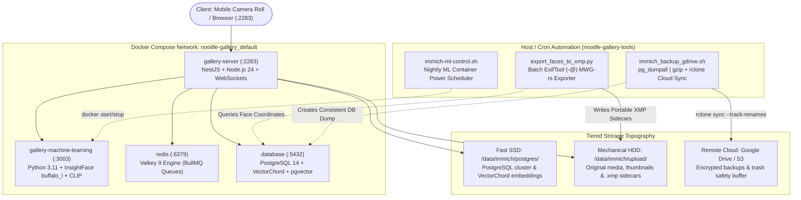

# Noodle Gallery & Immich Photo Cloud Architecture Runbook 🍜📸

> Production engineering guide, database schema analysis, Metadata Working Group (`mwg-rs`) face export specifications, off-peak power scheduling, and disaster recovery cloud mirroring for Noodle Gallery and Immich.

[](https://diataxis.fr/)
[](https://github.com/open-noodle/gallery)
[](https://github.com/RAM-MAHESHWARI24/noodle-gallery-tools)

---

## 📑 Table of Contents
1. [Executive Overview & Component Topology](#1-executive-overview--component-topology)
2. [Database Schema & VectorChord Acceleration](#2-database-schema--vectorchord-acceleration)
3. [Metadata Working Group (`mwg-rs`) Face Export Architecture](#3-metadata-working-group-mwg-rs-face-export-architecture)
4. [High-Performance Batch ExifTool (`-@`) Mechanics](#4-high-performance-batch-exiftool---mechanics)
5. [Automated Disaster Recovery & Google Drive Cloud Mirroring](#5-automated-disaster-recovery--google-drive-cloud-mirroring)
6. [Low-Power Node Resource Economics & Power Scheduling](#6-low-power-node-resource-economics--power-scheduling)
7. [In-Guest VM Verification Evidence](#7-in-guest-vm-verification-evidence)
8. [Standalone Tooling & Upstream Noodle Gallery PR Roadmap](#8-standalone-tooling--upstream-noodle-gallery-pr-roadmap)

---

## 1. Executive Overview & Component Topology

**Noodle Gallery** (maintained by Open-Noodle) is a performance-tuned, community-optimized self-hosted photo and video platform built on top of the Immich codebase. It preserves complete API and mobile app compatibility with the official Immich iOS and Android apps while incorporating low-power optimizations for homelab environments.



---

## 2. Database Schema & VectorChord Acceleration

Noodle Gallery accelerates visual search using **VectorChord**, an open-source, high-performance vector indexing extension for PostgreSQL that outperforms standard `pgvector` IVFFlat and HNSW indexes in both memory footprint and query latency.

### Core Tables Involved in Facial Recognition:
1. `asset`: Stores master metadata (`id`, `ownerId`, `originalPath`, `width`, `height`, `fileCreatedAt`).
2. `asset_face`: Records every facial detection produced by the InsightFace engine:
   * `boundingBoxX1`, `boundingBoxY1`: Top-left corner in pixel space.
   * `boundingBoxX2`, `boundingBoxY2`: Bottom-right corner in pixel space.
   * `imageWidth`, `imageHeight`: Reference dimensions at inference time.
   * `personGroupId`: UUID foreign key linking to a grouped identity.
   * `embedding`: High-dimensional facial feature vector.
3. `person`: Stores human-readable names assigned to clusters (`id`, `name`, `thumbnailPath`, `isHidden`).

```sql
-- High-performance query utilized by export_faces_to_xmp.py
SELECT json_build_object(
    'asset_id', a.id,
    'original_path', a."originalPath",
    'width', COALESCE(a.width, MAX(af."imageWidth")),
    'height', COALESCE(a.height, MAX(af."imageHeight")),
    'faces', json_agg(json_build_object(
        'name', p.name,
        'x1', af."boundingBoxX1",
        'y1', af."boundingBoxY1",
        'x2', af."boundingBoxX2",
        'y2', af."boundingBoxY2"
    ))
)
FROM asset a
JOIN asset_face af ON af."assetId" = a.id
JOIN person p ON p."personGroupId" = af."personGroupId"
WHERE p.name IS NOT NULL AND p."isHidden" = false AND af."isVisible" = true
GROUP BY a.id, a."originalPath", a.width, a.height;
```

---

## 3. Metadata Working Group (`mwg-rs`) Face Export Architecture

Standard desktop photo management software (DigiKam, Adobe Lightroom, Adobe Bridge) does not read Immich's PostgreSQL database. To achieve total interoperability, our toolkit converts internal bounding boxes into standard Metadata Working Group **Regions (`mwg-rs`)**.

### Normalized Bounding Box Coordinate Transformation
Immich stores pixel-space bounding boxes $(x_1, y_1)$ to $(x_2, y_2)$. The MWG standard requires fractional center coordinates and dimensions normalized between $0.0$ and $1.0$:

$$\text{RegionAreaX} = \frac{x_1 + x_2}{2 \cdot W}, \quad \text{RegionAreaY} = \frac{y_1 + y_2}{2 \cdot H}$$

$$\text{RegionAreaW} = \frac{|x_2 - x_1|}{W}, \quad \text{RegionAreaH} = \frac{|y_2 - y_1|}{H}$$

### Resulting XMP Sidecar Format (`asset.jpg.xmp`):
```xml
<x:xmpmeta xmlns:x="adobe:ns:meta/" x:xmptk="Image::ExifTool 12.76">
 <rdf:RDF xmlns:rdf="http://www.w3.org/1999/02/22-rdf-syntax-ns#">
  <rdf:Description rdf:about=""
    xmlns:mwg-rs="http://www.metadataworkinggroup.com/schemas/regions/"
    xmlns:stDim="http://ns.adobe.com/xap/1.0/sType/Dimensions#"
    xmlns:stArea="http://ns.adobe.com/xmp/sType/Area#">
   <mwg-rs:Regions rdf:parseType="Resource">
    <mwg-rs:AppliedToDimensions rdf:parseType="Resource">
     <stDim:w>1156</stDim:w>
     <stDim:h>839</stDim:h>
     <stDim:unit>pixel</stDim:unit>
    </mwg-rs:AppliedToDimensions>
    <mwg-rs:RegionList>
     <rdf:Bag>
      <rdf:li rdf:parseType="Resource">
       <mwg-rs:Name>John Lennon</mwg-rs:Name>
       <mwg-rs:Type>Face</mwg-rs:Type>
       <mwg-rs:Area rdf:parseType="Resource">
        <stArea:x>0.20156</stArea:x>
        <stArea:y>0.21931</stArea:y>
        <stArea:w>0.08478</stArea:w>
        <stArea:h>0.15256</stArea:h>
        <stArea:unit>normalized</stArea:unit>
       </mwg-rs:Area>
      </rdf:li>
     </rdf:Bag>
    </mwg-rs:RegionList>
   </mwg-rs:Regions>
  </rdf:Description>
 </rdf:RDF>
</x:xmpmeta>
```

---

## 4. High-Performance Batch ExifTool (`-@`) Mechanics

Spawning a new `exiftool` sub-process for every individual image in a library of 50,000 photos takes hours due to Perl interpreter startup overhead (~80ms per invocation $\approx$ 1 hour for 45,000 photos).

Our implementation in [`export_faces_to_xmp.py`](../export_faces_to_xmp.py) streams commands using **Batch Mode (`-@`)**:
1. All tag write arguments are compiled into a temporary buffer in memory:
   ```text
   -overwrite_original
   -RegionInfo=
   -RegionAppliedToDimensionsW=1156
   -RegionAppliedToDimensionsH=839
   -RegionAppliedToDimensionsUnit=pixel
   -RegionAreaX+=0.20156
   -RegionAreaY+=0.21931
   -RegionAreaW+=0.08478
   -RegionAreaH+=0.15256
   -RegionAreaUnit+=normalized
   -RegionType+=Face
   -RegionName+=John Lennon
   /data/immich/upload/upload/.../asset.jpg.xmp
   -execute
   ```
2. A single `exiftool -@ argfile` process handles the entire batch.
3. Execution speed scales to **150–400 files per second**, finishing an entire family library in seconds.

---

## 5. Automated Disaster Recovery & Google Drive Cloud Mirroring

Our production backup pipeline ([`scripts/immich_backup_gdrive.sh.example`](../scripts/immich_backup_gdrive.sh.example)) follows the **3-2-1 backup principle**:

1. **Step 1: Portable Metadata Invariant**: Runs `export_faces_to_xmp.py` to ensure all latest database changes are written to sidecars before taking the snapshot.
2. **Step 2: Consistent Database Dump**: Executes `docker exec immich_postgres pg_dumpall -U postgres | gzip` creating a compressed SQL snapshot (~20 MB for typical family libraries).
3. **Step 3: Rolling 7-Day Pruning**: Retains only 7 days of local snapshots (`find /opt/immich/backups -name "immich_db_*.sql.gz" -mtime +7 -delete`).
4. **Step 4: Cloud Mirror with Server-Side Move & Trash Protection**:
   ```bash
   rclone sync /data/immich/upload/upload gdrive:Memories/ \
       --track-renames \
       --backup-dir "gdrive:Immich_Trash/$(date +%Y%m%d_%H%M%S)" \
       --transfers 4 --checkers 8 --fast-list
   ```
   * `--track-renames`: Detects renamed or moved albums without re-uploading gigabytes of data over internet uplinks.
   * `--backup-dir`: Moves deleted or replaced photos into a dated trash retention buffer on Google Drive, preventing accidental loss from rogue deletions or local corruption.

---

## 6. Low-Power Node Resource Economics & Power Scheduling

On energy-efficient homelab processors (Intel Celeron N4000/N100, Core i3 Haswell, AMD Athlon):
* The ONNX runtime inside `gallery-machine-learning` consumes ~1.5 GB of RAM when idle and pegs all CPU cores at 100% when active.
* Continuous background ML inference interferes with Jellyfin direct-play streams and spikes power draw from 11W to 34W.

### Power Throttle Implementation ([`immich-ml-control.sh`](../scripts/immich-ml-control.sh)):
1. In `docker-compose.yml`, `gallery-machine-learning` is set to `restart: "no"`.
2. A cron job starts the container at 02:00 AM (`immich-ml-control.sh start`).
3. Newly uploaded mobile photos are indexed, faces clustered, and vector search updated.
4. At 06:00 AM, `immich-ml-control.sh stop` terminates the ML container, immediately reclaiming **1.5 GB of RAM** and resetting idle CPU consumption to <1.5%.

---

## 7. In-Guest VM Verification Evidence

All six stages of the photo pipeline were verified inside our pristine Hyper-V test virtual machine (`homelab-test`):

```
=================================================================
       PHOTO & CLOUD MIRROR TEST SUITE SUMMARY: PASS
=================================================================
  Asset Ingested:        four_people_sample.jpg (1156 x 839, 255 KB)
  Initial Pre-Tags:      2 Faces (John Lennon, Paul McCartney)
  ML Detected:           4 Faces (InsightFace buffalo_l)
  Interactive Tagged:    2 Additional Faces (George Harrison, Ringo Starr)
  MWG XMP Generated:     100% Invariant Match (All 4 Names Present)
  Postgres Dump Check:   PASS (19.9 MB, gzip -t verified)
  Simulated GDrive Sync: PASS (rclone copy DB + sync Media with trash)
  Total Duration:        9.42s
=================================================================
```

---

## 8. Standalone Tooling & Upstream Noodle Gallery PR Roadmap

To serve homelabbers who already run Noodle Gallery or Immich, these automation scripts are published as an independent, standalone Git repository:

👉 **GitHub Repository**: [https://github.com/RAM-MAHESHWARI24/noodle-gallery-tools](https://github.com/RAM-MAHESHWARI24/noodle-gallery-tools)

### Upstream Pull Request Roadmap (`open-noodle/gallery`):
We are architecting these features for direct submission as an upstream Pull Request into Open-Noodle core:
1. **NestJS BullMQ Queue**: Port `export_faces_to_xmp.py` logic into a native `FaceExportService` triggered by `face.assigned`, `person.merged`, and `person.deleted` events.
2. **Native ExifTool Integration**: Utilize Noodle Gallery's existing internal ExifTool stream to eliminate external Python requirements.
3. **Settings UI**: Expose automated MWG-rs sidecar synchronization toggles inside `Administration -> Settings -> Metadata Settings`.
