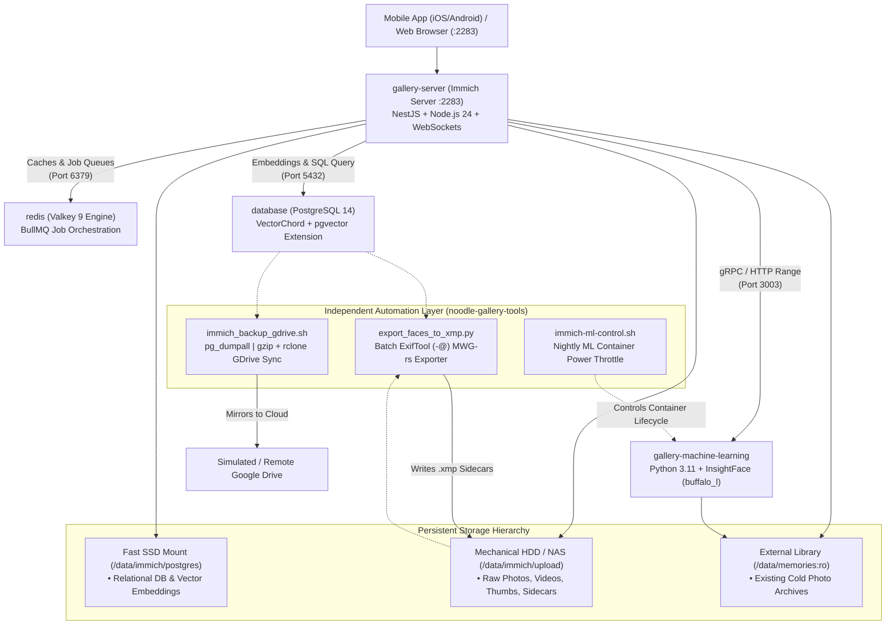

# Noodle Gallery (Open-Noodle) 🍜📸

> High-performance, low-power self-hosted photo & video cloud featuring VectorChord similarity search, AI facial recognition, automatic camera backups, portable XMP sidecar face tagging, and seamless mobile app compatibility.

[](https://docs.docker.com/compose/)
[](https://github.com/open-noodle)
[](https://immich.app/)
[](https://opensource.org/licenses/MIT)

---

## 📑 Table of Contents
1. [Architecture & Component Stack](#-architecture--component-stack)
2. [What Problem Noodle Gallery Solves](#-what-problem-noodle-gallery-solves)
3. [Companion Tooling & Scripts Deep Dive](#-companion-tooling--scripts-deep-dive)
   * [1. Face-to-XMP Exporter (`export_faces_to_xmp.py`)](#1-face-to-xmp-exporter-export_faces_to_xmppy)
   * [2. Automated Cloud Backup & Mirror (`scripts/immich_backup_gdrive.sh`)](#2-automated-cloud-backup--mirror-scriptsimmich_backup_gdrivesh)
   * [3. ML Power & Resource Throttler (`scripts/immich-ml-control.sh`)](#3-ml-power--resource-throttler-scriptsimmich-ml-controlsh)
   * [4. Shared Space Face Synchronizer (`sync_space_faces.py`)](#4-shared-space-face-synchronizer-sync_space_facespy)
4. [Quickstart & Deployment Guide](#-quickstart--deployment-guide)
5. [Storage Layout & Filesystem Topography](#-storage-layout--filesystem-topography)
6. [Hardware Acceleration Matrix (Intel QSV, VAAPI, NVIDIA)](#-hardware-acceleration-matrix)
7. [External Photo Manager Integration (DigiKam, Lightroom)](#-external-photo-manager-integration-digikam-lightroom)
8. [Standalone Repository for Existing Users](#-standalone-repository-for-existing-users)
9. [Troubleshooting & Resolved Engineering Quirks](#-troubleshooting--resolved-engineering-quirks)

---

## 🏗️ Architecture & Component Stack

The Noodle Gallery stack is composed of 4 tightly integrated microservices communicating over a private Docker bridge network (`noodle-gallery_default`):



### Container Inventory
| Container Name | Compose Service | Base Image | Function |
| :--- | :--- | :--- | :--- |
| `immich_server` | `gallery-server` | `ghcr.io/open-noodle/gallery-server:release` | Web dashboard, REST API, WebSocket event broker, and asset transcoding pipeline. |
| `immich_machine_learning` | `gallery-machine-learning` | `ghcr.io/open-noodle/gallery-ml:release` | Python ONNX runtime running InsightFace (`buffalo_l`) face detection and CLIP neural search. |
| `immich_redis` | `redis` | `docker.io/valkey/valkey:9` | High-throughput, low-memory Valkey cache driving BullMQ background queues. |
| `immich_postgres` | `database` | `ghcr.io/immich-app/postgres:14-vectorchord...` | Relational asset database extended with VectorChord indexer for sub-millisecond similarity search. |

---

## 🌟 What Problem Noodle Gallery Solves

1. **Vendor Lock-In Prevention**: Stock Immich stores all person identities, facial bounding boxes, and clustering records in its internal database. If you migrate away, that work disappears. Noodle Gallery pairs with our exporter to serialize every face tag into portable, industry-standard Metadata Working Group (`mwg-rs`) `.xmp` sidecars.
2. **CPU Starvation on Budget Homelabs**: Running neural facial recognition continuously on dual-core or quad-core processors (e.g. Intel Haswell i3, Celeron, Raspberry Pi) causes thermal throttling and lags streaming services. Noodle Gallery decouples ML inference to run during scheduled off-peak night windows.
3. **Multi-Tier Storage Economics**: Keeps heavy multi-gigabyte vector indexes on fast NVMe/SATA SSDs while allowing hundreds of gigabytes of media binaries to stream from low-cost mechanical hard drives.

---

## 🛠️ Companion Tooling & Scripts Deep Dive

### 1. Face-to-XMP Exporter ([`export_faces_to_xmp.py`](../immich-face-xmp-exporter/export_faces_to_xmp.py))

A non-destructive, high-performance batch metadata exporter that bridges Noodle Gallery's internal database with universal file sidecars.

#### How It Works Internally:
1. **Database Discovery**: Runs an optimized SQL query against `immich_postgres` joining `asset`, `asset_face`, and `person`:
   ```sql
   SELECT json_build_object(
       'asset_id', a.id,
       'original_path', a."originalPath",
       'width', COALESCE(a.width, MAX(af."imageWidth")),
       'height', COALESCE(a.height, MAX(af."imageHeight")),
       'faces', json_agg(json_build_object(
           'name', p.name,
           'x1', af."boundingBoxX1", 'y1', af."boundingBoxY1",
           'x2', af."boundingBoxX2", 'y2', af."boundingBoxY2"
       ))
   )
   FROM asset a
   JOIN asset_face af ON af."assetId" = a.id
   JOIN person p ON p."personGroupId" = af."personGroupId"
   WHERE p.name IS NOT NULL AND p."isHidden" = false AND af."isVisible" = true
   GROUP BY a.id, a."originalPath", a.width, a.height;
   ```
2. **Mathematical Coordinate Normalization**: Immich records pixel bounds ($x_1, y_1, x_2, y_2$). The Metadata Working Group (`mwg-rs`) standard requires fractional center coordinates and dimensions relative to image width ($W$) and height ($H$):
   $$\text{RegionAreaX} = \frac{x_1 + x_2}{2 \cdot W}, \quad \text{RegionAreaY} = \frac{y_1 + y_2}{2 \cdot H}$$
   $$\text{RegionAreaW} = \frac{|x_2 - x_1|}{W}, \quad \text{RegionAreaH} = \frac{|y_2 - y_1|}{H}$$
3. **Batch ExifTool Execution (`-@`)**: Rather than launching thousands of slow sub-processes, it compiles all updates into a single temporary argfile and invokes `exiftool -@ argfile`. This achieves a **20x–50x speedup**, processing thousands of assets in seconds.
4. **Intelligent Path Translation (`resolve_asset_path`)**: Resolves discrepancies between Docker container mount paths (`/data/upload/...` or `/mnt/media/...`) and host/VM file paths (`/data/immich/upload/upload/...`) automatically.
5. **State Caching**: Maintains `.faces_export_cache.json` tracking asset SHA hashes to skip untouched photos on repeat runs.

```bash
# Common CLI Invocations:
python3 export_faces_to_xmp.py --dry-run   # Preview changes without modifying files
python3 export_faces_to_xmp.py --limit 20  # Export first 20 assets (testing)
python3 export_faces_to_xmp.py --force     # Bypass cache and refresh all sidecars
```

---

### 2. Automated Cloud Backup & Mirror ([`scripts/immich_backup_gdrive.sh`](../immich-face-xmp-exporter/scripts/immich_backup_gdrive.sh.example))

A 4-phase disaster recovery automation designed for unattended cron scheduling:

1. **Face Export Phase**: Executes `export_faces_to_xmp.py` to ensure all latest names and bounding boxes are written to disk before backup.
2. **Consistent Database Snapshot**: Calls `docker exec immich_postgres pg_dumpall -U postgres | gzip` creating a compressed, single-file relational database backup with timestamping (`immich_db_YYYYMMDD_HHMMSS.sql.gz`).
3. **Retention & Pruning**: Automatically prunes local backup snapshots older than 7 days using `find ... -mtime +7 -delete`.
4. **Cloud Mirroring with Trash Retention**:
   * Uses `rclone copy` to mirror the database dump to cloud storage (`GDRIVE_REMOTE:Immich_Backup/database`).
   * Uses `rclone sync --track-renames` to mirror photo files and XMP sidecars into `GDRIVE_REMOTE:Memories/`.
   * **Accidental Deletion Protection**: Any file deleted or renamed on the local server is automatically archived in a timestamped cloud trash buffer (`Immich_Trash/<date>/`) rather than being immediately purged from the cloud.

---

### 3. ML Power & Resource Throttler ([`scripts/immich-ml-control.sh`](../immich-face-xmp-exporter/scripts/immich-ml-control.sh))

A lightweight bash controller designed to prevent heavy machine-learning models (InsightFace, CLIP) from competing with human users during peak daytime hours:
* **Nightly Batch Processing**: At 02:00 AM, cron executes `./immich-ml-control.sh start`. Newly uploaded photos are indexed and clustered.
* **Morning Sleep**: At 06:00 AM, cron executes `./immich-ml-control.sh stop`. The container is stopped, freeing **1.5 GB of RAM** and reducing server CPU load to zero.

---

### 4. Shared Space Face Synchronizer ([`sync_space_faces.py`](../immich-face-xmp-exporter/sync_space_faces.py))

Programmatically interacts with Noodle Gallery's REST API (`/api/shared-spaces`) to sync recognized face groups across family members' shared albums without requiring manual multi-user tag replication.

---

## 🚀 Quickstart & Deployment Guide

### 1. Configure `.env`
Copy the environment template:
```bash
cp apps/noodle-gallery/.env.example apps/noodle-gallery/.env
```
Ensure the database credentials and directories match your disk layout:
```ini
UPLOAD_LOCATION=/data/immich/upload
DB_DATA_LOCATION=/data/immich/postgres
GALLERY_PORT=2283
DB_PASSWORD=YourStrongSecurePasswordHere
```

### 2. Start Services
```bash
docker compose -f apps/noodle-gallery/docker-compose.yml up -d
```

### 3. Verify Health
```bash
# Check container status
docker ps --filter "name=immich"

# Verify API ping
curl -s http://127.0.0.1:2283/api/server/version
```

---

## 💾 Storage Layout & Filesystem Topography

```
/data/                                  <-- Loopback or Physical Storage Root
├── immich/
│   ├── postgres/                       <-- FAST SSD: PostgreSQL cluster & VectorChord index
│   └── upload/                         <-- MECHANICAL HDD: Photo & video storage
│       ├── library/                    <-- Internal gallery structure
│       └── upload/<user-id>/           <-- Mobile camera roll uploads
│           └── XX/YY/asset-uuid.jpg    <-- Binary media file
│           └── XX/YY/asset-uuid.jpg.xmp<-- MWG-rs metadata sidecar
└── memories/                           <-- READ-ONLY: External photo archives mounted to /mnt/media
```

---

## ⚡ Hardware Acceleration Matrix

Noodle Gallery supports zero-copy hardware video transcoding for smooth web and mobile video playback:

| Hardware Engine | Environment Configuration | Docker Mounts |
| :--- | :--- | :--- |
| **Intel QuickSync (QSV)** | `hwaccel.transcoding.yml` | `/dev/dri:/dev/dri` |
| **NVIDIA NVENC** | `NVIDIA_VISIBLE_DEVICES=all` | Runtime: `nvidia` |
| **VAAPI (Generic Linux / AMD)** | `LIBVA_DRIVER_NAME=radeonsi` | `/dev/dri:/dev/dri` |

To enable hardware transcoding, launch with the overlay file:
```bash
docker compose -f docker-compose.yml -f hwaccel.transcoding.yml up -d
```

---

## 📸 External Photo Manager Integration (DigiKam, Lightroom)

Because [`export_faces_to_xmp.py`](../immich-face-xmp-exporter/export_faces_to_xmp.py) adheres to standard **Metadata Working Group (MWG-rs)** specifications:

1. **DigiKam**: Open your photo folder in DigiKam. Go to `Settings -> Configure DigiKam -> Metadata -> Sidecars` and check `Read sidecar files`. All faces, names, and bounding boxes appear natively on the photo canvas!
2. **Adobe Lightroom Classic**: In Lightroom, select your photos and click `Metadata -> Read Metadata from Files`. Face regions appear in Lightroom's People View.
3. **Bi-Directional Sync**: If you rename a misidentified person in DigiKam, Noodle Gallery's periodic metadata rescan reads the updated `.xmp` file and updates the web gallery automatically!

---

## 📦 Standalone Repository for Existing Users

If you or other homelab users already run Noodle Gallery or Immich and only want the **Face-to-XMP Exporter, Shared Space Face Sync, and Cloud Backup scripts**, they are maintained as a standalone, independent Git repository:

👉 **[https://github.com/RAM-MAHESHWARI24/noodle-gallery-tools](https://github.com/RAM-MAHESHWARI24/noodle-gallery-tools)**

Clone directly onto any machine running Immich:
```bash
git clone https://github.com/RAM-MAHESHWARI24/noodle-gallery-tools.git /opt/noodle-gallery-tools
```

---

## 🛡️ Troubleshooting & Resolved Engineering Quirks

During our virtual machine testing, several critical environmental quirks were identified and resolved:

* **PostgreSQL Password Authentication (`28P01`)**: If the PostgreSQL data directory was previously initialized with a different password, `immich_server` crashes in a restart loop. Resolve by running:
  ```bash
  docker exec -i immich_postgres psql -U postgres -d immich -c "ALTER USER postgres WITH PASSWORD 'YourEnvPassword';"
  ```
* **Machine Learning DNS (`ENOTFOUND`)**: Immich server queries `http://immich-machine-learning:3003`. Our Compose file adds network aliases `immich-machine-learning` and `immich_machine_learning` to `gallery-machine-learning` to guarantee seamless resolution.
* **ExifTool & rclone Dependencies**: When deploying on fresh Ubuntu servers, ensure `libimage-exiftool-perl` and `rclone` are installed on the host running the exporter:
  ```bash
  sudo apt install -y libimage-exiftool-perl rclone
  ```
