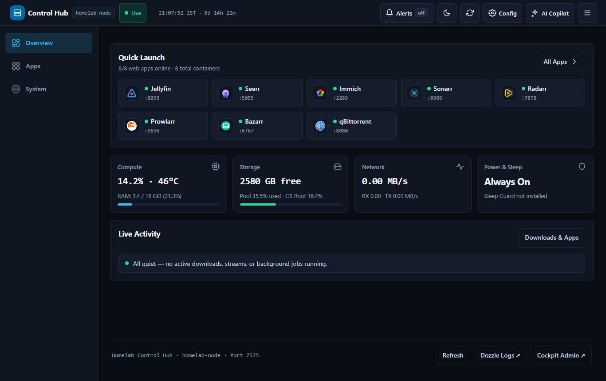
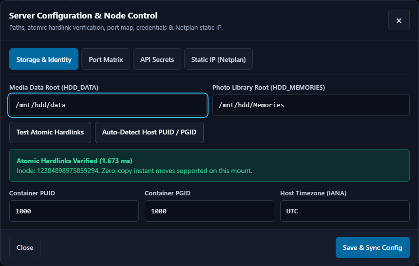
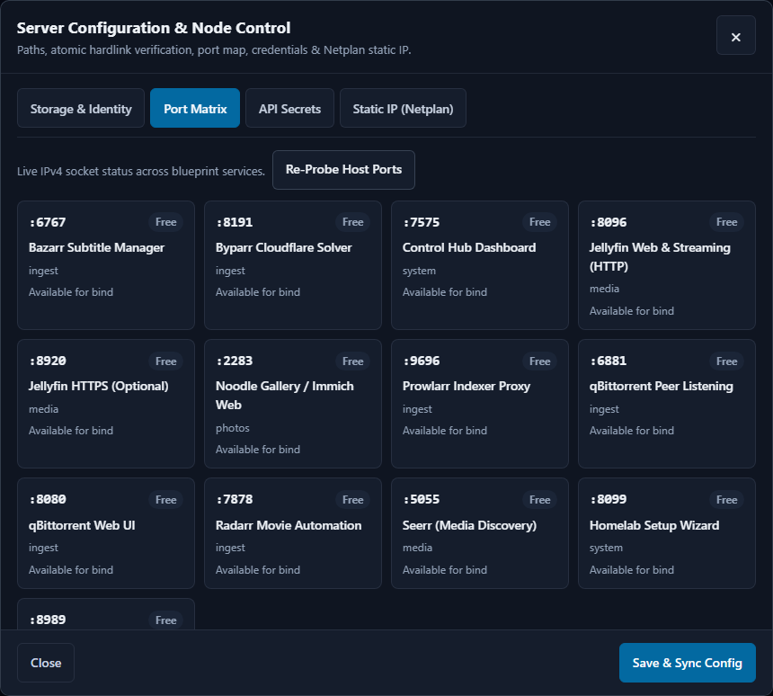
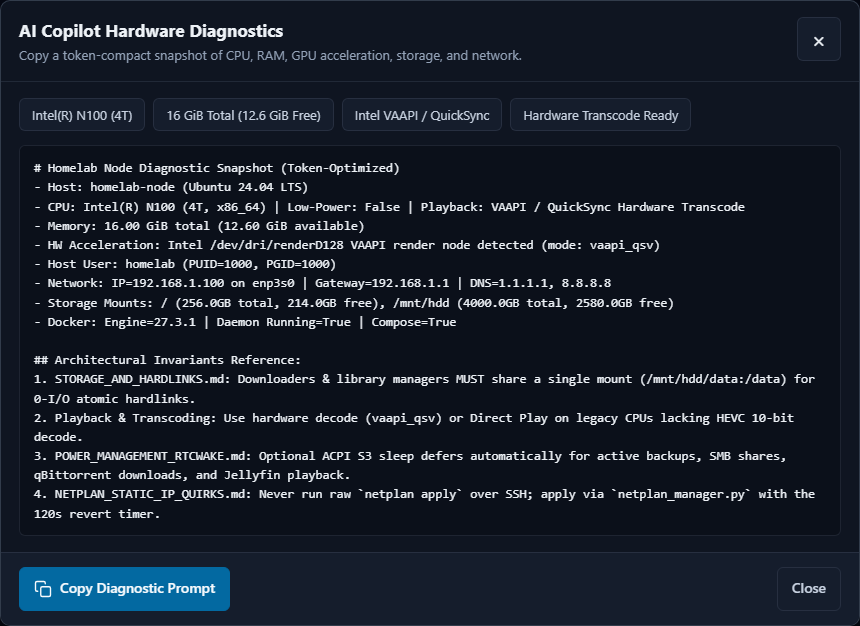

# Control Hub: Node Configuration & AI Copilot Integration

The modular configuration engine (`core/config_core/`) shared with the onboarding Setup Wizard is integrated directly into the **Control Hub 5-View Operations Console** at port `7575`.

Administrators can inspect their node topology, run live atomic hardlink probes, check the 13-service port matrix, preview and apply safe Netplan static IP changes with a live 120-second confirmation countdown, and export token-optimized AI Copilot diagnostics without leaving the browser.

---

## 1. Architecture Overview

```
                                +-----------------------------------+
                                |  Control Hub Operations Console   |
                                |        (http://<host>:7575)       |
                                |  Overview · Apps · Backups · TVs  |
                                |               System              |
                                +-----------------+-----------------+
                                                  |
                     +----------------------------+----------------------------+
                     |                                                         |
        [⚙️ Node Settings Modal]                                  [🤖 AI Copilot Modal]
                     |                                                         |
  +------------------+------------------+                   +------------------+------------------+
  | - 📁 Storage & Identity (Read-Only  |                   | - Dynamic CPU & GPU DRM Vendor Probe|
  |      Banner on Blueprint Installs)  |                   |   (Intel QSV / AMD / NVIDIA / Play) |
  | - 🔌 13-Service Port Matrix Prober  |                   | - Memory Headroom (Total vs Free)   |
  | - 🔐 PUID/PGID & Crypto Secrets Gen |                   | - Real Mounts & Block Device Matrix |
  | - 🌐 Safe Netplan Static IP (120s   |                   | - 1-Click Compact Prompt (~300 tok) |
  |      Revert + Live Confirm Banner)  |                   |   with HTTP LAN Clipboard Fallback  |
  +------------------+------------------+                   +-------------------------------------+
                     |
                     v
   +------------------------------------+
   | Flask Blueprint (config_center.py) |
   +-----------------+------------------+
                     |
       +-------------+-------------+
       |                           |
       v                           v
+----------------+      +---------------------+
| core/          |      | /etc/homelab/*.env  |
| config_core    |      | or Standalone .env  |
+----------------+      +---------------------+
```

---

## 2. Key Integrated Features

### 📁 1. Single-Mount Storage & Atomic Hardlink Tester
- **Path & Permission Honesty:** Displays `HDD_DATA` (`/mnt/hdd/data`) and `HDD_MEMORIES` (`/mnt/hdd/Memories`). On root-managed blueprint installs (`/etc/homelab`), the dialog clearly displays a **View Only (root-managed blueprint install)** banner with the exact CLI command instead of failing silently with `403`.
- **Live Hardlink Verification:** Runs real `os.link()` checks directly on host filesystem mounts to verify single-mount ext4/xfs compliance (returns Inode number, link count, and latency in ms).
- **Rule Enforcement:** Warns against cross-device (`EXDEV`) link issues where downloads and media are on separate mounts, preventing slow duplicate file copying.

### 🔌 2. Real-Time 13-Service Port Conflict Prober
- Probes IPv4 socket bindings and configured overrides for all 13 services:
  - `7575` Control Hub Dashboard
  - `8096` Jellyfin HTTP
  - `8920` Jellyfin HTTPS
  - `5055` Seerr (Media Discovery)
  - `8080` qBittorrent Web UI
  - `6881` qBittorrent Peer Listening
  - `8989` Sonarr TV Automation
  - `7878` Radarr Movie Automation
  - `9696` Prowlarr Indexer Proxy
  - `6767` Bazarr Subtitle Manager
  - `8191` Byparr Cloudflare Solver
  - `2283` Noodle Gallery / Immich Web
  - `8099` Homelab Setup Wizard (or custom `SETUP_PORT`)
- Displays truthful status pills (`In Use` with owning service vs `Available`) and protocol-aware **"Open Web UI"** links for active web services.

### 🔐 3. User Permissions & High-Entropy Credentials
- **Auto-Detect Host User:** Detects the container/human `PUID` and `PGID` (preferring configured env or UID `1000` over the unprivileged `homelab` daemon UID) so container volumes match host permissions.
- **Crypto Secrets Generator:** 1-click generation of strong alphanumeric passwords (safe for PostgreSQL and shell interpolation) and 32-character API keys for Radarr, Sonarr, and Prowlarr.

### 🌐 4. Safe Netplan Static IP with 120s Auto-Rollback & Live Confirmation
- Auto-detects active network interfaces (via `/proc/net/route`), gateway, and DNS servers.
- Generates standard Netplan v2 YAML configuration.
- **End-to-End Safety Guarantee:** Applies with an armed revert timer (`homelab-netplan-revert`, 120 s by default) and immediately surfaces a live **120-second confirmation countdown banner** (in both the modal and the Overview Attention Strip) with a direct link to the new IP and a **"Confirm New IP"** button (`/api/config/netplan-confirm`). Unless confirmed before the timer expires, the previous Netplan configuration is restored automatically.

### 🤖 5. AI Copilot Diagnostics & Compact Prompt Exporter
- Probes CPU model, architecture, thread count, and transcode capability (accurately distinguishing modern Intel N100/Alder Lake-N QuickSync CPUs from legacy Haswell Direct Play nodes).
- Probes RAM headroom and `/sys/class/drm/card*/device/vendor` (`0x8086` Intel QSV/VAAPI, `0x1002` AMD VAAPI, `0x10de` NVIDIA NVENC) alongside `/dev/dri/renderD128`.
- Generates a **token-optimized diagnostic prompt (~300 tokens)** tailored for ChatGPT, Claude, and Antigravity:
  - Includes real-time hardware specs, actual configured mount paths, network settings, and key blueprint architectural rules.
  - Features 1-click **"Copy AI Prompt"** with an HTTP-safe clipboard fallback so copying works over plain `http://<lan-ip>:7575` LAN origins.

### 📊 6. Universal Hardware Telemetry & Per-Filesystem Storage Truth
- **Dynamic Vitals & Thermal Probing:** Populates host CPU model, core/thread count, CPU package temperature via `/sys/class/hwmon` (`coretemp`, `k10temp`, `zenpower`, `cpu_thermal`), and physical memory headroom without hardcoded machine assumptions.
- **Per-Filesystem Storage Breakdown (`st_dev` + Root Hourly Timer):** Groups measured directory sizes by the actual filesystem (`st_dev`) they reside on (separating OS Root `/` SSD appdata/backups from Data Pool HDD media/photos), powered by the root hourly `homelab-storage-sizes.timer` (`0644` atomic JSON cache) outside Control Hub's `100M` cgroup.
- **Universal Block Device Throughput:** Resolves mountpoints through `/proc/mounts`, `/sys/block`, and `lsblk` (supporting LVM `dm-*`, NVMe, SATA, eMMC `mmcblk*`, MDADM `md*`, and single-disk hosts without duplicating disks).

---

## 3. Visual Verification

| Feature | Screenshot |
| :--- | :--- |
| **5-View Operations Console (`Overview`)** |  |
| **Storage & Atomic Hardlink Tester** |  |
| **13-Service Port Matrix** |  |
| **AI Copilot Diagnostics** |  |
