# Control Hub GUI Visual History

Automated side-by-side Playwright captures across the recent Control Hub GUI milestones (`1366x860`), rendered against identical deterministic hardware, container, backup, and download fixtures.

Generated by [`testing/capture_visual_history.py`](../testing/capture_visual_history.py) on `2026-11-24 17:17 UTC`.

## Captured Commits

| Stage | Commit | Date | Summary |
| :--- | :--- | :--- | :--- |
| **PR #56 — Pivot Phase A & B (5-View Console Baseline)** | `2ff463b` | 2026-11-21 | Merge pull request #56 from RAM-MAHESHWARI24/feat/control-hub-pivot |
| **PR #57 — De-AI Polish Pass (Impeccable & Hallmark)** | `032e103` | 2026-11-21 | Merge pull request #57 from RAM-MAHESHWARI24/feat/control-hub-de-ai-polish |
| **PR #60 — Hallmark Console C1 (OKLCH Tokens, Fonts & 4px Scale)** | `8cda9bc` | 2026-11-24 | feat(control-hub): apply Hallmark Console C1 tokens, offline fonts, and 4px spacing (#60) |
| **PR #61 — Hallmark Console C2 (Bench, Audit Spine & Service Ledger)** | `e4a7879` | 2026-11-24 | feat(control-hub): compose Console Overview bench and ruled Apps ledger (C2) (#61) |

## What Actually Changed Visually

1. **`2ff463b` -> `032e103` (PR #57 — De-AI Polish):** Deliberately incremental; kept the `#090d14` slate + sky-blue `#38bdf8` layout intact while removing eyebrow clutter, glass blur, and nested card chrome.
2. **`032e103` -> `8cda9bc` (PR #60 — Console C1):** Replaced blue-tinted navy slate with 3-step neutral graphite OKLCH (`console: graphite`) and warm cream (`console: paper`), self-hosted `Host Grotesk` + `Atkinson Hyperlegible Mono`, split **Amber** operator buttons from **Cool Blue** instrument bars, and normalized all spacing onto a 4px scale.
3. **`8cda9bc` -> `e4a7879` (PR #61 — Console C2):** Replaced Overview's separated cards and Quick Launch tiles with flush 1px hairline grids (`Host Record` audit spine added beside Live Activity), and converted `#/apps` from stacked rows into a ruled multi-column `service-ledger` table on desktop.


## Overview (Dark Theme)

Quick Launch, 4-cell Vitals Bench, Live Activity, and Host Record across commits.

### PR #56 — Pivot Phase A & B (5-View Console Baseline) (`2ff463b`)

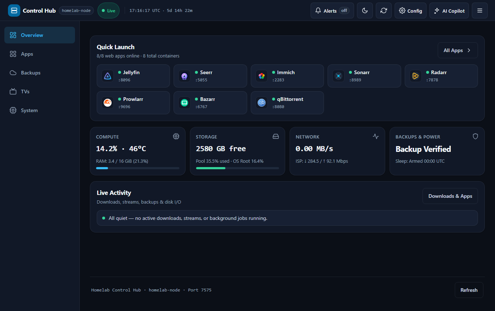

### PR #57 — De-AI Polish Pass (Impeccable & Hallmark) (`032e103`)

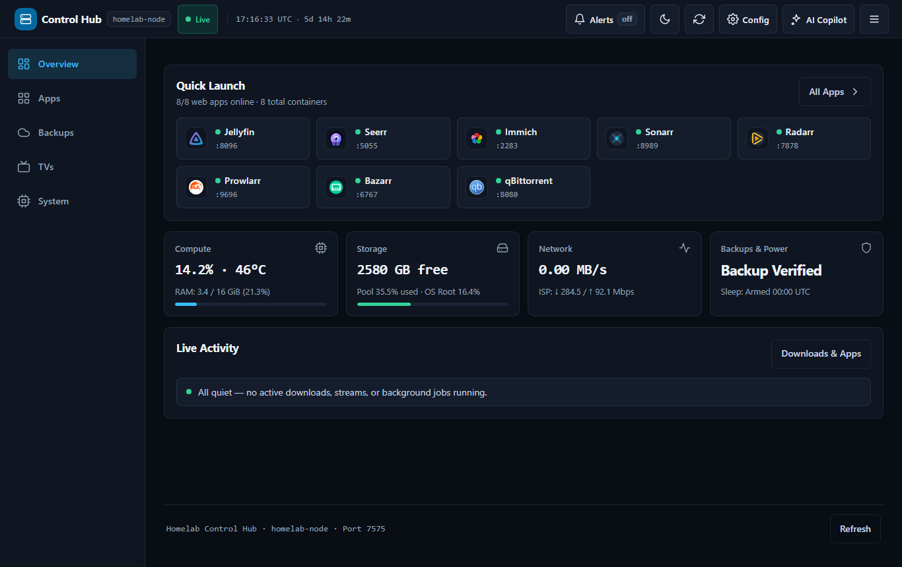

### PR #60 — Hallmark Console C1 (OKLCH Tokens, Fonts & 4px Scale) (`8cda9bc`)

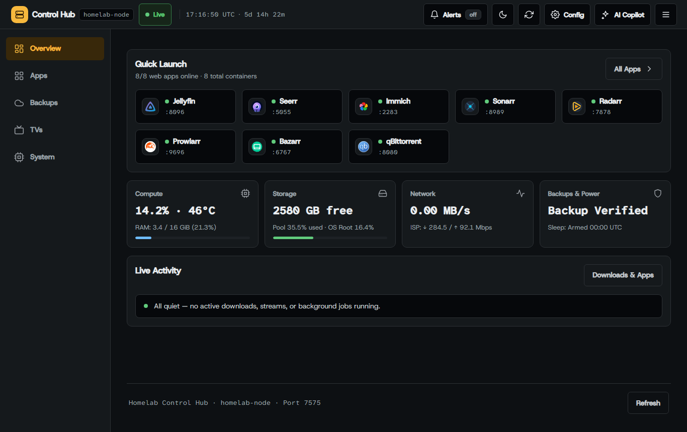

### PR #61 — Hallmark Console C2 (Bench, Audit Spine & Service Ledger) (`e4a7879`)

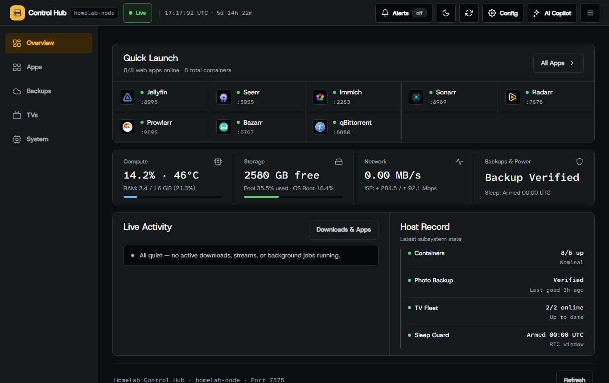


## Apps & Media (Dark Theme)

Installed Services list/table and qBittorrent download queue across commits.

### PR #56 — Pivot Phase A & B (5-View Console Baseline) (`2ff463b`)

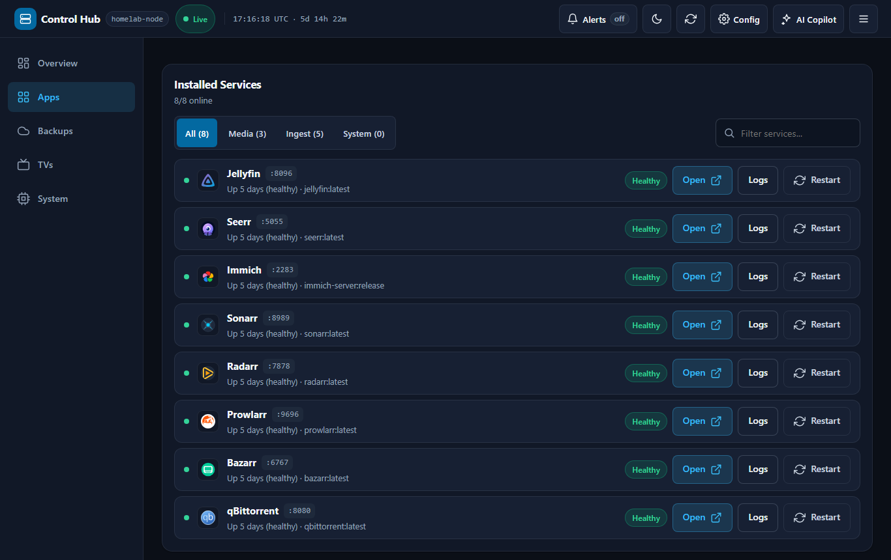

### PR #57 — De-AI Polish Pass (Impeccable & Hallmark) (`032e103`)

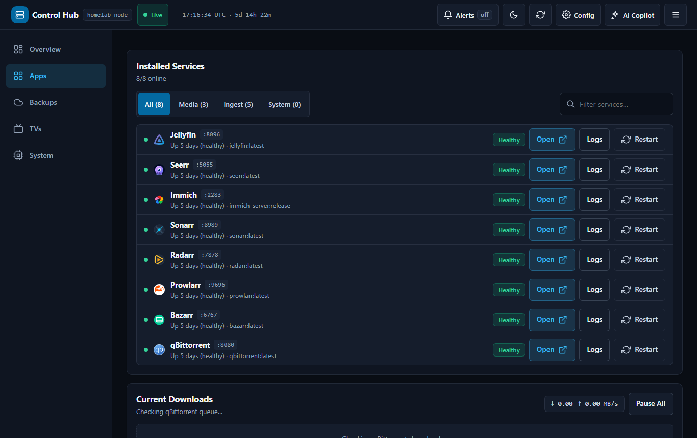

### PR #60 — Hallmark Console C1 (OKLCH Tokens, Fonts & 4px Scale) (`8cda9bc`)

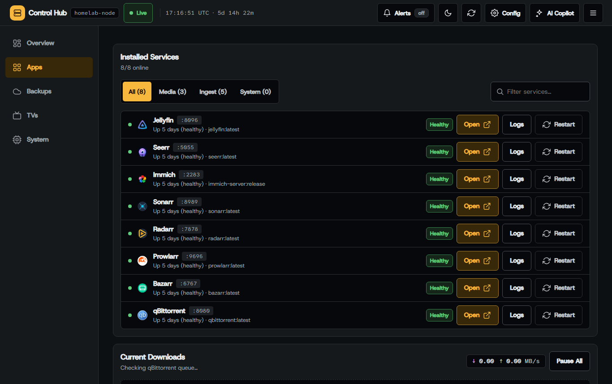

### PR #61 — Hallmark Console C2 (Bench, Audit Spine & Service Ledger) (`e4a7879`)

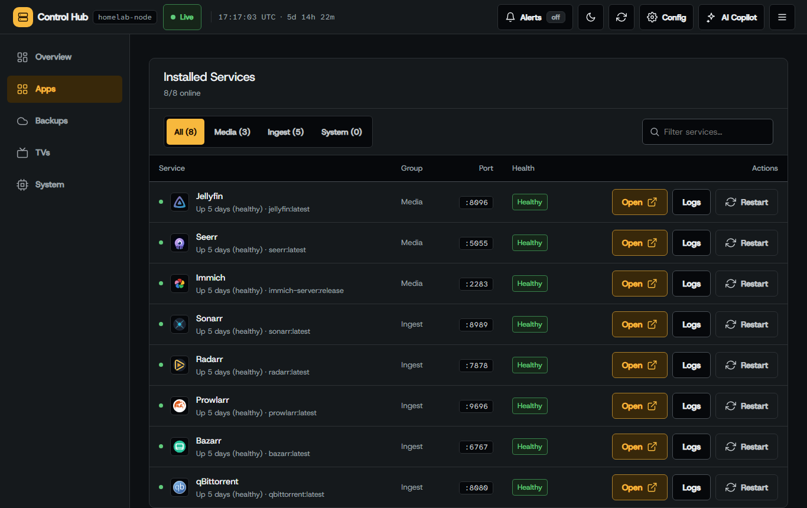


## Overview (Light Theme)

Light colorway parity (`Carbon Slate` -> Hallmark `console: paper`).

### PR #56 — Pivot Phase A & B (5-View Console Baseline) (`2ff463b`)

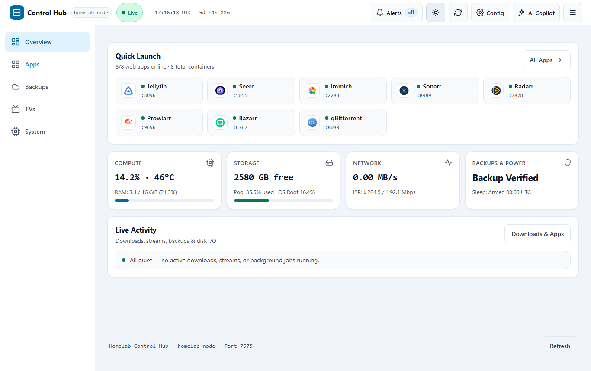

### PR #57 — De-AI Polish Pass (Impeccable & Hallmark) (`032e103`)

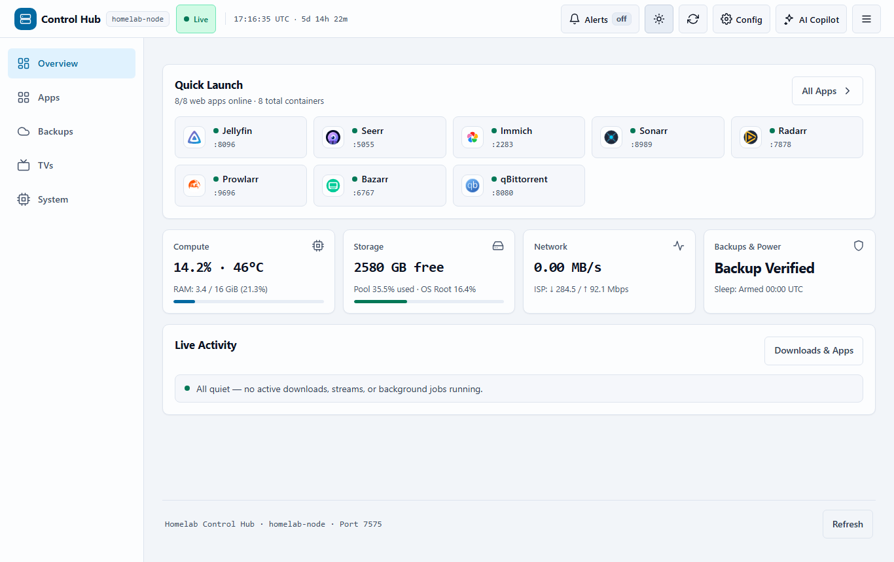

### PR #60 — Hallmark Console C1 (OKLCH Tokens, Fonts & 4px Scale) (`8cda9bc`)

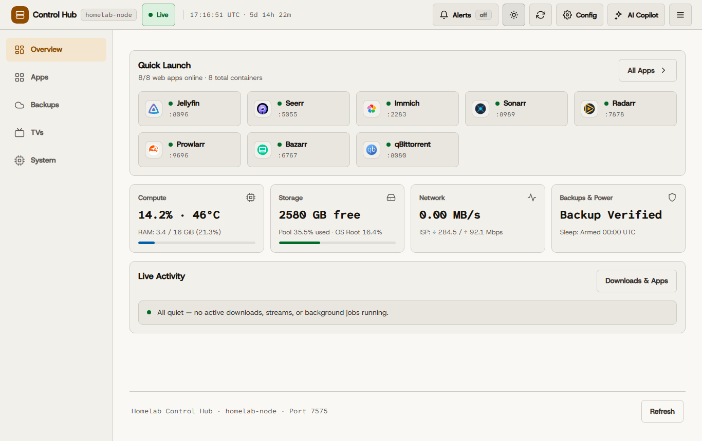

### PR #61 — Hallmark Console C2 (Bench, Audit Spine & Service Ledger) (`e4a7879`)

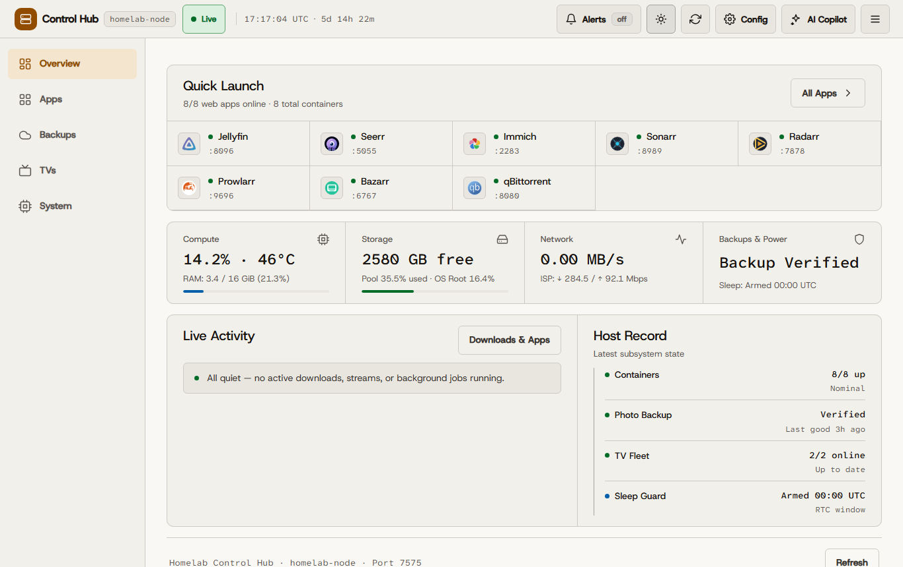

## Re-Running Captures

```bash
python testing/capture_visual_history.py
# Or compare custom commits:
python testing/capture_visual_history.py --commits 2ff463b 032e103 8cda9bc e4a7879
```
