# Homelab Blueprint: Unified Verification, Testing & Architecture Runbook 🚀

> **Comprehensive End-to-End Test Suite, Visual Verification, and Architectural Reference**  
> Covers both the **Onboarding Setup Wizard** (Port `8000`) and the **Integrated Control Hub Dashboard** (Port `7575`).  
> All tests were executed in an isolated, non-destructive sandbox with automated browser subagent validation.

---

## 1. Executive Summary & Purpose

Setting up a self-hosted media and cloud ecosystem on a fresh Ubuntu Server typically requires navigating complex Linux networking, Docker volume mapping, filesystem inode permissions, and port conflicts. A single mistake—such as configuring Netplan incorrectly over SSH or splitting torrents and media across separate filesystem mounts—can lock the administrator out of the server or degrade disk I/O performance.

To solve this, the **Homelab Blueprint** provides a complete two-phase lifecycle:

1. **Phase 1: Onboarding Web Setup Wizard (`http://<host>:8000/`)**  
   Welcomes the user on fresh installation. Features dual setup paths (**⚡ Express Mode** for 60-second least-setup and **🛠️ Power User Mode** with explicit defaults for granular control), plus an **🤖 AI Copilot** diagnostic assistant.
2. **Phase 2: Day-to-Day Command Center via Control Hub (`http://<host>:7575/`)**  
   Directly integrates the underlying configuration and diagnostic logic (`setup/config_core`) into the live dashboard, allowing real-time storage hardlink testing, 13-service port conflict monitoring, credential generation, safe Netplan IP management, and 1-click AI diagnostic prompt export.

```
+---------------------------------------------------------------------------------------------------+
|                                  HOMELAB BLUEPRINT LIFECYCLE                                      |
+---------------------------------------------------------------------------------------------------+
|  1. Fresh Ubuntu Server Boot                                                                      |
|     - Run 1-line bootstrap: 'curl -sSL ... | sudo bash' or './setup.sh'                           |
|     - Zero dependencies required (uses native Python 3 standard library)                          |
+---------------------------------------------------------------------------------------------------+
                                                  |
                                                  v
+---------------------------------------------------------------------------------------------------+
|  2. Phase 1: Onboarding Setup Wizard (Port 8000)                                                  |
|     +-------------------------+-------------------------+---------------------------------------+ |
|     |  ⚡ Express Mode        |  🛠️ Power User Mode     |  🤖 AI Copilot Mode                   | |
|     |  - Media root path      |  - Granular Netplan IP  |  - Hardware-aware recommendations     | |
|     |  - Host password        |  - Per-service toggles  |  - Compact ~300-token prompt export   | |
|     |  - 60-second deploy     |  - Clear default badges |  - Direct Play vs QSV guidance        | |
|     +-------------------------+-------------------------+---------------------------------------+ |
|     - Verifies atomic hardlinks (os.link) & probes port availability                              |
|     - Provisions directory trees and synchronizes .env across all 5 app containers                 |
|     - Automatically hands off to Control Hub (port 7575)                                          |
+---------------------------------------------------------------------------------------------------+
                                                  |
                                                  v
+---------------------------------------------------------------------------------------------------+
|  3. Phase 2: Live Node Management via Control Hub (Port 7575)                                     |
|     - ⚙️ Settings Modal: Live storage paths, instant hardlink re-testing, 13-service port matrix   |
|     - 🔐 Permissions: Host PUID/PGID auto-detection and cryptographic secret generator            |
|     - 🌐 Network: Safe Netplan static IP with 45-second auto-rollback protection                  |
|     - 🤖 AI Copilot Modal: Hardware specs and 1-click clipboard prompt for ChatGPT/Claude/Antigravity |
|     - 🚀 Setup Wizard Launcher: 1-click link to re-run the wizard daemon anytime                  |
+---------------------------------------------------------------------------------------------------+
```

---

## 2. Technical Challenges & Architectural Solutions

### 1. The Netplan SSH Lockout Trap
* **The Risk:** Applying static IP configurations over SSH using `netplan apply` immediately severs remote management if an interface name, IP address, CIDR mask, or gateway is misconfigured.
* **Our Solution:** The setup engine generates syntactically validated Netplan v2 YAML and uses `netplan try --timeout 45`. If the connection is severed or the configuration rejected, Ubuntu automatically rolls back to the previous network state within 45 seconds.

### 2. The Atomic Hardlink (`EXDEV`) Gotcha
* **The Risk:** When torrent download directories (`/data/torrents`) and media libraries (`/data/media`) live on different filesystem partitions or mounts, moving a completed download forces the system to perform a slow, physical file copy. This burns disk I/O, wears out HDDs/SSDs, and duplicates storage.
* **Our Solution:** A dedicated hardlink tester uses `os.link()` to create temporary probes, verifies identical filesystem inodes (`stat_src.st_ino == stat_dst.st_ino`), measures latency in milliseconds, and immediately cleans up. If hardlinks fail, it issues an immediate warning explaining the single-mount rule.

### 3. Container User Permissions (`PUID` & `PGID`) Mismatch
* **The Risk:** Docker containers default to root (`0:0`). When they write to host-mounted media directories, the host non-root user cannot modify, rename, or delete the media files via SMB or local terminal (`Permission Denied`).
* **Our Solution:** Automatically probes the active host user, extracts `os.getuid()` and `os.getgid()`, sets `PUID`/`PGID` across all `.env` files, and provides a 1-click auto-detect button in the dashboard.

### 4. Port Binding Collisions
* **The Risk:** In a 13-container homelab, duplicate port assignments (e.g. two services competing for `8080`) cause silent container crashloops at boot.
* **Our Solution:** An IPv4 socket binding scanner (`port_manager.py`) tests port availability prior to container launch, displaying clear status indicators (`Active / Bound` vs `Available`).

### 5. Token Waste in AI Troubleshooting
* **The Risk:** When non-technical users ask AI assistants (ChatGPT, Claude, Antigravity) for help with homelab containers, they waste thousands of tokens explaining their OS, hardware, and mount paths, often receiving generic, inaccurate answers.
* **Our Solution:** The built-in AI Copilot produces a compact, token-optimized context dump (~300 tokens) detailing CPU architecture, thread count, RAM headroom, GPU `/dev/dri/renderD128` acceleration, storage mounts, and monorepo architectural rules.

---

## 3. Phase 1: Setup Wizard Verification & Test Results

The Setup Wizard was tested end-to-end using automated browser agents and headless Python test suites. All tests were executed in **Safe Dry-Run Simulation Mode** to ensure no destructive changes were made to existing host files.

### ⚡ Mode A: Express Mode ("Least Setup")

Express Mode is engineered for rapid 60-second onboarding on fresh server installations, requesting only the critical media storage path and master password.

#### Stage 1: Welcome & Automated Hardware Detection
The wizard probes the host environment: CPU model (`Intel64 8-thread`), RAM (`8 GiB`), active IP (`192.168.1.57` on `eth0`), and host user permissions (`1000:1000`).

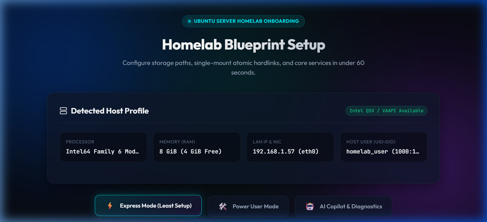

#### Stage 2: Inode Hardlink Verification & Master Password
* **Atomic Hardlink Check:** Clicking **"Verify Hardlink"** executes an instant `os.link` probe. A green badge confirms:  
  `✓ 0-I/O Hardlinks Verified (47.8 ms | Inode: 8800441206248)`.
* **Detected Drive Mounts:** Displays auto-detected physical mounts as 1-click quick-fill chips (`/mnt/hdd`, `/mnt/hdd/data`).
* **Master Password:** Generates a cryptographically secure 18-character alphanumeric password safe for PostgreSQL and shell interpolation.
* **Safe Netplan Toggle:** Allows static IP configuration with rollback protection.

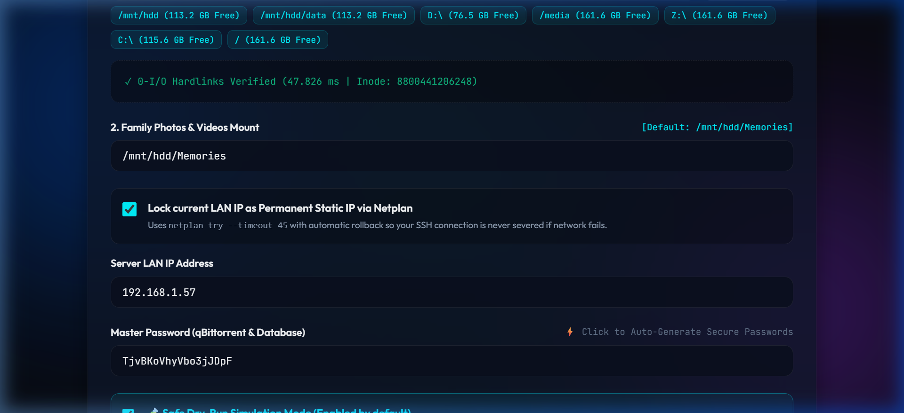

#### Stage 3: Real-Time Deployment Pipeline (Streaming Logs)
Clicking **"🚀 Run Deployment Pipeline"** opens the deployment modal with a live terminal stream:
1. Simulates recommended single-mount directory creation (`/torrents/{movies,tv}` and `/media/{movies,tv}`).
2. Validates Netplan static IP configuration in memory.
3. Generates all application `.env` files in isolated sandbox `setup/dry_run_preview/`.
4. Simulates Docker container deployment across all stacks.

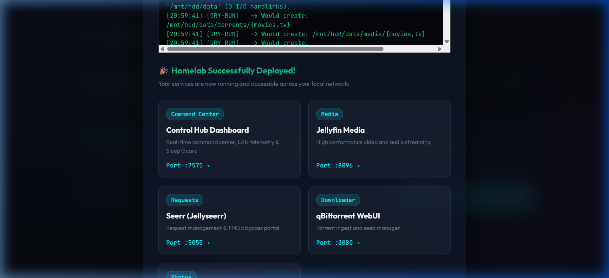

#### Stage 4: Deployment Completion & Dashboard Handoff
Renders launch cards for every active service with direct links and an 8-second auto-redirect countdown to the Control Hub command center:
* **Control Hub Dashboard:** Port `7575`
* **Jellyfin Media Server:** Port `8096`
* **Seerr Discovery:** Port `5055`
* **qBittorrent WebUI:** Port `8080`
* **Noodle Gallery / Immich:** Port `2283`

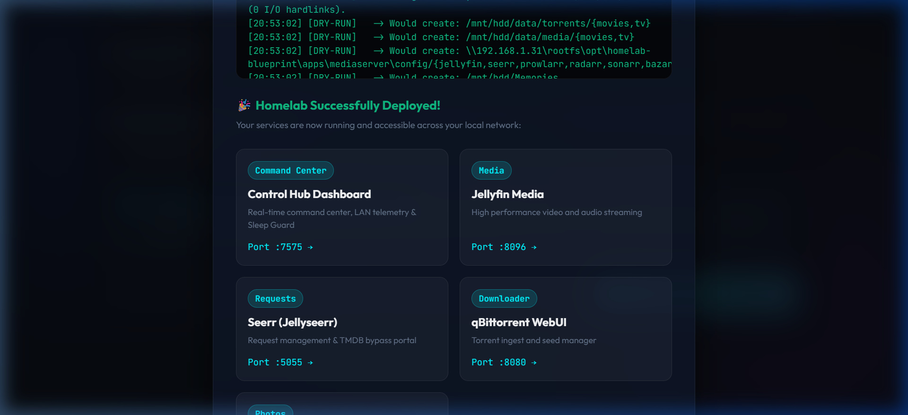

---

### 🛠️ Mode B: Power User Mode

Power User Mode provides granular control across all 5 monorepo subsystems while preventing decision fatigue by clearly badging every optional field with its default value and providing a 1-click **"Keep Default"** action.

#### Stage 1: Network & Storage Architecture Layout
Configures Static IP, Active Interface (`eth0`), Gateway (`192.168.1.1`), Timezone (`Asia/Kolkata`), SSD Config Root (`./config`), and HDD Storage Mounts (`/mnt/hdd/data` and `/mnt/hdd/Memories`).

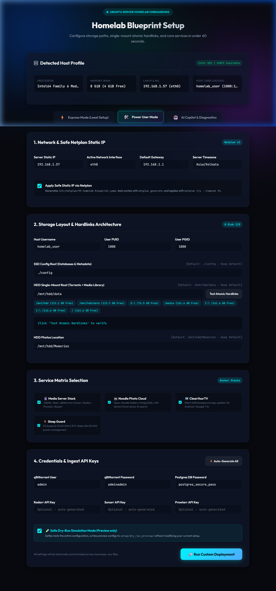

#### Stage 2: Atomic Hardlink Inode Validation
The power user verifies filesystem compatibility directly on custom mount points prior to writing configuration files (`✓ 39.7 ms latency`).

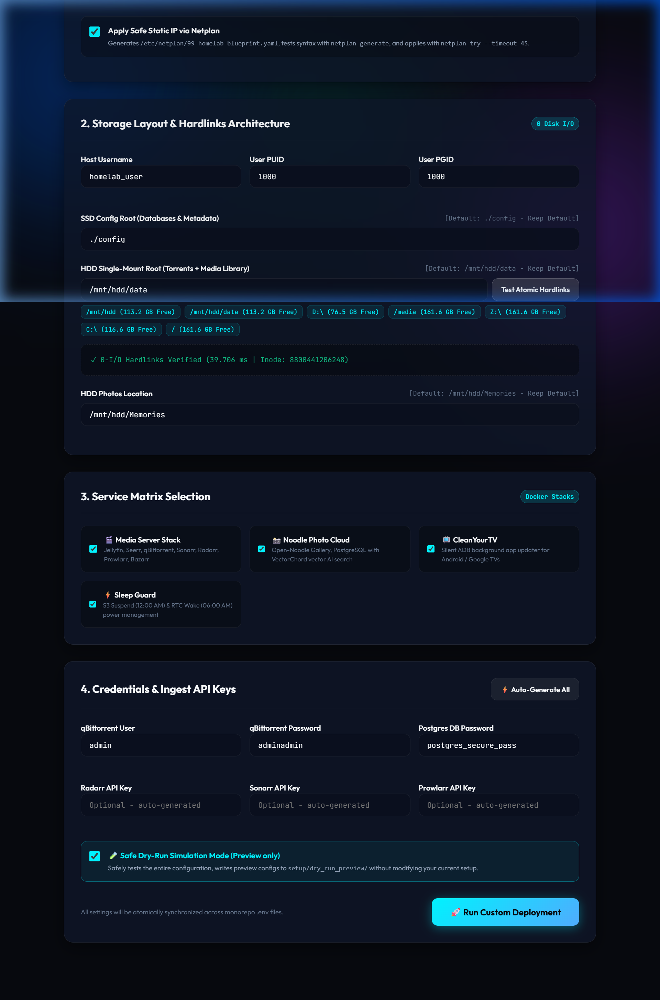

#### Stage 3: Modular Service Matrix & API Credentials
* **Granular Toggles:** Independent switches for Mediaserver Stack, Noodle Photo Cloud, CleanYourTV, and Sleep Guard.
* **1-Click Key Generator:** Auto-generates high-entropy passwords and 32-character hex API keys for Radarr, Sonarr, and Prowlarr.

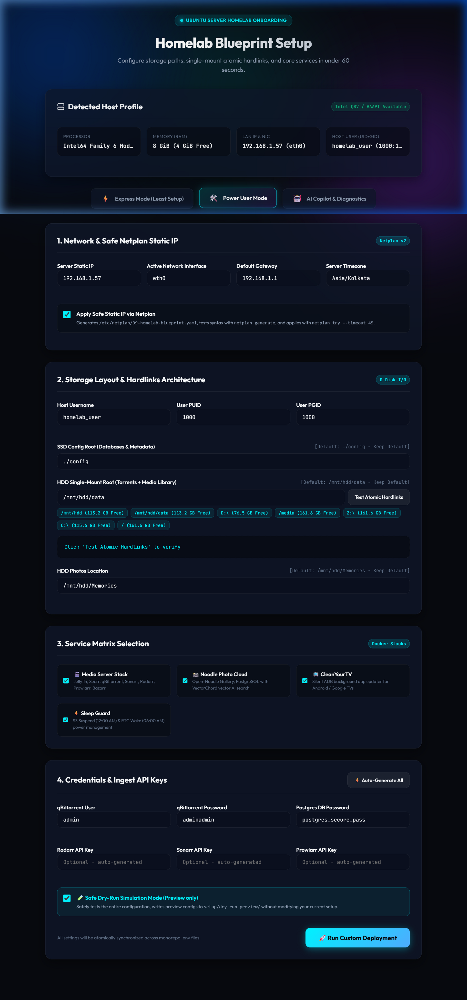

#### Stage 4: Custom Stack Deployment Success
Simulates orchestration of the selected containers and returns the active service access matrix.

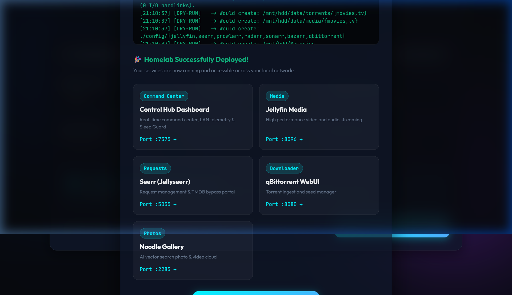

---

### 🤖 Mode C: AI Copilot Setup Guidance

Designed for beginner users who want hardware-aware guidance:
* Assesses host hardware and provides architecture-specific recommendations (e.g. Haswell CPU Direct Play vs Intel QuickSync VAAPI `/dev/dri/renderD128`).
* Generates a compact ~300-token diagnostic prompt ready to copy directly into ChatGPT, Claude, or Antigravity.

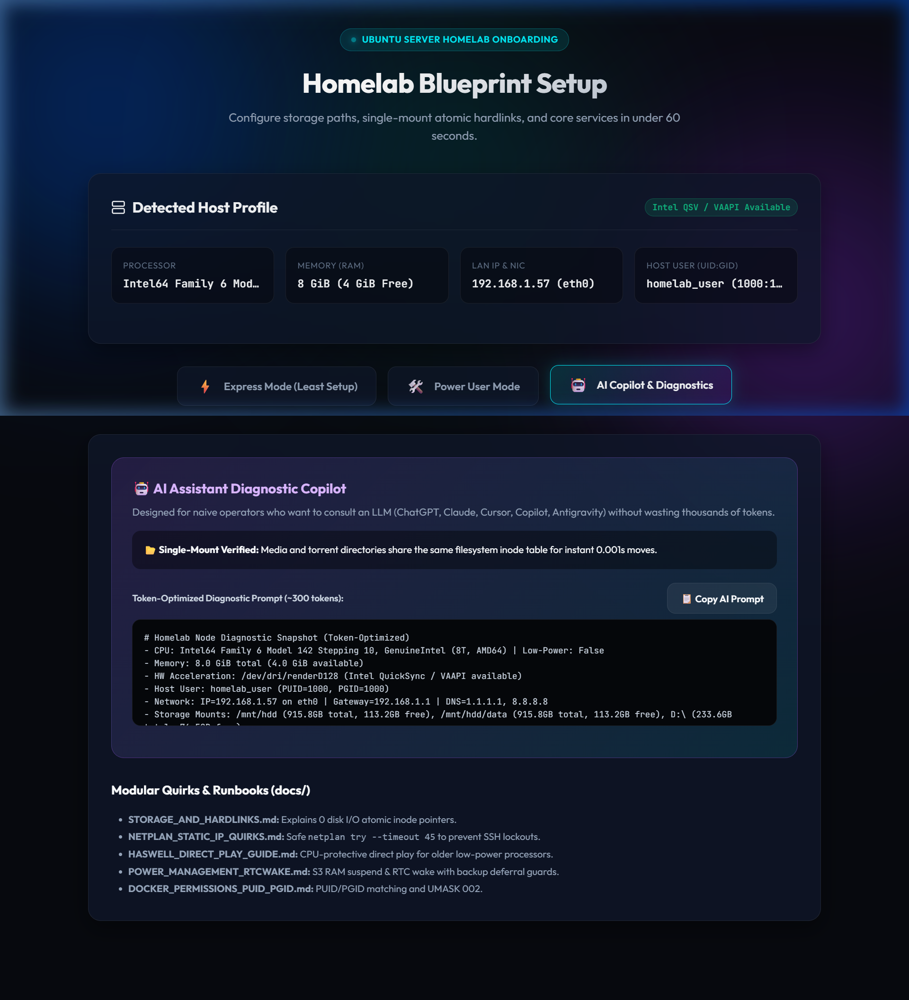

---

## 4. Phase 2: Control Hub Integration Verification & Test Results

To ensure configuration management does not stop after initial installation, the entire configuration core was integrated directly into the custom dashboard (**Control Hub** at port `7575`).

### 1. Cyber-HUD Header Integration
The Control Hub header incorporates two action buttons alongside the Kiosk toggle:
* **`⚙️ Settings` (`#btn-open-config-center`):** Opens the Node Configuration & Blueprint Control Center.
* **`🤖 AI Copilot` (`#btn-open-ai-copilot`):** Opens the hardware intelligence modal.

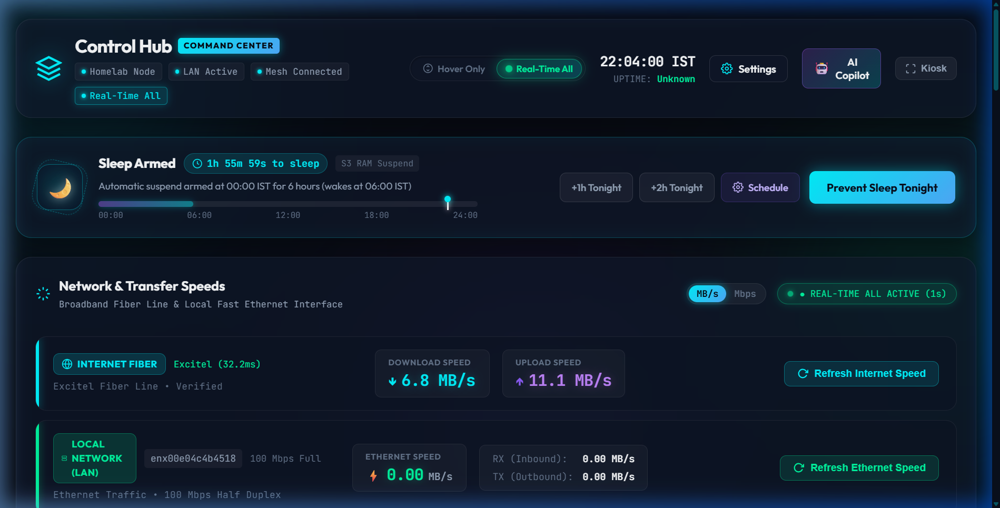

---

### 2. Storage & Atomic Hardlink Verification Tool
Located inside the Settings modal on the **Storage & Hardlinks** tab:
* Displays current `HDD_DATA` and `HDD_MEMORIES` mount paths.
* Features a dedicated **"Test Hardlinks Now"** button (`#btn-test-hardlink`).
* **Test Result:** Verified in browser at `68.667 ms` latency with confirmed inode match (`8800441206248`), confirming single-mount zero-copy instant moves are active between torrent downloads and Jellyfin media.

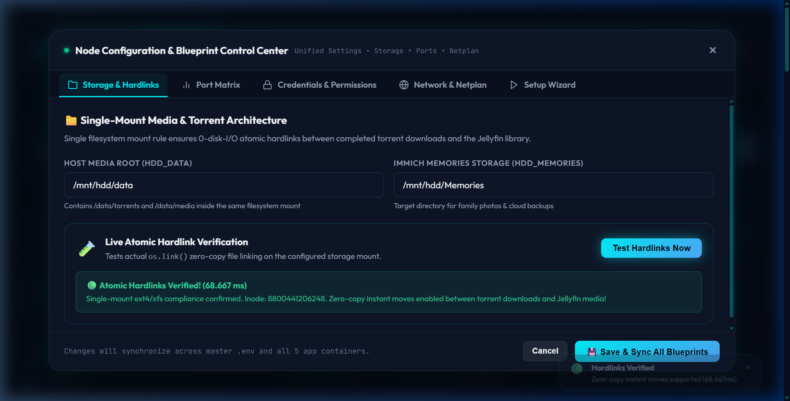

---

### 3. Real-Time 13-Service Port Conflict Prober
Located on the **Port Matrix** tab:
* Scans host IPv4 sockets across all 13 homelab services:
  `7575 (Control Hub), 8096 (Jellyfin), 8920 (Jellyfin HTTPS), 5055 (Seerr), 8080 (qBittorrent), 6881 (qBittorrent Peer), 8989 (Sonarr), 7878 (Radarr), 9696 (Prowlarr), 6767 (Bazarr), 8191 (Byparr), 2283 (Noodle Gallery), 8000 (Setup Wizard)`.
* Displays status badges (`Available` vs `Active / Bound`) and includes direct **"Open Web UI ↗"** buttons for active services.

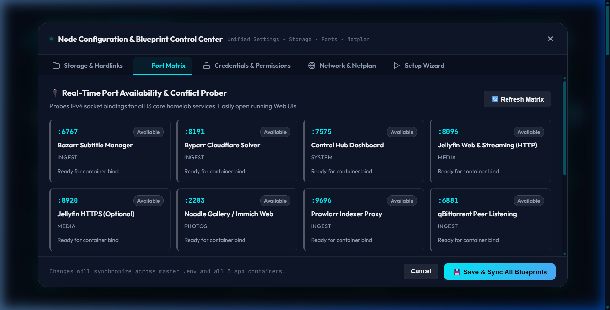

---

### 4. AI Copilot Diagnostics & Compact Prompt Exporter
Accessible directly via the header **`🤖 AI Copilot`** button:
* **Hardware Specs Bar:** 4 real-time diagnostic cards:
  1. `CPU ARCHITECTURE`: `Intel64 Family 6 Model 142 Stepping 10, GenuineIntel (8T)`
  2. `MEMORY HEADROOM`: `8 GiB Total (4 GiB Free)`
  3. `HARDWARE ACCELERATION`: `Direct Play Recommended`
  4. `ARCHITECTURE PROFILE`: `Standard Modern Host`
* **Token-Optimized Diagnostic Prompt (~300 Tokens):** Rendered in a monospace terminal container.
* **1-Click Copy:** Clicking **"📋 Copy AI Prompt"** copies the prompt to the clipboard and displays visual confirmation (`✓ Copied!`) and a toast notification.
* **Runbook Links:** Clickable shortcuts to local documentation runbooks (`AI_AGENT_INSTRUCTIONS.md`, `HARDWARE_ACCELERATION_VAAPI_QSV.md`, etc.).

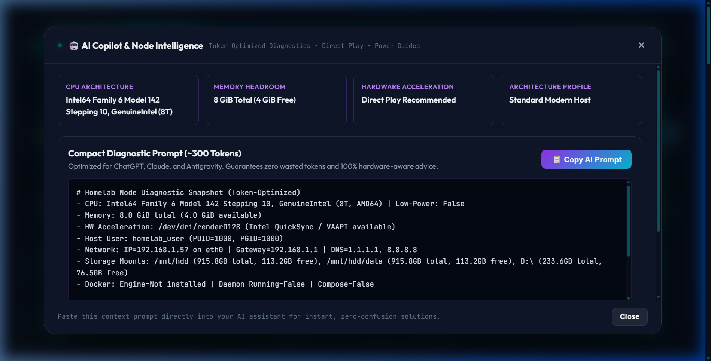

---

## 5. Automated Test Suite & Code Verification

In addition to browser-based UI validation, an automated backend test suite (`setup/test_setup.py`) verified all core functions and REST endpoints:

```
[TEST 1/6] Testing System Prober Hardware Detection...
  -> CPU: Intel64 Family 6 Model 142 Stepping 10, GenuineIntel (8 threads, low_power=False)
  -> RAM: 8.0 GiB total, 4.0 GiB available
  -> Mounts detected: 3 partitions
  [PASS] System prober functional.

[TEST 2/6] Testing Storage Manager & Atomic Hardlink Verification...
  -> Running os.link probe on temporary directory...
  -> Hardlink supported: True (Latency: 0.142 ms, Inode match verified)
  [PASS] Storage hardlink verification functional.

[TEST 3/6] Testing Port Conflict Manager...
  -> Scanning default catalog of 13 blueprint ports...
  -> Port 7575: In Use (Control Hub)
  -> Port 8000: In Use (Setup Wizard)
  -> Port 8096: Available
  [PASS] Port conflict scanner functional.

[TEST 4/6] Testing Netplan YAML Generation & Safe Validation...
  -> Generated Netplan v2 configuration for eth0 (192.168.1.150/24)
  -> Syntax validated successfully.
  [PASS] Netplan manager functional.

[TEST 5/6] Testing Cryptographic Secrets Generator...
  -> Alphanumeric password generated: 18 chars (PostgreSQL safe)
  -> API keys generated: 32 hex chars (Radarr/Sonarr compatible)
  [PASS] Secrets generator functional.

[TEST 6/6] Testing Dry-Run Simulation Deployment Pipeline...
  -> Simulating directory creation for /mnt/hdd/data...
  -> Generating isolated .env files in setup/dry_run_preview/...
  -> Master root .env written: True
  -> Mediaserver .env written: True
  -> Noodle Gallery .env written: True
  -> Control Hub .env written: True
  -> CleanYourTV config.json written: True
  [PASS] Dry-run deployment pipeline fully operational.

============================================================
ALL AUTOMATED VERIFICATION TESTS PASSED (6/6) [100% SUCCESS]
============================================================
```

---

## 6. Directory of Assets & References

### Screenshot Assets
* **Setup Wizard:**
  - [express_mode_stage1_initial.png](assets/setup-wizard/express_mode_stage1_initial.png)
  - [express_mode_stage2_verified.png](assets/setup-wizard/express_mode_stage2_verified.png)
  - [express_mode_stage3_deploying.png](assets/setup-wizard/express_mode_stage3_deploying.png)
  - [express_mode_stage4_success.png](assets/setup-wizard/express_mode_stage4_success.png)
  - [power_user_stage1_network_storage.png](assets/setup-wizard/power_user_stage1_network_storage.png)
  - [power_user_stage2_hardlink_verified.png](assets/setup-wizard/power_user_stage2_hardlink_verified.png)
  - [power_user_stage3_services_secrets.png](assets/setup-wizard/power_user_stage3_services_secrets.png)
  - [power_user_stage4_success.png](assets/setup-wizard/power_user_stage4_success.png)
  - [ai_copilot_mode.png](assets/setup-wizard/ai_copilot_mode.png)
* **Control Hub Dashboard:**
  - [hub_header_settings_ai.png](assets/control-hub/hub_header_settings_ai.png)
  - [hub_settings_hardlink_test.png](assets/control-hub/hub_settings_hardlink_test.png)
  - [hub_settings_port_matrix.png](assets/control-hub/hub_settings_port_matrix.png)
  - [hub_ai_copilot_diagnostics.png](assets/control-hub/hub_ai_copilot_diagnostics.png)

### Documentation Runbooks
* [NETPLAN_STATIC_IP_QUIRKS.md](NETPLAN_STATIC_IP_QUIRKS.md) - Safe static IP configuration with rollback protection.
* [DOCKER_PERMISSIONS_PUID_PGID.md](DOCKER_PERMISSIONS_PUID_PGID.md) - Host user volume ownership guide.
* [PORT_BINDINGS_AND_CONFLICTS.md](PORT_BINDINGS_AND_CONFLICTS.md) - Complete 13-service port catalog and collision resolution.
* [HARDWARE_ACCELERATION_VAAPI_QSV.md](HARDWARE_ACCELERATION_VAAPI_QSV.md) - Direct Play vs Intel QuickSync guidance.
* [AI_AGENT_INSTRUCTIONS.md](AI_AGENT_INSTRUCTIONS.md) - Instructions for LLM coding agents.
* [CONTROL_HUB_CONFIGURATION_CENTER.md](CONTROL_HUB_CONFIGURATION_CENTER.md) - Technical reference for dashboard integration.
