# Three-Tier Quality Gatekeeping & Defect Prevention Architecture 🛡️

> **Industry Standard Engineering Reference:** Comprehensive architectural specification for Shift-Left quality gatekeeping, automated verification barriers, and branch protection across Homelab Blueprint and its standalone sub-modules.

[](https://diataxis.fr/)
[](#the-three-tier-quality-model)
[-success.svg)](../.github/workflows/ci.yml)

---

## 📑 Table of Contents

1. [Executive Summary & The Shift-Left Paradigm](#1-executive-summary--the-shift-left-paradigm)
2. [The Three-Tier Quality Model](#2-the-three-tier-quality-model)
3. [Tier 1: Pre-Commit Local Gate (<1.5s)](#3-tier-1-pre-commit-local-gate-15s)
4. [Tier 2: Pre-Push Outbound Gate (Integration & Unit Suites)](#4-tier-2-pre-push-outbound-gate-integration--unit-suites)
5. [Tier 3: Remote CI & GitHub Branch Protection (The Iron Gate)](#5-tier-3-remote-ci--github-branch-protection-the-iron-gate)
6. [Cross-Repository Matrix (Monorepo & Standalone Sub-Modules)](#6-cross-repository-matrix-monorepo--standalone-sub-modules)
7. [Installation, Lifecycle & Emergency Bypass Policy](#7-installation-lifecycle--emergency-bypass-policy)

---

## 1. Executive Summary & The Shift-Left Paradigm

In modern production software engineering, defects, syntax regressions, and leaked secrets cost exponentially more to fix the further downstream they escape:

$$\text{Cost to Resolve Defect: } \text{IDE / Pre-Commit} \ll \text{Pre-Push} \ll \text{Remote CI} \ll \text{Production Runtime}$$

To guarantee that broken documentation links, unparseable CLI arguments, syntax regressions, or unencrypted keys can **never enter git history or break remote CI builds**, this repository enforces a **Three-Tier Gatekeeping Architecture**:

```mermaid
flowchart TD
    subgraph T1["Tier 1: Local Pre-Commit Hook (< 1.5s)"]
        A["Developer commits code ('git commit')"] --> B["py_compile Bytecode Validation"]
        B --> C["Entropy & Token Sanitization Scanner"]
        C --> D["Doc Link & Anchor Integrity Verification"]
        D --> E["CLI Contract Validation (--help)"]
        E --> F["ShellCheck Static Analysis"]
        F --> G["Commit Created Locally"]
    end

    subgraph T2["Tier 2: Local Pre-Push Hook (~35s)"]
        G --> H["Developer pushes code ('git push')"]
        H --> I["Schema Migrator Check (--check)"]
        I --> J["Setup Wizard Matrix Regression Suite"]
        J --> K["Control Hub Standalone Smoke Suite"]
        K --> L["Full Documentation Anchor Scanner"]
        L --> M["Push Transmitted to Remote Git Server"]
    end

    subgraph T3["Tier 3: Remote GitHub Iron Gate (Server-Side)"]
        M --> N["Direct Pushes to protected branches REJECTED"]
        N --> O["Pull Request Mandatory"]
        O --> P["Matrix CI Runners (Ubuntu 22.04 & 24.04 x Py 3.10-3.12)"]
        P --> Q["Multi-Arch Buildx Container Manifest Probing"]
        Q --> R["Trivy Vulnerability & Gitleaks Deep Scan"]
        R --> S["Merge to main / develop Approved"]
    end

    style T1 fill:#0f172a,stroke:#38bdf8,stroke-width:2px,color:#fff
    style T2 fill:#0f172a,stroke:#a855f7,stroke-width:2px,color:#fff
    style T3 fill:#0f172a,stroke:#22c55e,stroke-width:2px,color:#fff
```



---

## 2. The Three-Tier Quality Model

| Tier | Enforcement Point | Latency Budget | Scope | Target Defect Type |
| :--- | :--- | :--- | :--- | :--- |
| **Tier 1 (Pre-Commit)** | Local Developer Git Hook | `< 2 seconds` | Staged changes only | Syntax errors, private keys, broken doc links, CLI `--help` crashes |
| **Tier 2 (Pre-Push)** | Local Outbound Git Hook | `< 45 seconds` | Entire local worktree | Configuration schema drift, unit test regressions, port collisions |
| **Tier 3 (Branch Protection)** | Remote GitHub Server | `< 3 minutes` | PR & Merge Targets | Cross-OS matrix parity, container build syntax, supply chain CVEs |

---

## 3. Tier 1: Pre-Commit Local Gate (<1.5s)

Implemented via [`.githooks/pre-commit`](../.githooks/pre-commit) and [`.githooks/pre_commit.py`](../.githooks/pre_commit.py).

### Enforced Quality Checks:
1. **Python Syntax & Bytecode Compilation:**
   * Uses Python's native `py_compile.compile(doraise=True)` against all staged `.py` files.
   * Catches indentation errors, unclosed brackets, and syntax regressions instantaneously without needing slow third-party tools.
2. **High-Entropy Secret & Key Sanitization:**
   * Scans staged files for accidental credential inclusion:
     * Private Key blocks (`BEGIN RSA/OPENSSH/DSA/EC/PGP PRIVATE KEY`)
     * GitHub Personal Access Tokens (`ghp_[a-zA-Z0-9]{36}`)
     * GitHub Fine-Grained Tokens (`github_pat_[a-zA-Z0-9_]{82}`)
     * AWS Access Key IDs (`AKIA[0-9A-Z]{16}`)
3. **Documentation Relative Link & Image Integrity:**
   * If any `.md` file is staged, it runs [`testing/test_docs_integrity.py`](../testing/test_docs_integrity.py).
   * Validates that all relative links (`../path/file.ext`) point to real, existing files, preventing 404 dead links in documentation.
4. **CLI Argument Parsing Contract (`--help`):**
   * If CLI utilities (`sync_space_faces.py`, `export_faces_to_xmp.py`, `schema_migrator.py`) are staged, verifies that `--help` returns exit code `0`.
5. **Shell Script Static Analysis:**
   * Automatically invokes `shellcheck --severity=warning` against staged `.sh` files if `shellcheck` is present in the local `PATH`.

---

## 4. Tier 2: Pre-Push Outbound Gate (Integration & Unit Suites)

Implemented via [`.githooks/pre-push`](../.githooks/pre-push) and [`.githooks/pre_push.py`](../.githooks/pre_push.py).

### Enforced Quality Suites:
1. **Configuration Schema Parity:**
   * Executes `python setup/config_core/schema_migrator.py --check`.
   * Ensures that `.env.example` templates and subsystem `.env` files remain 100% in sync with zero missing keys.
2. **Setup Wizard Regression Suite:**
   * Executes `python setup/test_setup.py`.
   * Validates hardware probing, CSPRNG secret generation, atomic `os.link` inode checks, and dry-run deployment generation.
3. **Control Hub Standalone Smoke Suite:**
   * Executes `python -m unittest discover -s tests` within `apps/control-hub`.
   * Validates `/api/health`, `/api/livez`, `/api/readyz`, hardware vitals, OpenAPI 3.1 contracts, and static dashboard HUD loading.
4. **Global Documentation Anchor Verification:**
   * Executes full cross-repository link and markdown anchor validation.

---

## 5. Tier 3: Remote CI & GitHub Branch Protection (The Iron Gate)

Implemented via [`.github/workflows/ci.yml`](../.github/workflows/ci.yml) and GitHub repository rulesets.

### Server-Side CI Stages:
1. **Linting & Secret Sanitization**:
   * Official Gitleaks Action (`gitleaks/gitleaks-action@v2`) across all commit history.
   * ShellCheck on all infrastructure launchers and maintenance scripts.
2. **Setup Wizard Multi-OS & Multi-Python Matrix**:
   * Evaluates `ubuntu-22.04` and `ubuntu-24.04` across Python `3.10`, `3.11`, and `3.12` (6 concurrent runner permutations).
   * Runs end-to-end lifecycle handoff and pipeline regression suites.
3. **Docker Compose & Multi-Architecture Verification**:
   * Validates Docker Compose syntax across `mediaserver`, `noodle-gallery`, and `control-hub`.
   * Sets up QEMU and Docker Buildx to inspect multi-platform image indexes (`linux/amd64`, `linux/arm64`) for all production services.
4. **Trivy Vulnerability & Security Scanner**:
   * Runs Aqua Security Trivy across filesystem and container dependencies.

---

## 6. Cross-Repository Matrix (Monorepo & Standalone Sub-Modules)

The three-tier quality architecture is applied across all three interconnected repositories:

| Repository | Remote | Tier 1 (Pre-Commit) | Tier 2 (Pre-Push) | Tier 3 (CI / Branch Rules) |
| :--- | :--- | :--- | :--- | :--- |
| **`homelab-blueprint`** | `origin` | `.githooks/pre-commit` (Doc links, py_compile, secrets, CLI) | `.githooks/pre-push` (Setup Wizard, Control Hub tests, Schemas) | `Homelab Blueprint CI` (9 Matrix Jobs) |
| **`control-hub`** | `control-hub` | `.githooks/pre-commit` (py_compile, secrets, ShellCheck, OpenAPI) | `.githooks/pre-push` (Standalone Daemon Test Matrix) | `Control Hub Standalone CI` (7 Matrix Jobs) |
| **`noodle-gallery-tools`**| `noodle-gallery-tools` | `.githooks/pre-commit` (CLI `--help`, py_compile, doc links) | `.githooks/pre-push` (flake8, CLI validation) | `CI` (Python 3.10-3.12 Matrix) |

---

## 7. Installation, Lifecycle & Emergency Bypass Policy

### Automated Activation
1. When cloning the repository and executing [`setup.sh`](../setup.sh), Git automatically activates the tracked hooks:
   ```bash
   git config core.hooksPath .githooks
   ```
2. Manual activation at any time:
   ```bash
   ./setup.sh --doctor
   # OR directly:
   git config core.hooksPath .githooks
   ```

### Emergency Bypass Policy
In critical break-fix emergency scenarios where an urgent commit must be recorded before tests finish:
* **Bypass Pre-Commit:** `git commit --no-verify -m "hotfix: ..."`
* **Bypass Pre-Push:** `git push --no-verify origin <branch>`

> [!CAUTION]
> Bypassing Tier 1 or Tier 2 locally will **not** bypass Tier 3 on GitHub. Protected branches will still reject any Pull Request or merge where automated checks fail.
