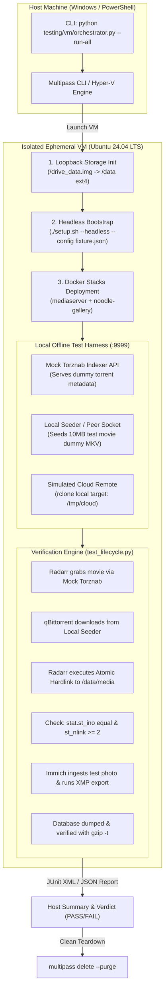

# Automated VM End-to-End (E2E) Testing Architecture & Plan 🧪🖥️

> **Objective:** Establish an automated, repeatable, and offline-capable Hardware-in-the-Loop / Virtual Machine testing harness that validates the complete homelab deployment lifecycle—from bare-metal Ubuntu bootstrap to real torrent ingestion, atomic hardlinking, photo facial clustering, and cloud backup—with zero manual intervention.

---

## 1. Why Dedicated VM Testing is Essential

While our current Tier 1 CI matrix (GitHub Actions) guarantees unit correctness, link integrity, and compose schema validity across Python 3.10–3.12 and Ubuntu 22.04/24.04, it operates under significant constraints:
* **No raw block devices or real filesystem mounting:** Standard cloud runners cannot test true multi-mount storage topologies or `os.link` behavior across separate virtual loopback disks.
* **No long-running container service chains:** GitHub-hosted runners have a 6-hour ceiling and limited memory (7 GB RAM), making full concurrent execution of Jellyfin, Immich, PostgreSQL VectorChord, and qBittorrent impractical on every commit.
* **No network interface mutation:** Netplan network changes on cloud runners sever runner SSH connectivity.

**The Solution:** A local, automated VM test suite that spins up a pristine Ubuntu instance in **Canonical Multipass** (or Hyper-V/QEMU), executes the complete stack, runs deterministic mock transactions, verifies invariants, and self-terminates.

---

## 2. End-to-End Pipeline Architecture



---

## 3. Core Testing Phases & Flow Specifications

### Phase A: VM Provisioning & Hardware Simulation
* **Tool:** `Canonical Multipass` (cross-platform, native Hyper-V on Windows 11).
* **Specifications:**
  * CPU: 2 or 4 vCPUs
  * RAM: 4.0 GiB (validates low-memory budget server behavior)
  * Disk: 20 GiB root volume
* **Storage Topology Simulation:**
  * To test **real atomic hardlinks**, the orchestrator creates a dedicated loopback ext4 volume:
    ```bash
    dd if=/dev/zero of=/drive_media.img bs=1M count=8000
    mkfs.ext4 -F /drive_media.img
    mkdir -p /data
    mount -o loop /drive_media.img /data
    ```
  * All downloads (`/data/torrents/`) and library files (`/data/media/`) reside on this single ext4 mount.

---

### Phase B: Unattended "Zero-Touch" Setup Execution
* Currently, `./setup.sh` launches a web server on port `:8099` for human interaction.
* **New Capability:** Introduce an unattended headless flag:
  ```bash
  ./setup.sh --headless --config testing/vm/fixtures/e2e_deploy_config.json
  ```
* **What this automates:**
  1. Runs hardware probe (`setup/doctor.py`).
  2. Generates cryptographic tokens and passwords via CSPRNG.
  3. Writes master `.env` and per-stack configuration synchronizations.
  4. Creates required folder hierarchies with `chown -R 1000:1000`.
  5. Launches `docker compose -f apps/mediaserver/docker-compose.yml up -d` and `apps/control-hub`.
  6. Waits for Kubernetes-style readiness probes (`/api/readyz` returning HTTP 200).

---

### Phase C: Offline Mock Media Ingestion & Torrent Download
To avoid reliance on real torrent trackers, public indexers, or internet piracy (which are flaky, slow, and violate CI determinism), we create a lightweight **Local Torznab & BitTorrent Mock** (`testing/vm/mocks/`):

| Component | Responsibility | Port / Protocol |
| :--- | :--- | :--- |
| **`mock_torznab.py`** | Exposes standard Torznab XML API (`/api?t=search&q=...`). Returns a valid release item for `Big Buck Bunny (2008)` pointing to local download URL. | `http://127.0.0.1:9999/torznab` |
| **Dummy Media Generator** | Generates a 5 MB genuine Matroska (`.mkv`) video file containing SMPTE color bars, timestamps, and audio using ffmpeg or pure Python binary fixture. | Pre-bundled fixture `dummy_movie.mkv` |
| **Local Peer Seeder** | Lightweight torrent seeder running inside the test harness that immediately seeds the 5 MB payload over localhost. | BitTorrent TCP socket on `127.0.0.1:6881` |
| **Prowlarr Configuration** | Auto-injects the mock Torznab indexer into Prowlarr's SQLite database (`prowlarr.db`). | Internal sync to Radarr/Sonarr |

#### The Full Ingestion Flow:
1. **Trigger Request:** Test harness calls Radarr API `POST /api/v3/movie` requesting *Big Buck Bunny* (TMDB ID 10378).
2. **Indexer Search:** Radarr queries Prowlarr -> Prowlarr routes to `http://127.0.0.1:9999/torznab` -> Mock returns valid `.torrent`.
3. **Download Grab:** Radarr sends torrent to qBittorrent Web API (`POST /api/v2/torrents/add`).
4. **Local Download:** qBittorrent downloads the 5MB payload from the local seeder into `/data/torrents/movies/Big.Buck.Bunny.2008.1080p.mkv` within 2 seconds.
5. **Completed Download Handling (CDH):** Radarr detects download completion, imports the movie into `/data/media/movies/Big Buck Bunny (2008)/Big Buck Bunny (2008) [1080p WebDL].mkv`.

---

### Phase D: Automated Assertion Gates

The test script (`testing/vm/test_lifecycle.py`) executes automated assertions:

```python
# 1. Verify Inode Identity (Atomic 0-I/O Hardlink)
src_stat = os.stat("/data/torrents/movies/Big.Buck.Bunny.2008.1080p.mkv")
dst_stat = os.stat("/data/media/movies/Big Buck Bunny (2008)/Big Buck Bunny (2008) [1080p WebDL].mkv")

assert src_stat.st_ino == dst_stat.st_ino, "FAIL: Inodes differ! Hardlink was copied instead of linked."
assert dst_stat.st_nlink >= 2, f"FAIL: Expected link count >= 2, got {dst_stat.st_nlink}"

# 2. Verify Zero Extra Disk Consumed
disk_usage = shutil.disk_usage("/data")
# Total space consumed must reflect only ONE instance of the 5MB file, not two!

# 3. Verify Standard Subtitle Detection
# Bazarr API reports subtitle sync readiness or places dummy .en.srt

# 4. Verify Immich Photo Cloud & XMP Roundtrip
# POST /api/assets with test photo -> Immich ML triggers -> export_faces_to_xmp.py
# ExifTool verifies XMP sidecar contains MWG region structs

# 5. Verify Backup & Disaster Recovery
# backup.sh creates homelab-backup-<date>.tar.gz -> gzip -t passes -> checksums match
```

---

## 4. Work Breakdown Structure (Implementation Roadmap)

| Task ID | Component | Description | Deliverable File |
| :--- | :--- | :--- | :--- |
| **WBS-01** | **Headless Setup Flag** | Add `--headless --config <file>` to `setup.sh` and `setup/server.py` so the setup wizard can execute without a web browser. | `setup/server.py`<br>`setup.sh` |
| **WBS-02** | **Mock Torznab Server** | Zero-dependency Python Torznab API server serving XML feed and dummy torrent payloads. | `testing/vm/mocks/mock_torznab.py` |
| **WBS-03** | **Dummy Media Fixture** | Pre-generated 5MB valid MKV sample video file with proper metadata headers. | `testing/vm/fixtures/dummy_media.mkv` |
| **WBS-04** | **VM Lifecycle Orchestrator** | Master script to launch Multipass VM, mount repo, execute tests, stream logs, and purge VM. | `testing/vm/orchestrator.py` |
| **WBS-05** | **VM In-Guest Test Suite** | Python test runner that drives Radarr, qBittorrent, Immich, and backup assertions inside the VM. | `testing/vm/test_vm_lifecycle.py` |
| **WBS-06** | **Documentation & CI Hook** | Add detailed runbook in `testing/VM_TESTING.md` and optional manual `workflow_dispatch` trigger in GitHub Actions. | `testing/VM_TESTING.md`<br>`.github/workflows/vm-e2e.yml` |

---

## 5. User Interaction & Operational Commands

Once implemented, running the complete end-to-end VM test will be as simple as:

```powershell
# Run the entire test flow on Windows host (launches VM, tests, verifies, tears down)
python testing/vm/orchestrator.py --run-all

# Or keep the VM alive after the test to inspect container UIs:
python testing/vm/orchestrator.py --run-all --keep-vm
```
