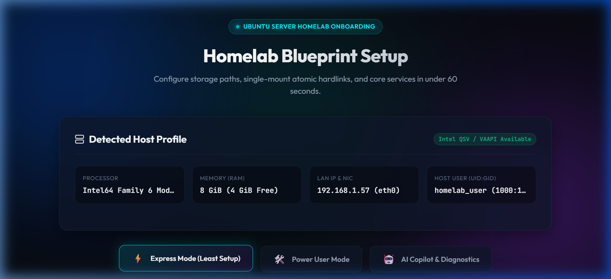
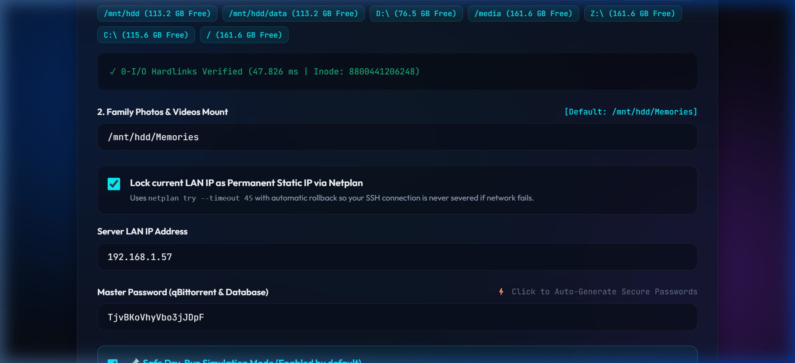
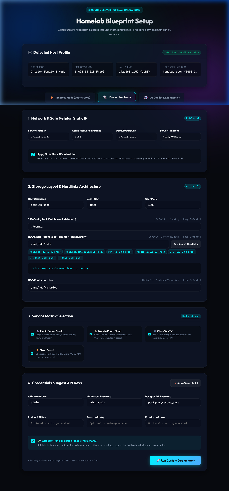
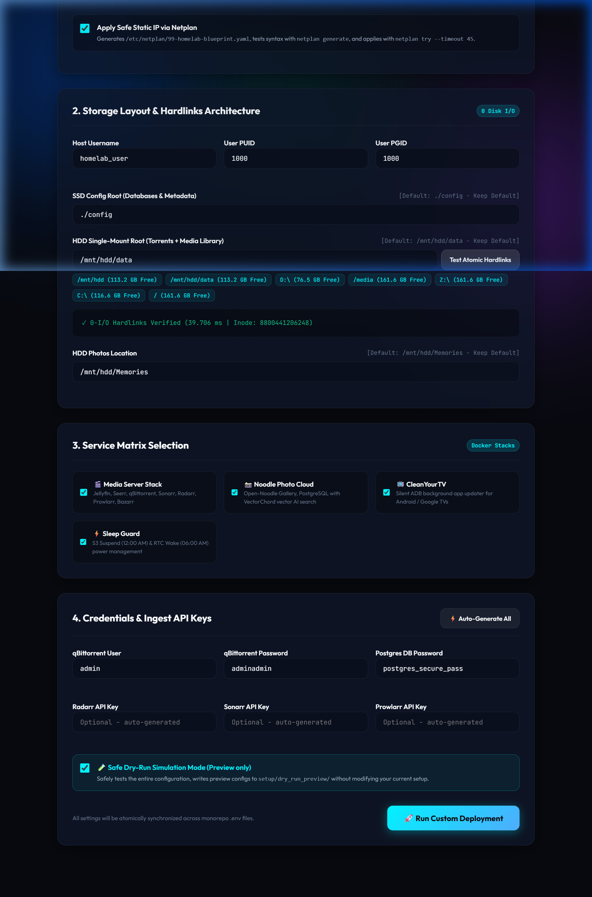
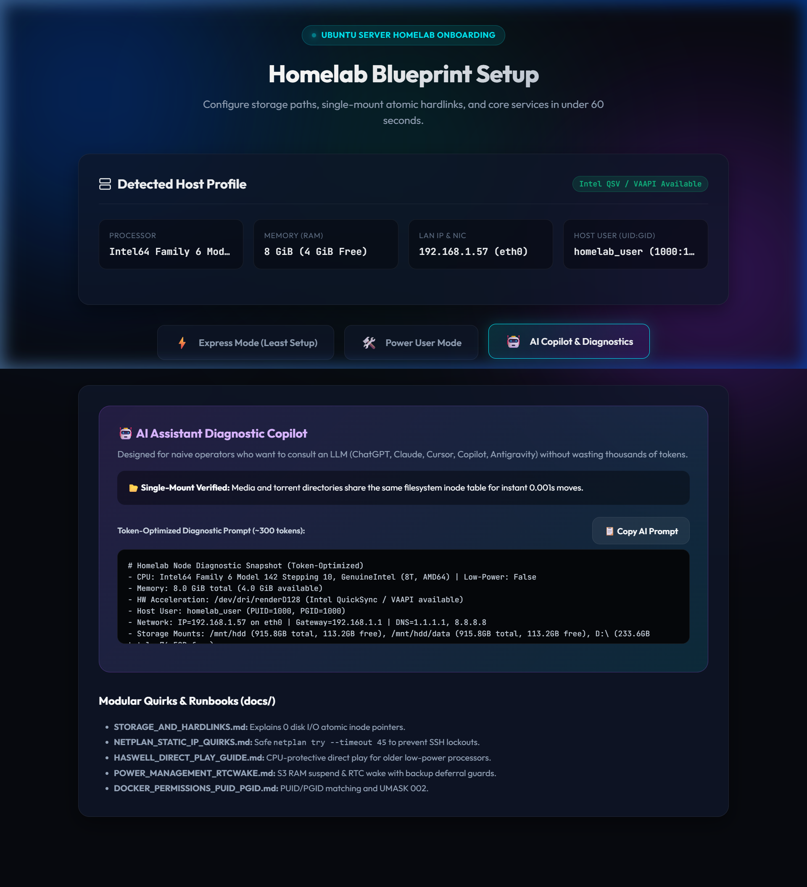
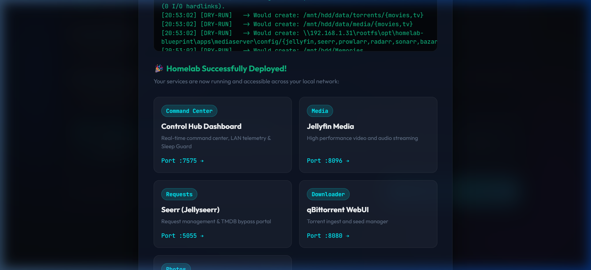

# Homelab Setup Wizard ⚡🧙

> Zero-dependency, browser-based onboarding and provisioning wizard for Ubuntu Homelab Servers.  
> Runs entirely on the Python 3 standard library with zero `pip install` requirements.

[](https://www.python.org/)
[](https://opensource.org/licenses/MIT)
[](#architecture)
[](#quickstart)

---

## 🌟 Why a Zero-Dependency Setup Wizard?

When setting up a fresh Ubuntu Server or mini-PC, installing Node.js, npm packages, or heavy Python web frameworks before the server is even configured creates a chicken-and-egg problem. 

The **Homelab Setup Wizard** is designed with strict engineering constraints:
* **Zero External Dependencies:** Built solely on Python's built-in `http.server`, `socket`, `subprocess`, `urllib`, and `json` modules.
* **Runs on Clean Installs:** Executes immediately on a barebones Ubuntu Server with default Python 3.
* **Non-Destructive Dry-Run Support:** Supports a full simulation mode (`dry_run: true`) that writes preview configs to `setup/dry_run_preview/` without touching production filesystems or network interfaces.
* **Zero-Downtime Safe Netplan:** Validates static IP changes with `netplan generate`, applies them with an armed revert timer, and only keeps them once confirmed from the new address.
* **Atomic Hardlink Inode Tester:** Performs real-time `os.link` file system probes to guarantee 0-I/O hardlinks before any media containers are spun up.

---

## 🚀 Quickstart

### Launching the Wizard

From the homelab repository root:
```bash
# 1. Pre-flight host readiness diagnostic (Homelab Doctor)
./setup.sh --doctor

# 2. Standard launch (starts onboarding Web GUI on port 8000)
sudo ./setup.sh

# Or directly via Python
python3 setup/server.py
```

Terminal output:
```
============================================================
  HOMELAB BLUEPRINT - ONBOARDING WIZARD
============================================================
  Web UI: http://<server-lan-ip>:8000
  Local:  http://127.0.0.1:8000
============================================================
```

Open `http://<your-server-ip>:8000` from any browser on your local network (laptop, tablet, or phone).

---

## 🧭 The Three Onboarding Modes

### 1. ⚡ Express Mode ("Least Setup")
Designed for 60-second onboarding. Asks only for the essentials:
* **Single Mount Media/Data Path** (e.g. `/mnt/hdd/data` with 1-click auto-detected drive chips).
* **Family Photos Path** (e.g. `/mnt/hdd/Memories`).
* **Master Password** (with 1-click high-entropy CSPRNG generator).
* **Safe Netplan Static IP Toggle** (auto-detects current LAN IP and gateway).
* **Second audio language** for dual-audio downloads (the rest of the release preferences use their defaults).




### 2. 🛠️ Power User Mode
Full granular control across all 5 monorepo subsystems:
* **Network & Host Architecture:** Static IP, Subnet mask, Gateway, DNS, Timezone, Active NIC.
* **Storage & Paths:** SSD config paths, HDD root mount, download categories (`torrents/movies`, `torrents/tv`).
* **Modular Stack Toggles:** Opt-in cards for the media stack, photo cloud, ML schedule, photo backup, TV auto-updater, Sleep Guard, Samba, Tailscale and the media extras (Byparr, TMDB bypass, DNS override).
* **Release preferences:** how Radarr and Sonarr pick downloads (see [below](#release-preferences)).
* **Smart Defaults:** Every optional field displays a default badge and a 1-click **"Keep Default"** reset action.
* **Security & Secrets:** 1-Click **"⚡ Auto-Generate All"** for database credentials and *arr API keys.




### 3. 🤖 AI Copilot Mode
For users working with AI coding assistants (ChatGPT, Claude, Cursor, Antigravity):
* Gathers live hardware diagnostics (CPU architecture, core count, RAM, detected disks, and `/dev/dri` GPU render nodes).
* Generates a token-optimized prompt (~300 tokens) ready to copy/paste into an LLM for personalized architecture advice.
* Recommends optimal hardware-specific flags (e.g. Haswell Direct Play, VAAPI driver selection).



### Release preferences

A step in Power User Mode, next to the media extras. The answers are saved in the installer config (`/etc/homelab/config.json`), rendered into `/etc/homelab/mediaserver.env` as `MEDIA_*` keys, and applied at the end of the media module by `apps/mediaserver/scripts/wire_arr.py profiles apply`. Seerr is registered afterwards, with the default profile below as its default.

| Question | Config key | Env key | Choices (default first) |
| :--- | :--- | :--- | :--- |
| Second audio language | `media_second_language` | `MEDIA_SECOND_LANGUAGE` | None, or a language from `apps/mediaserver/profiles/languages.json` (Hindi, Tamil, Telugu, Spanish, ...) |
| Default profile for new titles | `media_default_profile` | `MEDIA_DEFAULT_PROFILE` | `compact` (`1080p Compact`), `family` (`1080p Family`, needs a language) |
| What can your TVs and players decode? | `media_codecs` | `MEDIA_CODECS` | `["hevc"]`; add `av1`, `dv` |
| Seeding | `media_seeding` | `MEDIA_SEEDING` | `while-it-helps`, `off` |
| Stuck downloads | `media_stuck_downloads` | `MEDIA_STUCK_DOWNLOADS` | `replace` (watch-only for the first 7 days), `off` |
| Manage release profiles | `media_profiles` | `MEDIA_PROFILES` | `true`; `false` leaves profiles to you or Recyclarr |
| (headless only) Public tracker list | `media_public_trackers` | `MEDIA_PUBLIC_TRACKERS` | `true`; `false` for private trackers |

`/api/deploy` refuses invalid answers with HTTP 400 (for example `family` without a language). On an upgrade, a config without these keys keeps the existing `mediaserver.env` values, and a missing `MEDIA_PROFILES` means off, so an existing server's profiles are not overwritten until its owner opts in. What the profiles do: [release profiles guide](../docs/MEDIA_RELEASE_PROFILES.md).

---

## 🔌 REST API Endpoints

The wizard server exposes lightweight JSON endpoints on port `8000`:

| Method | Endpoint | Description |
| :--- | :--- | :--- |
| `GET` | `/api/health` | Healthcheck and server state |
| `GET` | `/api/probe` | Live hardware auto-detection (CPU, RAM, NICs, IP, Disks) |
| `GET` | `/api/ai/context` | Generates token-optimized AI copilot diagnostic prompt |
| `GET` | `/api/release/languages` | Second audio languages the release profile pack supports |
| `POST` | `/api/verify/hardlink` | Runs live `os.link` probe to test atomic hardlink support |
| `POST` | `/api/secrets/generate` | Generates cryptographically secure passwords and API keys |
| `POST` | `/api/netplan/preview` | Returns generated Netplan YAML configuration |
| `POST` | `/api/deploy` | Executes configuration deployment pipeline (supports `dry_run: true`); HTTP 400 for invalid release preferences |

---

## 🧪 Automated Verification Suite

Run the built-in automated test suite to verify all endpoints, HTML assets, and deployment logic:
```bash
python3 setup/test_setup.py
```

Expected output:
```
Testing GET /api/health... -> {'status': 'healthy'}
Testing GET /api/probe... -> Detected hardware & NICs
Testing GET /api/ai/context... -> Prompt generated
Testing POST /api/verify/hardlink... -> Hardlink verified
Testing POST /api/secrets/generate... -> Secrets generated
Testing GET static HTML, CSS, JS... -> Assets OK
Testing POST /api/deploy (dry_run=True)... -> Deployed cleanly
ALL TESTS PASSED WITH 100% SUCCESS!
```

---

## 🔗 Seamless Handoff to Control Hub

Upon successful deployment, the setup wizard automatically hands off orchestration to the **Control Hub** command center:
* Displays clickable direct launch links for each deployed service.
* Runs an 8-second visual auto-redirect countdown to `http://<server-ip>:7575`.
* Shuts down port `8000` or keeps it standby for fast reconfiguration.


