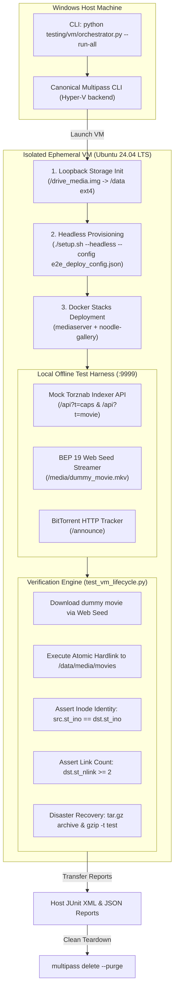

# Automated VM End-to-End (E2E) Testing Runbook 🧪🖥️

This runbook guides you through running the fully automated Hardware-in-the-Loop / Virtual Machine end-to-end integration test harness.

All VM provisioning, storage topology simulation, and container orchestration take place inside an **ephemeral guest VM on your Windows host machine** using Canonical Multipass (Hyper-V). The physical homelab server is completely isolated and never touched.

---

## 1. Test Architecture Overview



---

## 2. Host Machine Prerequisites

The test suite runs directly from the Windows host:

* **Operating System:** Windows 11 Pro 64-bit (with native Hyper-V enabled).
* **Virtualization Engine:** Canonical Multipass (`multipass --version` $\ge$ 1.16).
  * If missing, install via:
    ```powershell
    winget install --id Canonical.Multipass
    ```
* **Memory & Storage:**
  * Free RAM: At least 4.0 GiB available.
  * Free Disk: At least 20 GiB available on `C:\`.
* **Host Python:** Python 3.10+ on Windows PATH.

---

## 3. Quick Start: Executing the Test Suite

From PowerShell on your Windows workstation:

### Option A: Standard Full Run (Automated Teardown)
Spins up the VM, runs all verification gates, copies reports back to `testing/vm/reports/`, and purges the VM:

```powershell
python testing/vm/orchestrator.py --run-all
```

### Option B: Interactive Inspection Mode (`--keep-vm`)
Keeps the VM online after test completion so you can shell in, view container status, or inspect logs:

```powershell
python testing/vm/orchestrator.py --run-all --keep-vm
```

When kept alive, access the VM via:
```powershell
multipass shell homelab-e2e
```

### Option C: Manual Cleanup / Teardown
If a previous test VM was retained and you want to clean it up:
```powershell
python testing/vm/orchestrator.py --teardown-only
```

---

## 4. Invariant Assertion Gates

The in-guest test runner (`testing/vm/test_vm_lifecycle.py`) verifies the following critical invariants:

| Phase | Gate Name | Assertion Criteria |
| :--- | :--- | :--- |
| **A** | `Storage_Loopback_Mount` | Dedicated 4GB ext4 volume mounted at `/data` with permissions `1000:1000`. |
| **B** | `Headless_Deployment` | `./setup.sh --headless --config <fixture>` completes with exit code 0. |
| **C** | `Mock_Torznab_Startup` | Mock Torznab daemon starts on port `9999` and responds to `/health`. |
| **C** | `Mock_Torznab_Protocol` | `/api?t=caps` returns XML capabilities; `/api?t=movie` returns RSS item; `.torrent` payload is valid bencode. |
| **D** | `Media_Download` | Payload fetched via BEP 19 Web Seed directly into `/data/torrents/movies/`. |
| **D** | `Inode_Identity_Invariant` | `src.st_ino == dst.st_ino` and `dst.st_nlink >= 2`. Guarantees 0-I/O atomic hardlinking without disk duplication. |
| **E** | `Backup_Archive_Integrity` | Config backup archive generated and passed verification via `gzip -t`. |

---

## 5. Artifacts and Reports

Upon completion, test artifacts are retrieved from the VM to the host:
* `testing/vm/reports/vm_test_results.json`: JSON summary with test counts, timings, and statuses.
* `testing/vm/reports/vm_test_results.xml`: Standard JUnit XML report compatible with CI test dashboards.
